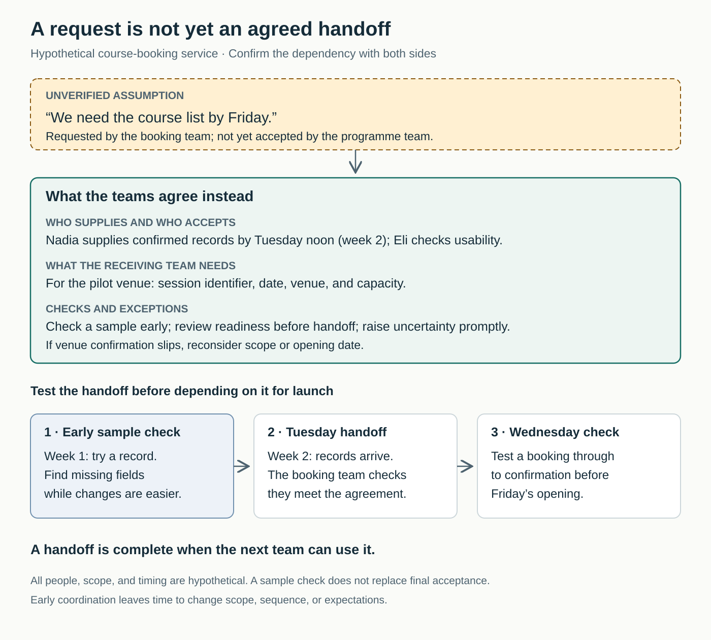

## “Our part is ready” does not mean the work can proceed

A team finishes a new booking service, then discovers that the programme office cannot supply confirmed session details. The website works, but customers cannot book anything.

The delivery plan included “course list by Friday.” The programme office had seen the request. Nobody had checked whether it could meet that date—or whether “course list” meant names, tentative dates, or confirmed places available to book.

The response is usually more chasing, escalation, and overtime. These may recover the immediate situation while leaving the next project vulnerable to the same misunderstanding.

## The core move: turn dependencies into working agreements

**Identify what your work needs from others—and what others need from you—while there is still time to adjust. Confirm the handoff with both sides, including what must be usable, when, and how changes will be handled.**

The established practices include **dependency mapping**, **handoff planning**, and **make-ready planning**. This pattern combines them without requiring a particular project framework.

A dependency exists when progress relies on another contribution: information, a decision, access, materials, specialist capacity, or completed work.

Atlassian’s dependency-mapping guidance covers both upstream and downstream impacts, named contacts, risks, and continuing feedback between teams. Mapping is a starting point for coordination rather than a substitute for it. [Atlassian Team Playbook, *Dependency Mapping*](https://www.atlassian.com/team-playbook/plays/dependency-mapping)

## Why the problem remains hidden

Teams usually understand their own workload better than the work their requests create elsewhere. Something that appears to be “send us the list” may require confirmations, checks, and decisions involving several people.

Different incentives compound the problem. Your launch may be urgent while the supplying team is handling another commitment. Adding a date to your plan does not allocate capacity in theirs.

Handoffs also contain assumptions about quality and completeness. One team can finish its contribution according to its own definition while leaving the receiving team unable to use it.

The Lean Construction Institute’s guidance on reliable promises distinguishes a request from a commitment made with suitable competence, time, and capacity. It also emphasizes jointly understood **conditions of satisfaction**: what the recipient needs in order to regard the handoff as successful. [LCI, *Reliable Promises*](https://leanconstruction.org/lean-topics/reliable-promises/)

These are practitioner approaches. They support useful conversations but cannot remove uncertainty or guarantee delivery.

## A booking launch becomes a smaller, credible commitment

*The following example is hypothetical.*

A training provider plans to open bookings at the end of a two-week development period. Eli, who leads the booking team, has requested the course list by Friday of the first week.

Instead of waiting until Friday, he contacts Nadia in the programme office. She explains that several venues remain unconfirmed. Her team can supply provisional course names, but cannot yet promise bookable sessions across the whole programme.

Eli initially pushes back: the launch date has already been announced internally. Nadia points out that the request never became an agreement.

They examine what the booking team actually needs: a session identifier, date, confirmed venue, and capacity. Eli also needs time to check the import and test a booking through to confirmation.

One venue is already confirmed. With their service lead’s agreement, they reduce the first release to that venue. Nadia commits to supplying its confirmed records by noon on Tuesday of week two. Other venues will follow when ready.

They also arrange an early sample. It reveals that the programme spreadsheet identifies courses, while the booking service needs a distinct identifier for each session. They resolve the mismatch before the full handoff.

Nadia and Eli check readiness before Tuesday and agree to raise any uncertainty promptly. If the handoff becomes doubtful, the service lead will choose between reducing scope further and changing the opening date.

The trade-off is real: the provider launches with fewer choices, and the programme team spends time preparing a sample earlier than usual. In return, the booking team avoids building against an untested assumption.

On Tuesday, Eli checks the delivered records against their agreement. On Wednesday, the teams test the complete booking journey. Friday’s opening proceeds for the pilot venue.

The useful outcome is a coordinated, usable handoff. Neither team has had to pretend the entire programme was ready.

## What changes in daily work

Start with one upcoming result that depends on another person or team. Trace what must be available before the next step can genuinely proceed.

Speak with someone who understands the supplying work and can make or arrange a commitment. Include the receiving side: they can explain requirements that may be invisible to the supplier.

For an important dependency, establish:

- **The contribution:** what is needed and what makes it usable.
- **The people:** who supplies it, who checks it, and who resolves competing priorities.
- **The timing:** when it is needed, what is currently forecast, and what has actually been agreed.
- **The feedback:** when to check progress and which changes require immediate contact.
- **The response to difficulty:** how to change scope, sequence, resources, or expectations.

A brief written exchange may be sufficient. More complex handoffs may need a conversation and a trial.

Keep assumptions distinguishable from agreements. “Requested,” “under discussion,” and “agreed” describe different situations. Preserve uncertainty when the supplying team cannot yet make a credible commitment.

The Last Planner System calls preparation that removes constraints before work is undertaken **make-ready planning**. Its distinction between work that should happen, can happen, and is committed for execution is useful beyond construction. [LCI, *Last Planner System*](https://leanconstruction.org/lean-topics/last-planner-system/)

An individual can surface a dependency, clarify requirements, and propose an early check. Resolving conflicting departmental priorities usually requires leadership support. A coordinator cannot personally promise another team’s time.

Atlassian recommends sharing the map with adjacent teams and reviewing it as work evolves. Match the review frequency to the consequence and timing of change; use existing coordination where it already serves the purpose. [Atlassian, *Dependency Mapping*](https://www.atlassian.com/team-playbook/plays/dependency-mapping)

## Early coordination should preserve options

“Early” means before the dependency forces an expensive choice. It does not mean specifying every detail at the start.

For uncertain work, first identify the likely dependency, a contact, and the next point at which more information will become available. Make the agreement more precise as understanding improves.

An agency waiting for client approval, for example, might first establish who can approve and reserve a review opportunity. It can settle detailed acceptance criteria once a draft exists.

Sometimes the better intervention is to reduce the dependency. Could a smaller release proceed independently? Could a team gain appropriate access or capability rather than repeatedly joining another team’s queue?

DORA’s software-delivery research identifies loosely coupled teams and systems—able to test and release with less external coordination—as capabilities associated with strong delivery performance. That evidence concerns software; the broader lesson here is a practical inference: recurring coordination overhead deserves examination of the underlying work design. [DORA, *Loosely Coupled Teams*](https://dora.dev/capabilities/loosely-coupled-teams/)

## Failure modes and signs of progress

**The map becomes the achievement.** An elaborate diagram without conversations, ownership, or follow-up provides little assurance.

**A requested date becomes a reported commitment.** Preserve the distinction even when the plan becomes uncomfortable.

**Coordination becomes pressure to agree.** A credible refusal or alternative proposal gives the team information it can use. Forced agreement conceals the capacity problem.

**“Sent” becomes “accepted.”** Check that the receiving team can use what arrived. An early sample helps expose mismatches but does not replace final checks.

**Every dependency gets a standing meeting.** Spend attention where uncertainty or consequences justify it. Low-risk, routine handoffs may need only a clear agreement and an exception route.

**All uncertainty is treated as failure.** New information should trigger adjustment. If reporting risk brings blame, people may wait until recovery options have disappeared.

Look for dependencies confirmed before dependent work starts, earlier warning of changes, fewer unusable handoffs, and less waiting or rework caused by mismatched expectations.

Also check the cost: are teams spending excessive time coordinating? Are they protecting milestones by passing disruption elsewhere?

These are suggested indicators, not a validated scorecard. More recorded dependencies may initially mean better discovery. More meetings or a higher percentage of “green” statuses does not establish better delivery.

## Connections to neighboring patterns

[[teamwork-make-the-work-visible|Make the Work Visible]] provides a shared place to show dependencies, uncertainty, and waiting. Early coordination turns those signals into agreements and action.

[[teamwork-clarify-decision-rights|Clarify Decision Rights]] identifies who can resolve a conflict over capacity, scope, or timing when the teams cannot settle it themselves.

[[teamwork-deliver-small-slices|Deliver Small Slices]] can reduce the number of contributions that must arrive together, creating earlier opportunities to test whether a handoff works.

## Best starting source

[Atlassian’s *Dependency Mapping* guide](https://www.atlassian.com/team-playbook/plays/dependency-mapping). It offers an accessible introduction to identifying impacts, assigning contacts, considering risks, and maintaining feedback across teams.
