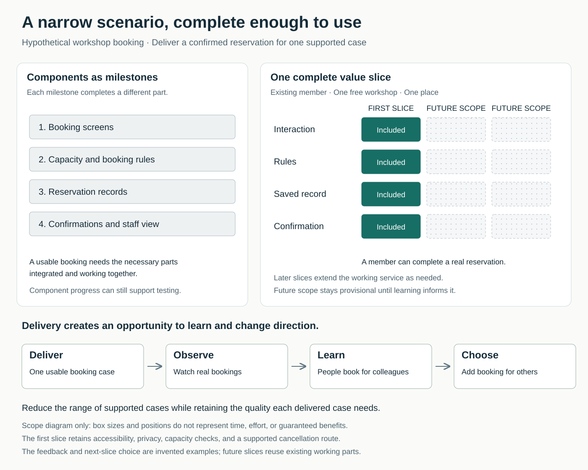

The project is progressing. The screens are designed, the data structure is almost ready, and another team is building the confirmation emails. Each group can demonstrate completed work.

But nobody can yet make a booking.

When someone asks for a smaller first release, the team removes a few features. The remaining project still requires most of the original components, so useful delivery remains distant.

The difficulty is how the team has divided the work. Its milestones describe parts of a solution, while the person waiting for that solution needs those parts to work together.

## The core move

**Complete a small, useful change through its necessary steps, put it into use or meaningful evaluation, and let the response inform what comes next.**

In software development, this is often called **vertical slicing**. A slice crosses whichever components are necessary to produce an observable change for a user. For example, a reservation may require an interface, capacity rules, a saved record, and confirmation. Supporting one narrowly defined reservation scenario can be a small slice through all four.

Humanizing Work distinguishes these slices from work confined to an architectural layer, which requires other changes before users receive the benefit. [Guide to Splitting User Stories](https://www.humanizingwork.com/the-humanizing-work-guide-to-splitting-user-stories/)

The same idea applies outside software. A team revising onboarding could complete the first-morning experience for one role—including instructions, access arrangements, and manager responsibilities—before expanding the program.

## Why large pieces persist

Component-based plans fit familiar responsibilities. Designers design, specialists define rules, and operations teams prepare delivery. Each group can work efficiently within its own area.

The drawback appears when the team needs to integrate those contributions and discover whether they solve the intended problem. Large amounts of work may be underway before anyone can try a complete scenario.

Large batches also have practical causes. If review, approval, or release is expensive, bundling work can seem economical. Smaller delivery therefore sometimes requires improving the release process itself. DORA identifies fixed handoff costs as one reason teams accumulate large batches. Its guidance associates small-batch working, alongside other capabilities, with software delivery and organizational performance; it does not establish that every team benefits from arbitrarily tiny releases. [DORA: Working in small batches](https://dora.dev/capabilities/working-in-small-batches/)

Small slices create earlier opportunities to discover mistaken assumptions. The benefit depends on someone examining the result and being able to change subsequent work.

## One workshop booking, completed

Consider a **hypothetical** community organization introducing online workshop booking. Its initial plan includes paid and free events, group bookings, waiting lists, reminders, cancellations, and attendance reports.

The team initially divides delivery into screens, booking rules, records, and communications. Each milestone is substantial, and none alone enables a reservation.

They choose a narrower first outcome: **an existing member can reserve one place at one free workshop and receive confirmation**.

This uses the organization’s existing member accounts. The first slice includes a clear workshop page, availability checks, a saved reservation, confirmation, and a basic staff view. It prevents duplicate reservations and overbooking. Members can cancel through an explicitly supported contact route, with staff updating the same booking record.

Payments, automatic waiting lists, and reporting remain outside this first delivery. Accessibility, appropriate handling of personal information, and dependable booking behavior remain part of it.

The change creates friction. The event coordinator wants all workshops supported immediately. The technical team worries about revisiting the design later. The support team asks who will handle cancellations.

They agree on a bounded pilot for one workshop, allocate support time, and retain the existing booking route for other events. The team also agrees how it will observe bookings and record staff effort.

In this fictional pilot, people repeatedly switch to email because they need to reserve places for colleagues. That observation changes the sequence: booking for another person moves ahead of automatic reminders.

The first delivery has both provided a useful service and informed a decision. The team still has substantial work ahead, but its next commitment now reflects experience.

This is an illustrative example, not a reported case or a promise of reduced development time.

## Finding a useful boundary

Start with a person and an outcome. “Members can reserve a place” gives the team a better starting point than “build the booking database.”

Then examine the variations making that outcome large. Could the first delivery support one event type, one operation, or one business-rule variation? Humanizing Work’s splitting guide provides concrete patterns for finding these boundaries, including separating operations, data variations, and simple cases from more complex ones. [Story-splitting patterns](https://www.humanizingwork.com/the-humanizing-work-guide-to-splitting-user-stories/)

Check that the remaining scope still makes sense. If somebody can request a reservation but cannot discover whether it succeeded, the team may have cut through the middle of the useful outcome.

Bill Wake’s original **INVEST** guidance offers a useful check: work should be valuable, small, and testable, while allowing negotiation and aiming for manageable dependencies. Independence is an aspiration, rather than a claim that every change can be implemented in any order. [INVEST in Good Stories, and SMART Tasks](https://xp123.com/invest-in-good-stories-and-smart-tasks/)

A practical first step is to take one large upcoming item and describe a narrower scenario that a recipient could complete. Discuss it with the people needed to deliver and support it. Identify what can wait and what remains essential.

An individual can propose that split. Agreement about supported users, deferred scope, staffing, and release conditions belongs with the relevant team and decision-makers.

## Small scope needs a complete quality standard

A small slice can still require several disciplines and considerable care. Its size comes from limiting the range of supported situations.

The Scrum Guide makes a related distinction: an increment must be usable, integrated with previous increments, and meet the agreed Definition of Done. Reduced scope does not remove the quality measures required for the delivered product. [Scrum Guide: Increment and Definition of Done](https://scrumguides.org/scrum-guide.html#increment)

Manual operations can sometimes keep a first slice manageable, as with the workshop’s cancellation route. Their workload and reliability need explicit consideration. Otherwise, an apparently small delivery conceals an expanding operational commitment.

Earlier delivery also creates no automatic learning. Arrange observation, support feedback, and a decision about the next step. GOV.UK’s user-research guidance recommends research throughout development and live operation, with findings shared across the team. [Research continually](https://www.gov.uk/service-manual/user-research/how-user-research-improves-service-design)

## When the pattern needs adaptation

Small slices are particularly useful when requirements contain many variations, usefulness is uncertain, or integration problems appear late.

A useful increment does not always justify a separate public release. Several small stories may need to combine into something worth shipping or evaluating with a wider audience. Humanizing Work distinguishes daily slices of value from larger, meaningful delivery increments. [The Three Essential Levels of Planning](https://www.humanizingwork.com/3-essential-levels-of-planning/)

Technical groundwork also remains legitimate. A migration, investigation, or infrastructure task may enable future delivery without immediately changing a user’s experience. Make its purpose and dependency explicit. Relabeling it as a user benefit adds little clarity.

Likewise, a prototype can answer a design question without becoming an operational service. Describe what it establishes and what remains untested.

Where physical installation, certification, or release overhead makes frequent deployment impractical, seek smaller opportunities to validate assumptions before the final release. The appropriate boundary depends on what can genuinely be completed and assessed.

## Failure modes and signs of progress

One failure is dividing work into more tickets without changing the point at which anyone receives value.

Another is completing small pieces but regrouping them into a large batch before testing or release. DORA specifically identifies this as a way to lose the feedback benefits of small-batch work. [Small-batch pitfalls](https://dora.dev/capabilities/working-in-small-batches/)

A third is choosing only easy slices while postponing the uncertainty that could undermine the entire project. The first slice should be narrow enough to complete and relevant enough to teach the team something important.

Look beyond the number of completed items:

- Can intended recipients complete a meaningful action sooner?
- Does feedback change priorities or design?
- Are integration problems discovered earlier?
- Are support effort, errors, and rework acceptable?
- Can lower-value scope be deferred or dropped?

A small slice has done useful work when it improves someone’s situation or gives the team sound grounds for its next decision.

## Neighboring patterns

[[teamwork-limit-work-in-progress|Limit Work in Progress]] controls concurrent commitments. Small slices make those commitments easier to complete, while WIP limits discourage starting many slices simultaneously.

**Close the Customer Feedback Loop** turns delivery into learning. Deliver Small Slices supplies earlier opportunities for that feedback.

[[teamwork-optimize-the-whole|Optimize the Whole]] keeps the slice connected to a meaningful outcome, including the work required to support it after release.

## Best starting source

[Humanizing Work’s Guide to Splitting User Stories](https://www.humanizingwork.com/the-humanizing-work-guide-to-splitting-user-stories/). Its worked examples and splitting patterns make it especially useful when a team understands the principle but struggles to find a smaller, meaningful increment.
