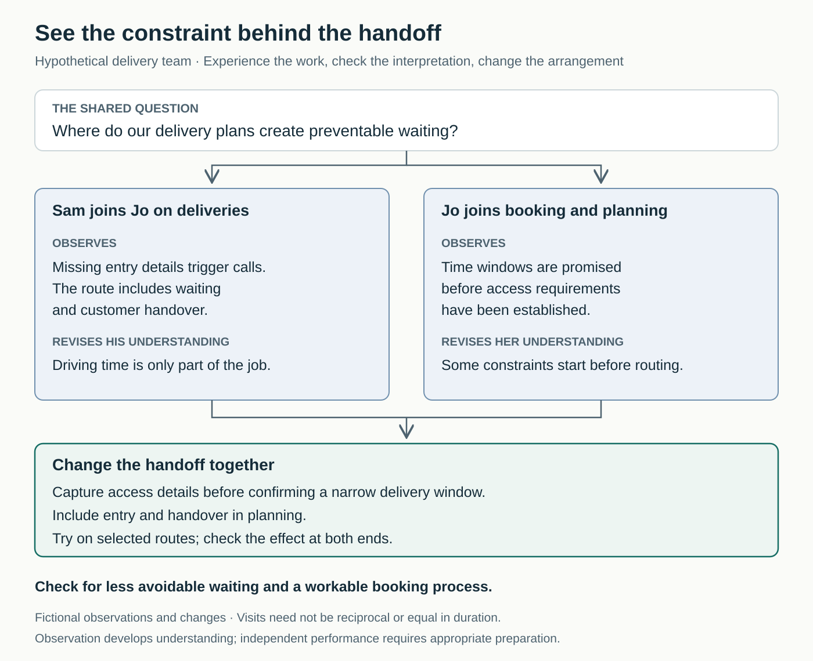

## The explanation changes when you join the work

Sam plans delivery routes. Jo delivers equipment. When routes run late, Sam points to the schedule: the driving time fits. Jo points to the day: the schedule leaves out much of what actually happens.

They exchange increasingly detailed explanations. Sam thinks Jo resists planning; Jo thinks Sam ignores practical constraints.

Another meeting might clarify the disagreement. Spending time alongside each other offers a different opportunity: seeing the interruptions, decisions, and workarounds that never make it into the handoff.

## The core move: encounter the conditions behind the role

**Spend time where a colleague’s work happens, observing or participating appropriately. Check what you think you learned with them, then use it to improve how you work together.**

Established practices include **job shadowing**, **cross-training**, **job rotation**, and Lean’s **go and see** approach. These overlap but serve different purposes.

Shadowing primarily develops understanding through observation. Supervised participation adds experience of selected tasks. Job rotation usually involves a longer temporary reassignment. A complete role swap is one option, not a requirement.

The University of Bristol’s guidance distinguishes observation, focused visits to particular activities, and closely supervised hands-on participation. The appropriate form depends on the learning objective and the work involved. [Bristol, *Job Shadowing Guidelines*](https://bristol.ac.uk/media-library/sites/staffdevelopment/documents/pssd/Job_Shadowing_Guidelines.pdf)

## Why descriptions leave something out

People tend to explain the parts of a job they recognize as important. Familiar judgments and workarounds can disappear from the explanation because they feel obvious to the person performing them.

A colleague may hear “check the delivery details” without seeing the calls needed to establish which entrance is open. A planner may appear inflexible without revealing the customer promises already constraining the route.

Direct experience supplies material for a more accurate explanation. It can expose a poorly designed process as well as correct a mistaken assumption about someone.

Lean practitioner John Shook emphasizes observing the actual work, understanding its purpose and process, and respecting the people doing it before proposing changes. This is practitioner guidance for inquiry, rather than a promise that visiting another department will resolve its problems. [Shook, “Go See, Ask Why, Show Respect”](https://www.lean.org/the-lean-post/articles/how-to-go-to-the-gemba-go-see-ask-why-show-respect/)

Research offers qualified support for learning about other roles. In two computer-simulation experiments, cross-training improved teams’ shared understanding of how members’ roles interacted. Findings differed on how much training was needed; they did not establish that full role rotation was necessary for that benefit. These studies do not demonstrate that a brief workplace visit creates lasting empathy or better performance. [Marks, Sabella, Burke, and Zaccaro, 2002](https://pubmed.ncbi.nlm.nih.gov/11916213/)

## A route planner discovers the missing work

*The following example is hypothetical.*

Sam’s manager arranges for him to accompany Jo on a delivery route. They agree to investigate where the plan creates preventable waiting. Jo retains responsibility for driving and deliveries; Sam observes and helps check paperwork under her direction.

At one stop, the address is correct but the equipment entrance is locked. Jo calls the customer, finds another contact, and waits for someone to arrive. At another, the handover requires an explanation and a signature from a person who is elsewhere in the building.

Sam had treated these stops mainly as driving plus unloading. He now sees work that the plan barely represents.

He starts suggesting changes while Jo is trying to complete a handover. She asks him to hold his questions until they are back in the vehicle. His presence is adding effort, even though the purpose is useful.

Later, Jo joins a booking and planning session. She discovers that customers are offered narrow delivery windows before access requirements are established. Sam inherits some constraints rather than choosing them himself.

Together with booking staff, they propose two changes: obtain access details before confirming a narrow window, and include entry and handover in route planning.

The manager approves a trial on selected routes. Booking staff worry that extra questions will lengthen calls. Sales colleagues dislike offering fewer precise windows.

During the trial, drivers need fewer clarification calls on those routes, while bookings take longer to arrange. The team keeps the access questions and examines when they genuinely affect the delivery promise.

The experience produces a specific operational change. It does not establish that every late delivery has the same cause.

## How to make the experience useful

Start with one coordination question: what happens to our contribution after we hand it over, or what makes a recurring request difficult to fulfil?

Choose an activity that can illuminate that question. A focused visit to a handoff may teach more than following someone through an unrelated day. Repeated short visits may reveal variation that one longer visit misses.

Agree the purpose, timing, participation, and follow-up with the host. Bristol’s guidance treats hosting as preparation and teaching work, and asks visitors to establish objectives and review outcomes. Time must be allowed for both people. [Bristol guidelines](https://bristol.ac.uk/media-library/sites/staffdevelopment/documents/pssd/Job_Shadowing_Guidelines.pdf)

During the activity, separate observation from interpretation. “Jo made three calls to find an entrance” is different from “the customer was disorganized.” Ask the host what explains the situation and whether it is typical.

Questions also change the work. Government guidance on contextual observation distinguishes quiet observation, occasional questions, and continuous explanation: each trades natural behavior against access to the person’s reasoning. Choose deliberately and allow time afterward for clarification. [GOV.UK, *Contextual Research and Observation*](https://www.gov.uk/service-manual/user-research/contextual-research-and-observation)

Where appropriate, try a bounded task. For example, a developer might work through a support case alongside an adviser, who checks and sends the response. This can reveal difficulties that watching alone leaves abstract.

Before returning to normal work, identify what you might change—and check that interpretation with the host. The visitor should particularly examine changes within their own influence.

An individual can propose an exchange and improve their own handoffs. Managers may need to arrange cover, authorize participation, and resolve changes affecting workload or service promises. Reciprocal visits can help, but equal time in each role is unnecessary.

## When it helps—and when another approach is needed

This pattern is useful when teams repeatedly misunderstand each other’s constraints, proposals create unexpected downstream work, or leaders make decisions far from the conditions of delivery.

It is less useful when the real problem is already clear and nobody will authorize a remedy. Another visit cannot compensate for insufficient staffing or an unresolved priority conflict.

Observation may be enough when participation requires substantial expertise or authorization. Use a demonstration, simulation, or suitable remote session where direct involvement is impractical. Seeing a task does not establish competence to perform it independently.

Consider ordinary variation. A quiet morning may conceal peak demand; an exceptional crisis may distort the visitor’s impression. Ask what you missed and whether another occasion would change the picture.

Explain the learning purpose to people affected by the visit. Respect confidentiality, withdraw when necessary, and arrange access or accommodations beforehand. These are practical requirements in Bristol’s hosting guidance. [Bristol guidelines](https://bristol.ac.uk/media-library/sites/staffdevelopment/documents/pssd/Job_Shadowing_Guidelines.pdf)

## Failure modes and signs of progress

**The visit becomes a performance inspection.** People hide difficulties or stage a polished demonstration. Make the purpose clear and give the host room to explain problems without being judged on the visitor’s incomplete understanding.

**The visitor becomes an instant expert.** A few hours reveal questions, not mastery. Shook cautions against jumping to solutions and against leaders creating more trouble through premature answers. [Lean Enterprise Institute](https://www.lean.org/the-lean-post/articles/how-to-go-to-the-gemba-go-see-ask-why-show-respect/)

**The host absorbs all the cost.** Preparation, explanations, and interruptions are work. Adjust expectations rather than treating hosting as free capacity.

**Appreciation substitutes for action.** “Your job is harder than I realized” may matter, but the recurring problem still needs a decision.

**Participation becomes novelty staffing.** Brief exposure should not be used to justify unsupported cover or the assumption that specialists are interchangeable.

Look for more accurate explanations of each other’s constraints, confirmed by the people doing the work. Then examine whether requests, plans, or handoffs change.

Useful results might include fewer avoidable clarification calls, less rework, more realistic commitments, or earlier discussion of downstream effects. Check whether improvements create extra burdens elsewhere.

These are suggested indicators, not a validated scorecard. Visits completed and positive feedback demonstrate participation and reaction. Better coordination requires evidence from subsequent work.

## Connections to neighboring patterns

[[teamwork-share-critical-knowledge|Share Critical Knowledge]] develops usable coverage for selected responsibilities. Experiencing another role may reveal what needs transferring without providing sufficient training itself.

[[teamwork-optimize-the-whole|Optimize the Whole]] uses the experience to improve the complete service, including consequences outside one team’s immediate measures.

[[teamwork-coordinate-dependencies-early|Coordinate Dependencies Early]] turns newly understood constraints into clearer requests, acceptance conditions, and commitments before work becomes blocked.

## Best starting source

[The University of Bristol’s *Job Shadowing Guidelines*](https://bristol.ac.uk/media-library/sites/staffdevelopment/documents/pssd/Job_Shadowing_Guidelines.pdf). This practical guide explains different forms of participation, preparation for hosts and visitors, and how to review what was learned.
