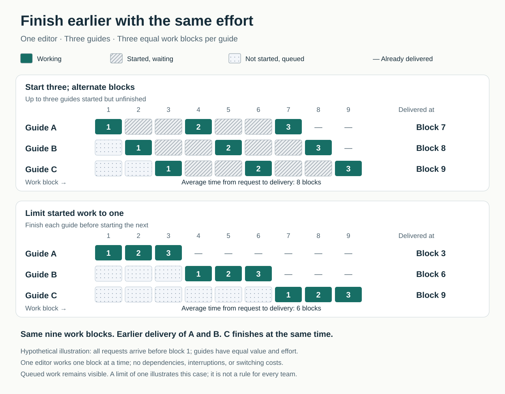

By Wednesday, almost everything has started. A proposal needs review, two customer requests await clarification, and a presentation is nearly finished. Everyone has something to do. Yet when someone asks what the team can deliver today, the answer is uncertain.

The usual response is to keep moving: start another request while waiting, prepare the next project, give everyone a fresh assignment. Each decision seems reasonable. Together, they create a growing collection of unfinished promises.

Limiting work in progress changes the question from “What else can we start?” to “What would help us finish something already underway?”

## The core move

**Agree how much work can be started but unfinished, and make room before starting more.**

Work in progress, commonly shortened to **WIP**, includes items waiting between steps. A document awaiting review still counts. So does a request blocked by missing information. An “in progress” label does not mean someone is actively working on it.

A WIP limit can apply to an entire workflow or a particular stage. A team might allow five customer requests from acceptance through delivery, with no more than two awaiting specialist review. These are examples, not recommended numbers. Kanban University defines a WIP limit as an explicit policy constraining work within a chosen part of the system. [Kanban Method Glossary](https://kanban.university/glossary/)

The limit creates a decision point. When capacity is full, the team considers finishing, helping, unblocking, or renegotiating existing work before accepting another commitment.

## Why starting more can make delivery slower

Starting feels productive. It reassures requesters, gives people something concrete to do, and produces visible activity. Finishing often requires less comfortable work: resolving ambiguity, asking for a decision, coordinating a handoff, or helping outside one’s usual specialty.

Consequently, new tasks can become an escape from the difficulties holding up existing ones.

The distinction between **working time and waiting time** helps explain the result. A request may need only a few hours of attention yet spend days waiting for the right person. Dependencies, priority changes, and excessive unfinished work can all contribute to that delay. [Kanban University’s explanation of flow efficiency](https://kanban.university/flow-efficiency-a-great-metric-you-probably-arent-using/)

There is also a mathematical relationship. Under suitable long-run conditions, **average WIP equals throughput multiplied by average time in the system**. If completion rate remains unchanged, more unfinished work corresponds to longer average time in the workflow. This relationship, Little’s Law, concerns averages; it does not predict an individual task’s completion date. [John D. C. Little’s original paper](https://pubsonline.informs.org/doi/abs/10.1287/opre.9.3.383)

Crucially, throughput may change when the limit changes. A limit that leaves necessary resources without usable work can reduce output. The aim is enough concurrent work to sustain delivery without accumulating avoidable queues. [Project Production Institute’s technical explanation](https://projectproduction.org/journals/PPI-JOURNAL-TT-Optimal-Level-of-WIP-in-a-Production-System.pdf)

## Three guides, one editor

Consider a hypothetical communications team producing three short customer guides. All three requests arrive together. Each requires three equal blocks of editing, and one editor has capacity for one block at a time.

To demonstrate progress on every request, the editor alternates:

**A → B → C → A → B → C → A → B → C**

Guide A finishes after block seven, B after block eight, and C after block nine. Until block seven, customers receive nothing.

Now suppose the team agrees to finish one guide before starting another:

**A → A → A → B → B → B → C → C → C**

A finishes after block three, B after block six, and C after block nine. The editor performs exactly the same amount of work. Two guides reach customers earlier; the last finishes at the same time. Average time from request to delivery falls from eight blocks to six.

The difficult decision happens before the editing. The team must tell B’s requester that their guide is queued rather than claim that everything is underway.

This example deliberately assumes equal effort and value, no dependencies, and no switching penalty. It illustrates how the sequence of work affects delivery. It does not establish that every team should have a limit of one. Different deadlines, specialists, or opportunities for independent parallel work could justify another arrangement.

## Turning a limit into a working agreement

A useful starting approach is to examine where unfinished work accumulates, then agree a modest change. The following questions are a practical synthesis, rather than a prescribed Kanban procedure.

First, define the commitment. Does a request count as started when someone accepts it, begins production, or allocates delivery capacity? What must happen before it counts as finished? Choose boundaries that reflect a meaningful promise.

Next, include the waiting. If review and publication are necessary for delivery, stopping the count at “draft complete” gives an incomplete picture.

Then agree what happens when the limit is reached. People need options beyond silently exceeding it. They might review a colleague’s work, obtain missing information, simplify a deliverable, or explicitly cancel something no longer worth completing. The Kanban Guide describes starting new work when capacity becomes available as a **pull system**. [The Kanban Guide](https://kanbanguides.org/the-kanban-guide)

An individual can start by making personal commitments visible and resisting unnecessary new starts. A team-wide limit requires agreement from people who assign and prioritize work. A manager who continues issuing immediate assignments can defeat the policy regardless of what the board displays.

There is a cost: some requesters must wait before work starts, and some specialists may spend more time helping others finish. Those trade-offs should be discussed openly.

## When the pattern helps—and what it cannot solve

Look for many nearly finished items, long review queues, frequent interruptions, or difficulty naming the next deliverable. These are reasons to investigate WIP, rather than proof that excess WIP is the only problem.

Imagine another hypothetical team with four active requests. One is blocked by an external supplier. Removing it from the board does not remove the commitment. The team can escalate the dependency or negotiate an explicit exception if useful capacity would otherwise remain idle. Exceptions should have reasons and review points; otherwise they quietly become the normal workload. [Kanban University on temporary overrides](https://kanban.university/patterns-of-kanban-maturity/)

Nor does limiting WIP resolve permanently excessive demand. If requests consistently exceed delivery capacity, the team also needs prioritization, reduced scope, additional capacity, or fewer commitments.

Research supports caution about universal promises. A 2018 observational study covering more than 8,000 work items across five software teams found lower WIP associated with shorter lead times, but productivity results complicated the picture. The researchers could not identify a straightforward optimal limit, and quality data were insufficient. Association does not establish that changing the limit alone caused the outcomes. [Study summary and limitations](https://www.sintef.no/en/publications/publication/1637884/)

## How the practice goes wrong

One failure is to turn the limit into a demand that everyone work faster. The useful response to a full system is to examine commitments and obstacles.

Another is cosmetic compliance: blocked items disappear, side projects stay unrecorded, or large projects become single cards. The number looks acceptable while the burden remains.

A third is moving the queue outside the measurement. Time from “started” to “finished” may improve while customers wait longer before anything starts. In the guide example, all requests remain visible, and the comparison measures from their shared arrival time.

Judge the change through several observations:

- Are completed items reaching recipients sooner?
- Are old commitments and blockers being resolved?
- Is the completion rate holding up?
- Are quality, rework, and workload acceptable?
- Has waiting merely shifted elsewhere?

The Kanban Guide recommends tracking WIP, throughput, work-item age, and cycle time. Those measures describe workflow behavior; they need to be interpreted alongside the usefulness and quality of what arrives. [Flow metrics](https://kanbanguides.org/the-kanban-guide)

## Neighboring patterns

**Make Work Visible** reveals commitments and waiting; [[teamwork-limit-work-in-progress|Limit Work in Progress]] adds a rule governing further starts.

[[teamwork-work-the-bottleneck|Work the Bottleneck]] addresses a constraint that a full queue may expose. A limit makes that constraint harder to overlook, but does not repair it.

[[teamwork-deliver-small-slices|Deliver Small Slices]] makes work easier to finish and assess. Smaller useful items and explicit limits can reinforce one another, provided the team keeps the actual commitments visible.

## Best starting source

[The Kanban Guide](https://kanbanguides.org/the-kanban-guide), particularly “Actively Managing Items in a Workflow.” It connects WIP control to decisions about starting, unblocking, and completing work.
