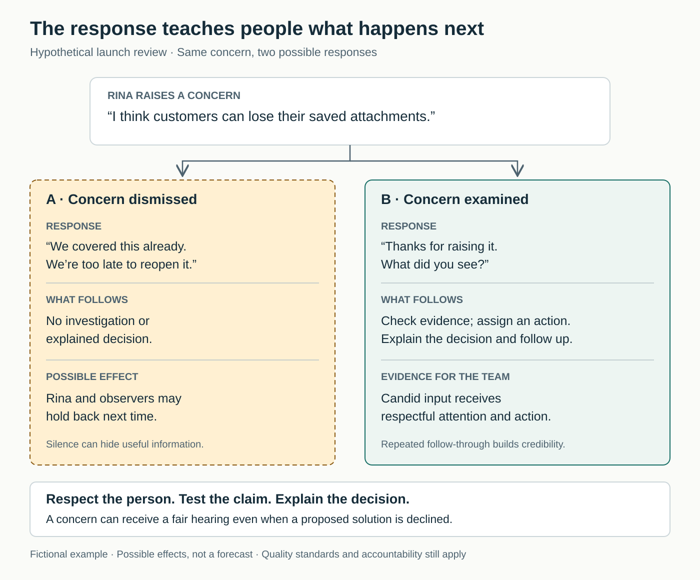

## When silence looks like agreement

A team finishes its launch review. The manager asks, “Any concerns?” Nobody answers. The launch goes ahead.

Afterward, a problem emerges that several people had suspected. One thought it was too late to object. Another lacked enough evidence to challenge the specialist. A newer colleague remembered what happened when someone questioned the previous launch.

The manager responds by reminding everyone to speak up earlier. But the next review is equally quiet.

The team has treated speaking up as an individual responsibility while leaving the consequences of speaking largely unchanged.

## The core move: make candor worth the risk

**Make questions, concerns, disagreements, and admissions of error receive respectful attention. Then show what happened because someone raised them.**

The established concept is **team psychological safety**: a shared belief that taking interpersonal risks at work is acceptable. These risks include asking for help, acknowledging uncertainty, and challenging an established view. Amy Edmondson’s foundational study of 51 work teams found psychological safety associated with learning behavior. Its observational design could not establish causation. [Edmondson, 1999](https://web.mit.edu/curhan/www/docs/Articles/15341_Readings/Organizational_Learning_and_Change/Edmondson_1999_Psychological_safety.pdf)

“Make It Safe to Speak Up” names a practical way to cultivate that condition. A declaration that everyone is welcome to contribute is a beginning; people also need evidence from everyday interactions.

High standards still apply. People can question a decision, receive challenging feedback, and remain responsible for their work. Edmondson’s practitioner guidance treats psychological safety and motivation toward excellent performance as complementary leadership responsibilities. [Edmondson, HBS Online interview](https://online.hbs.edu/podcast/amy-edmondson-on-building-high-performing-teams)

## Why useful information stays private

Speaking up can create an immediate personal cost for a benefit that belongs to everyone. Asking a basic question might expose a gap in knowledge. Reporting a mistake might affect someone’s reputation. Challenging a manager might threaten future assignments. Edmondson’s research identifies these interpersonal and career concerns as obstacles to learning behavior. [Edmondson, 1999](https://web.mit.edu/curhan/www/docs/Articles/15341_Readings/Organizational_Learning_and_Change/Edmondson_1999_Psychological_safety.pdf)

Consider the resulting loop: a concern receives a dismissive response; colleagues become more cautious; the leader hears fewer objections and assumes the plan is sound. When trouble eventually appears, it seems that nobody warned them.

This is a useful explanatory model, rather than a claim that every quiet meeting follows the same mechanism. People may also be silent because they agree, need time to think, or lack relevant information. The task is to make candid participation possible without demanding a performance of disagreement.

## A launch concern gets a different response

*The following example is hypothetical.*

A team is preparing to release a customer onboarding form. Rina, a recently hired support colleague, says: “I think customers can lose their saved attachments.”

The team lead, Amir, has already described the release as ready. His first impulse is to say, “We covered this already. We’re too late to reopen it.”

Instead, he pauses: “Thanks for raising it. What did you see?”

Rina explains that an attachment disappeared when she returned to an unfinished application. A developer says this cannot happen in the current version. Amir asks them to check the sequence together rather than settle the question through seniority.

They reproduce the problem under a particular condition. Fixing it will consume time reserved for a cosmetic improvement. The team defers that improvement and keeps the release conditional on verifying the fix.

There is friction. The developer feels their work has been questioned. Amir acknowledges that his earlier readiness claim was premature. He also makes the discussion precise: the team is investigating a behavior in the product, and the developer’s knowledge is needed to understand it.

Before closing the review, they name who will fix and verify the issue. Amir later tells Rina what changed and updates the release decision.

The cost is real: investigation takes time, scope changes, and a leader revises a public commitment. The benefit is concrete: a relevant observation becomes available for a decision while the team can still act.

Now imagine a second, also hypothetical case: the concern turns out to involve an obsolete test version. The response can still be constructive: explain the evidence, correct the misunderstanding, and acknowledge the useful check. People should not need to be right every time to raise a reasonable concern.

## What changes in daily work

A useful starting point is one recurring meeting where important information tends to arrive late. Agree on how concerns will be invited, received, and resolved.

**Ask a specific question before announcing a settled position.** For example: “Where might this fail for the people handling customer requests?” Explain what remains uncertain and why another perspective matters. In his or her own words, a leader can acknowledge a knowledge gap. Edmondson recommends making the need for others’ contributions explicit, asking genuine questions, and pausing before responding defensively. [HBS Online interview](https://online.hbs.edu/podcast/amy-edmondson-on-building-high-performing-teams)

**Offer more than one route into the discussion.** Circulate the decision beforehand, allow written comments, and make room for private conversations. An invitation need not put a quiet colleague on the spot. Choose routes that fit the work and explain who will receive the information.

**Agree on a response.** Listen, clarify what was observed, and decide what examination is warranted. Record a next action or explain why none is needed. Acknowledgment alone leaves the speaker wondering whether contributing mattered.

**Address behavior that makes participation costly.** Ridicule, repeated interruption, and ignoring someone’s contribution require a response. AHRQ’s practical guidance explicitly recommends addressing disrespect, belittling, blame, and discouragement of speaking up. Although written for healthcare teams, these interpersonal practices translate readily to other settings. [AHRQ, *Creating Psychological Safety in Teams*](https://www.ahrq.gov/sites/default/files/wysiwyg/evidencenow/tools-and-materials/psychological-safety.pdf)

Any colleague can listen carefully, acknowledge uncertainty, and support someone whose concern is being brushed aside. Leaders have additional responsibilities: making time for investigation, correcting harmful behavior, and ensuring that raising a concern does not quietly damage someone’s opportunities.

The initial agreement can be small. Maintaining it requires attention, particularly when deadlines, embarrassment, or disagreement make a defensive response tempting.

## Where this helps—and what it cannot repair alone

This pattern is especially relevant when people reveal concerns privately after meetings, mistakes surface late, junior colleagues rarely question plans, or the same few people dominate difficult discussions.

It supports routine work as well as innovation: asking for clarification can matter just as much as proposing a new idea.

It cannot compensate for missing expertise, insufficient staffing, or unclear authority. A team may openly identify a problem and still need resources or a decision from elsewhere.

Where retaliation or harassment has actually occurred, another invitation to speak is insufficient. People need credible action addressing the behavior and an alternative route for raising concerns when their own manager is implicated. Asking the affected person to become more courageous leaves the underlying risk intact.

Participation also needs boundaries. Nobody should have to disclose personal experiences to demonstrate openness. During urgent work, teams may need a concise way to flag an immediate concern, with fuller discussion afterward.

## Failure modes and evidence of progress

A common failure is **invitation without follow-through**. The leader thanks everyone for their candor, then leaves every difficult issue untouched. Another is **selective safety**: established members can challenge decisions while newcomers receive irritation for similar questions.

A third is treating all disagreement as harmful. Respectful scrutiny is part of the practice. Teams still need to assess evidence, reject weak proposals, and address poor conduct.

When someone responds badly, repair should be specific: “I cut you off earlier. That made it harder to raise the concern. Please take us through it.” The subsequent investigation and behavior matter more than a polished apology.

Judge progress through several observations:

- Relevant concerns surface while there is still time to respond.
- Questions and admissions of uncertainty come from a wider range of colleagues.
- People can describe what happened after they raised an issue.
- Challenges receive examination without personal attacks.
- Decisions improve, recurring problems are addressed, or avoidable rework declines.

These are suggested indicators, not a validated scorecard. More reported problems can reflect greater willingness to disclose them, so counts alone cannot tell you whether underlying performance improved. Equally, silence does not demonstrate that everything is working.

A manager’s confidence that the atmosphere is open is insufficient evidence. Ask colleagues about concrete experiences, including whether they held something back. Look for differences between people’s experiences rather than relying solely on a team average.

## Connections to neighboring patterns

[[teamwork-check-shared-understanding|Check Shared Understanding]] makes differing interpretations visible. People need permission to ask the question that might otherwise seem obvious.

[[teamwork-address-conflict-directly|Address Conflict Directly]] helps a team examine substantive disagreement once it has surfaced. Psychological safety makes that disagreement easier to reveal; conflict skills help people handle it constructively.

[[teamwork-run-one-improvement-experiment|Run One Improvement Experiment]] turns uncertainty into a bounded test. People need to be able to report disappointing results without making the experiment look successful to protect themselves.

## Best starting source

[Amy Edmondson’s HBS Online interview on building high-performing teams](https://online.hbs.edu/podcast/amy-edmondson-on-building-high-performing-teams). Its transcript gives direct, practical guidance on inviting contributions, responding constructively, and maintaining high expectations. For the research foundation, read her [1999 study](https://web.mit.edu/curhan/www/docs/Articles/15341_Readings/Organizational_Learning_and_Change/Edmondson_1999_Psychological_safety.pdf).
