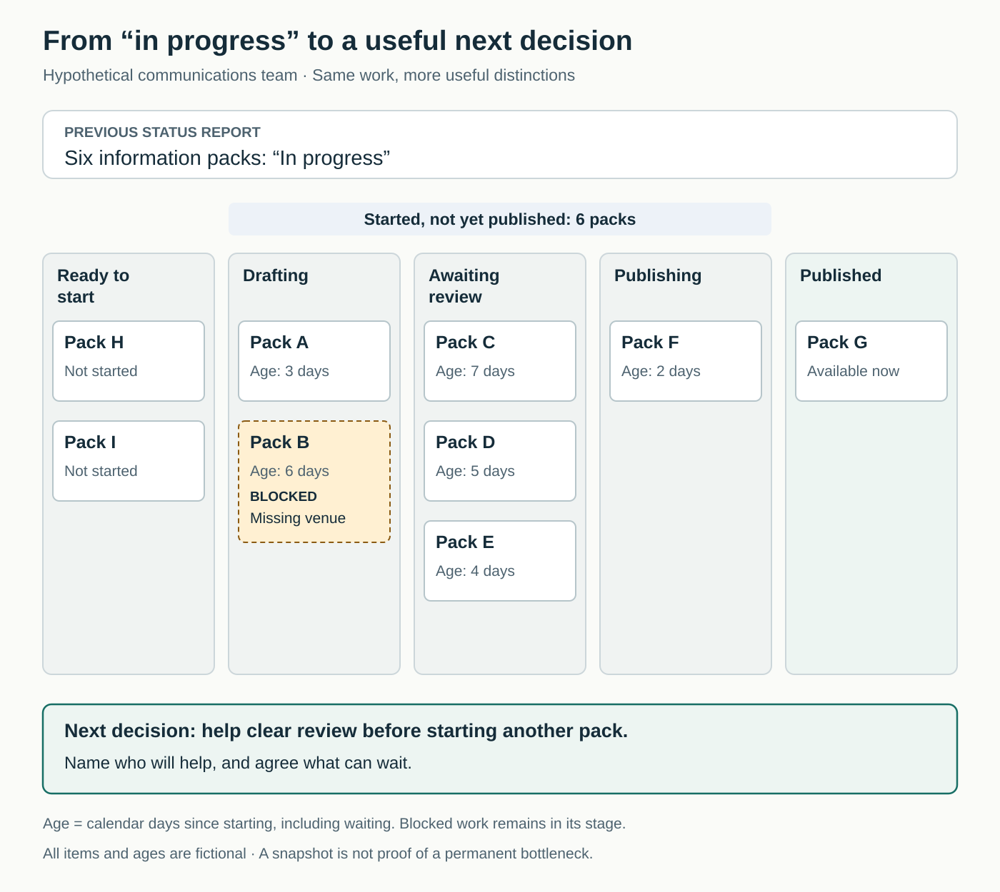

## Everyone is busy; nobody can explain the delay

A communications team has six information packs “in progress.” Designers are drafting, an editor is reviewing, and someone is arranging publication. Everyone reports being busy.

Yet event organizers keep asking when their packs will be available.

The manager requests more frequent updates. Each person supplies a fuller account of their activity, but assembling the overall picture still requires chasing messages and comparing personal lists.

The missing information sits between those accounts: which packs are waiting, what they need next, and where help would make a difference.

## The core move: create a shared picture people can act on

**Represent the work, its current state, and important obstacles in a shared place. Use that picture to decide what needs attention next.**

The established practices include **visual management** in Lean and **visualizing the workflow** in Kanban. This pattern draws on both without requiring adoption of either approach in full.

Kanban University recommends representing the actual workflow, including its waiting stages, rather than an idealized process. The useful question is how work really moves toward delivery. [Kanban University, *The Official Guide to the Kanban Method*](https://kanban.university/kanban-guide/)

A board is one possible representation. A shared table, annotated schedule, or dependency map may suit another situation. The essential feature is a common, understandable account of the work.

## Why individual updates leave gaps

People naturally see the part they are handling. A writer knows the draft is finished; the editor knows review has not started. Both descriptions can be accurate while “finished” means something different to each person.

Broad labels conceal these distinctions. “In progress” might mean active attention, waiting for approval, or abandoned temporarily because something urgent arrived.

Planned work can also crowd out the record of actual work. Corrections, interruptions, and requests handled through private messages consume capacity without appearing in the plan. Dominica DeGrandis identifies unplanned work, dependencies, and conflicting priorities as recurring sources of hidden delay in her practitioner account. [DeGrandis interview, InfoQ](https://www.infoq.com/articles/making-work-visible-book-review-interview-dominica-degrandis/)

A shared representation makes these conditions available for joint examination. It does not explain them automatically.

Lean practitioner Mark Hamel emphasizes that visual management should help people recognize a gap between the current condition and an expected condition. A display that cannot inform a response has limited practical value. [Lean Enterprise Institute, *Reinforcing Lean Behavior Through Visual Management*](https://www.lean.org/the-lean-post/articles/reinforcing-lean-behavior-through-visual-management/)

## Six packs become six different situations

*The following example is hypothetical.*

The communications team replaces its single “in progress” label with a shared view:

**Ready to start → Drafting → Awaiting review → Publishing → Published**

Each card represents an information pack. “Published” means the intended audience can access it; finishing a draft does not meet that condition.

The team discovers that, among the six started packs, two are in drafting, three await review, and one is being published. Another two packs have not started.

One drafting card carries an explicit warning: “Blocked—missing venue information.” It stays in its current stage, so the unfinished commitment remains visible.

The team also displays elapsed time since each pack started. The oldest pack awaiting review is seven days old. That does not mean it has spent seven days in review; the label covers its whole journey so far.

The editor, Gus, objects that the new view makes him look like the problem. Team lead Leena acknowledges the concern. They investigate the queue together and find that Gus has been expected to review packs alongside urgent corrections that were missing from the plan.

Leena postpones starting another pack. A designer helps prepare the review materials, while Gus retains responsibility for editorial approval. Leena contacts the organizer about the missing venue information.

There is a trade-off: the team produces fewer fresh drafts that day, and someone waiting for a new pack receives a revised expectation. It gives attention to work closer to publication.

One pack moves through review and becomes available. The board has helped the team make a useful decision. It has not proved that editorial review is a permanent bottleneck or solved the underlying allocation of Gus’s time.

## How to make visibility useful

Start with one workflow where people repeatedly ask for status or discover delays late. Involve the people who perform the work and those responsible for important handoffs.

**Choose a meaningful unit.** A card might represent a customer request, information pack, or hiring process. Choose a level that supports coordination. Recording every small action can obscure the commitments the team needs to manage.

**Define the states together.** Agree what “started,” “ready for review,” and “finished” mean. Show waiting explicitly where it affects decisions. Kanban University also recommends making movement criteria and other working agreements visible alongside the work. [Official Kanban Method guide](https://kanban.university/kanban-guide/)

**Include the work that changes capacity.** Repairs, recurring obligations, and urgent interruptions may need representation alongside planned delivery. Match the detail to the problem; a temporary record of interruptions may reveal something without becoming permanent administration.

**Show enough to support a next action.** Useful information can include the desired result, current state, a contact person, an important dependency, and elapsed age. A contact identifies where to ask for context; it does not imply that one person must perform every step.

**Keep it current and use it.** Agree who updates an item when its state changes. During coordination, examine what is waiting, what is blocked, and what the team can finish or unblock.

The Kanban Guide distinguishes visualization from actively managing and improving the workflow. It defines work-item age as elapsed time since starting and treats started-but-unfinished items as work in progress. Waiting therefore remains part of the picture. [*The Kanban Guide*, May 2025](https://kanbanguides.org/the-kanban-guide)

An individual can propose an initial view and expose missing work. A dependable shared view requires team agreement. Leadership support becomes necessary when acting on it means changing priorities, obtaining help, or negotiating with another department.

## When it helps—and when to simplify

This pattern is especially useful when work crosses people or teams, requests arrive through several channels, or “almost finished” items linger without a clear next step.

It also helps remote teams who cannot rely on overhearing what colleagues are doing. The shared view must be accessible to the people coordinating the work, rather than confined to a wall some members rarely see.

A small team with a simple workflow may need only a short shared list. A complex service may need connected views at different levels. Avoid forcing discovery, parallel activity, and repeated revision into a misleadingly neat sequence.

Sensitive work can use restricted access and neutral identifiers. Visibility should expose the coordination information people need, with an appropriate boundary around private details.

The representation is also incomplete by design. It cannot replace a conversation about an ambiguous problem or the expertise needed to resolve it.

## Failure modes and signs of progress

**The board becomes a display for management.** People update it before a reporting meeting, while daily decisions happen elsewhere. Bring it into the actual coordination process.

**Appearance improves while accuracy declines.** Waiting items are hidden, blocked cards disappear, or work is marked finished prematurely. Preserve the distinction between an attractive report and a truthful account.

**Visibility becomes surveillance.** Counting cards per person encourages arguments about task size and credit. DeGrandis warns that people may conceal errors or unplanned work when revealing them has punitive consequences. [DeGrandis interview](https://www.infoq.com/articles/making-work-visible-book-review-interview-dominica-degrandis/)

**Everything becomes visible at equal prominence.** Dense fields, unexplained colors, and stale items make the display harder to interpret. Hamel’s guidance is to begin with the question the visual needs to answer and keep it maintained. [Lean Enterprise Institute](https://www.lean.org/the-lean-post/articles/reinforcing-lean-behavior-through-visual-management/)

Look for practical changes: fewer status-chasing messages, earlier attention to dependencies, clearer decisions about what can wait, and fewer commitments lost between handoffs.

Then examine results: are items reaching their intended users more reliably, without increasing errors or exhausting the team? A current board demonstrates adoption. Improved delivery requires separate evidence.

Initially, recorded unfinished work may rise because previously hidden work has been added. Interpret the change before declaring performance worse.

## Connections to neighboring patterns

[[teamwork-limit-work-in-progress|Limit Work in Progress]] uses the shared picture to control how much work is started. Visibility reveals the load; limits change how the team handles it.

[[teamwork-work-the-bottleneck|Work the Bottleneck]] investigates a constraint and directs improvement toward it. A visible queue is a reason to investigate, rather than sufficient evidence of a lasting constraint.

[[teamwork-make-it-safe-to-speak-up|Make It Safe to Speak Up]] supports an honest representation. People need to be able to reveal delays, mistakes, and overload without making concealment the safer choice.

## Best starting source

[Kanban University’s *Official Guide to the Kanban Method*](https://kanban.university/kanban-guide/), particularly “Kanban Boards” and “Make Policies Explicit.” It explains how to represent the actual workflow and the agreements that make a shared view useful.
