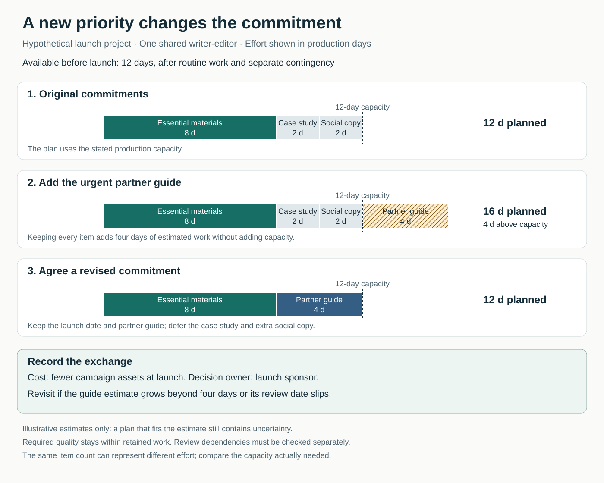

The team has agreed its launch plan. Then an important partner asks for a new guide. Everyone agrees that supporting the partner matters. Someone says, “Let’s make it a priority.”

The guide enters the plan. The launch date remains. So do the existing deliverables.

The team now has competing commitments, but no shared decision about which commitment should change. That decision eventually happens through late work, quiet omissions, rushed checks, or a disappointed requester.

Making trade-offs explicit brings the decision forward, while people can still influence it.

## The core move

**Name what a choice gains, what it gives up, who experiences the consequences, and who has authority to decide.**

A priority becomes operational when people understand its effect on existing commitments. “The partner guide comes first” is incomplete until the team knows what happens to the work previously scheduled.

Trade-offs can involve scope, timing, cost, responsiveness, flexibility, or effort required elsewhere. Atlassian’s Project Trade-Off Analysis asks teams to discuss which project variables can move, compare their assumptions, and document the resulting agreement. [Project Trade-Off Analysis](https://www.atlassian.com/team-playbook/plays/trade-offs)

The purpose is to make a choice that people can realistically deliver and support. That sometimes means reducing scope, sometimes changing a date, and sometimes finding a different way to achieve the outcome.

## Why the decision stays hidden

Accepting a request can feel easier than explaining its consequences. The benefit has an identifiable advocate, while the displaced work belongs to someone absent from the conversation.

Priority labels also conceal disagreement. A sponsor may mean “begin immediately.” A team member may mean “do this after the current task.” Another stakeholder may assume their own deadline remains protected.

Without an explicit exchange, the people doing the work must reconcile these interpretations themselves. They may have responsibility for delivery without authority to change the promises.

Limited resources make prioritization unavoidable. GOV.UK’s delivery guidance recommends revisiting priorities using performance information, user research, and stakeholder input, with the delivery team involved in the decision. [Deciding on priorities](https://www.gov.uk/service-manual/agile-delivery/deciding-on-priorities)

Writing down the consequences gives those people something concrete to discuss.

## A launch plan with one addition

Consider a **hypothetical** launch project. One writer-editor has twelve production days available before launch, after routine work and separate contingency. The remaining work is estimated as:

- Essential launch materials: eight days.
- A customer case study: two days.
- Extra social-media copy: two days.

The planned work uses the twelve available days.

A partner now needs a tailored onboarding guide. The estimate is four additional production days. Accepting everything would create sixteen days of planned work within twelve days of available capacity.

The team outlines three options:

**Keep the date and include the partner guide.** Defer the case study and extra social copy. Essential materials and the guide total twelve estimated days. The cost is fewer campaign assets at launch.

**Keep all the scope.** Reforecast delivery and check the revised timing with the partner and other teams. The cost is a later or staged release, whose consequences need assessment.

**Keep the original commitment.** Schedule the partner guide later and agree what support is available in the meantime. The cost falls on the partner’s launch experience and potentially on support staff.

Sales objects to losing the case study. The partner manager argues that the guide supports an immediate onboarding need. The writer-editor explains that additional help would require availability, briefing, and review; it cannot yet be counted as extra capacity.

The launch sponsor chooses the first option after hearing the affected teams. The plan names both deferred items. Their requesters receive the revised commitment.

The decision also has a review condition: revisit the plan if the guide estimate grows beyond four days or its review date slips. The arithmetic makes the choice understandable, but it does not guarantee the estimate.

These numbers and outcomes are invented to illustrate the practice. Actual effort, dependencies, and consequences would require investigation.

## Turning preferences into a usable agreement

Start with the outcome the team is protecting. A date can matter because an event cannot move; a feature can matter because users otherwise cannot complete the task. Ask what makes a constraint important before treating it as fixed.

Then distinguish genuine constraints from preferences. A contractual commitment, an approved budget, and somebody’s preferred presentation format have different consequences. People may initially disagree about their flexibility; surfacing that disagreement is part of the work. [Atlassian’s approach to rating flexibility](https://www.atlassian.com/team-playbook/plays/trade-offs)

Describe options in concrete terms. “Reduce scope” leaves too much interpretation. “Defer the case study and additional social copy” identifies the actual exchange.

Include consequences beyond the project boundary. A manual workaround may save development effort while creating recurring work for operations. A later release may disrupt a customer’s preparations. The people receiving those costs should have a voice.

Clarify who decides. Atlassian’s DACI framework separates the person coordinating a decision, the decision-maker, contributors, and people who must be informed. The roles are useful even without adopting the acronym. [DACI Decision-Making Framework](https://www.atlassian.com/team-playbook/plays/daci)

A useful decision record captures the choice, its reason, what changes, affected commitments, the owner, and a condition for review. This is a practical synthesis of the source guidance, rather than a required universal format.

An individual can start by attaching a consequence to an incoming request: “This looks like four days of remaining work; here are the commitments using that capacity.” Changing another team’s deadline or scope requires agreement from someone authorized to make that commitment.

## Make the sacrifice proportionate

Prioritization categories can help, provided they refer to a specific period. MoSCoW distinguishes Must Have, Should Have, Could Have, and Won’t Have **this time**. The timeframe matters: something can be essential eventually without being necessary for the next delivery. [Agile Business Consortium: MoSCoW Prioritization](https://www.agilebusiness.org/resource/what-is-moscow-prioritization/)

Item counts are a poor substitute for capacity. Adding one large request and removing one small task may leave the overload almost unchanged. Examine remaining effort, required skills, dependencies, and timing.

Also look for better options before accepting a costly sacrifice. Reusing an existing guide, narrowing the audience, or changing the delivery method might reduce the conflict. An apparent trade-off can partly reflect the current design of the work.

In another hypothetical team, a research report must reach a decision meeting on Friday. The team reduces decorative slide work to protect analysis and verification. That exchange is useful because it preserves the report’s purpose while making the presentation less elaborate.

## When the pattern helps—and its limits

This pattern helps when urgent additions are common, stakeholders defend competing deadlines, or staff routinely absorb changes through extra work.

Some conditions require escalation. If all proposed commitments are genuinely essential and the available capacity is insufficient, the team needs an authorized decision about scope, timing, resources, or whether to proceed. A workshop cannot manufacture feasibility.

Required quality also needs a clear boundary. The Scrum Guide, for example, explicitly allows scope to be clarified and renegotiated while stating that quality does not decrease during a Sprint. [Scrum Guide: The Sprint](https://scrumguides.org/scrum-guide.html#the-sprint)

Other contexts may permit different levels of polish or performance. State what remains acceptable and how it will be checked. Vague permission to “move faster” leaves the delivery team guessing.

Estimates remain uncertain, and specialist capacity is not freely interchangeable. Treat calculations as decision aids, with assumptions that can be revisited.

## Failure modes and signs of progress

One failure is a ceremonial ranking exercise. Everything receives a high score, but nobody changes the commitments.

Another is a decision that never reaches the plan. Deferred items continue appearing in status reports, so people keep trying to complete them.

A third is transferring the cost to someone who was not consulted: support staff, another team, customers, or employees working longer hours.

Look for changes in behavior and results:

- Do new priorities produce explicit changes to existing commitments?
- Can affected people explain what was deferred and why?
- Are review conditions acted on when assumptions change?
- Are late surprises, unplanned overtime, and hidden work decreasing?
- Do the protected outcomes justify the sacrifices?

The sources offer practitioner methods for making and communicating decisions. They do not establish a universally correct ranking or guarantee delivery. A clear decision is still a decision whose consequences need observation.

## Neighboring patterns

[[teamwork-clarify-decision-rights|Clarify Decision Rights]] establishes who can choose between commitments. Make Trade-offs Explicit gives that person a concrete choice and its consequences.

[[teamwork-limit-work-in-progress|Limit Work in Progress]] makes it harder to absorb every request through additional starts, creating a practical reason to renegotiate.

[[teamwork-deliver-small-slices|Deliver Small Slices]] expands the available options: the team may provide a narrower, useful result now while leaving other scope for a later decision.

## Best starting source

[Atlassian’s Project Trade-Off Analysis](https://www.atlassian.com/team-playbook/plays/trade-offs). It provides a practical way to expose differing assumptions about flexibility, discuss the sacrifices, and preserve the agreement for later decisions.
