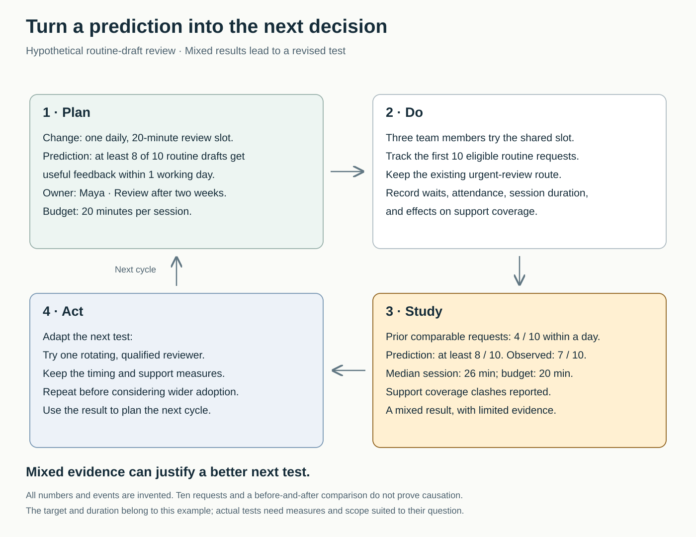

The retrospective produces six sensible actions: clarify priorities, improve handoffs, reduce meetings, update the board, share knowledge, and respond faster to reviews.

Everyone agrees. Two weeks later, some actions have started, others have disappeared into ordinary work, and the same frustrations return. Someone suggests trying a different tool.

The team has generated improvement ideas, but it has learned little about which changes help. It needs a smaller commitment with a clear question, an observable result, and a decision afterward.

## The core move

**Try one bounded change, state what you expect, observe what happens, and use the result to decide the next step.**

An improvement experiment tests a belief about how work could become better. “Introduce a daily review slot” describes a change. “A daily review slot will reduce waiting without disrupting customer support” describes a belief worth investigating.

This pattern draws on **Plan–Do–Study–Act**, or **PDSA**: plan a test, carry it out, study the results, and act on the learning. The Institute for Healthcare Improvement emphasizes small initial tests and linked cycles through which an idea is refined before wider implementation. [IHI: Testing Changes](https://www.ihi.org/library/model-for-improvement/testing-changes)

“One” provides focus for teams that repeatedly overcommit to improvement work. It is not a universal rule that only one change may ever be tested.

## Why good intentions produce little learning

Improvement work competes with delivery. An action without allocated time, an owner, or a review point can remain permanently desirable and practically optional.

Broad intentions are also difficult to evaluate. “Communicate better” could mean clearer requests, fewer channels, earlier escalation, or more meetings. If several changes happen together, the team may struggle to explain what contributed to the result.

The Scrum Patterns collection addresses this loss of focus through **Scrumming the Scrum**: select one important impediment, make its removal explicit work, and define how completion will be assessed. [Scrumming the Scrum](https://sites.google.com/a/scrumplop.org/published-patterns/retrospective-pattern-language/scrumming-the-scrum)

An experiment adds uncertainty to that commitment. The team intends to learn whether the proposed change improves the situation.

The Deming Institute’s account of PDSA emphasizes predicting results and comparing observations with the underlying theory. Carrying out a change is only part of the cycle. [Deming Institute: PDSA](https://deming.org/explore/pdsa/)

## A review slot with a mixed result

Consider a **hypothetical** three-person communications team. Routine drafts wait too long for useful feedback. Looking at its previous ten comparable requests, the team finds that four received actionable feedback within one working day.

Its proposed change is a daily, twenty-minute shared review slot. The team and manager allocate time for a two-week trial. Urgent requests retain their existing route.

Maya coordinates the test. The prediction is that at least eight of the first ten eligible routine drafts will receive useful feedback within one working day, with sessions fitting the twenty-minute allowance and customer-support coverage maintained.

“Useful feedback” means a decision or specific changes the author can act on. An acknowledgment alone does not count.

The team records requests, waiting times, attendance, session duration, and support conflicts. All ten requests remain in the result, including late responses and requests arriving near the trial’s end.

The observations are mixed:

- Seven of ten requests receive useful feedback within one working day.
- The median session lasts twenty-six minutes.
- One participant repeatedly struggles to attend while covering customer calls.

The team has seen more timely responses than in the earlier sample, but it has missed its prediction. Sessions also exceed the planned allowance, and the attendance arrangement conflicts with another responsibility.

One colleague wants to make the meeting permanent. Another wants to abandon it. They instead choose a narrower next question: could one rotating, qualified reviewer provide timely feedback without requiring everyone to attend?

The next cycle retains the timing and support measures while testing that staffing arrangement. Maya records what changed and why.

These people, figures, and results are invented. Ten requests and a before-and-after comparison cannot establish that the review slot caused the difference. The test has nevertheless exposed practical information the team can use.

## Choose a question the team can answer

Begin with an observable difficulty. “Routine drafts wait several days for actionable feedback” gives a clearer starting point than “our process is inefficient.”

Then select a change with a plausible connection to that difficulty. Explain why it might help. A shared slot could create predictable review capacity; it could also interrupt valuable work or become another meeting people cannot attend.

State a prediction before looking at the result. It may concern a quantity, a behavior, or a practical obstacle. The point is to make the expectation visible enough to compare with experience.

Agree the scope, owner, duration, and review point. The appropriate scale depends on the question. A short simulation may reveal whether instructions are understandable. A recurring scheduling problem may need observation across several working cycles.

The approach here is a practical synthesis. PDSA supplies the learning structure; it does not prescribe a ten-request sample or a two-week duration for teamwork.

An individual can investigate their own workflow or propose a test. Changes affecting colleagues’ time, responsibilities, or service commitments require agreement from those involved and the relevant decision-makers. Improvement work needs capacity alongside other commitments.

## Observe the benefit, the execution, and the cost

A useful test needs more than a preferred success number.

IHI distinguishes **outcome measures**, **process measures**, and **balancing measures**. Together, they examine whether the result improves, whether the intended process happens, and whether the change creates problems elsewhere. [IHI: Establishing Measures](https://www.ihi.org/library/model-for-improvement/establishing-measures)

For the review example:

**The intended benefit** is more timely, useful feedback. The team should eventually check whether that also helps drafts reach completion.

**The process check** asks whether sessions happen and the appropriate reviewer participates.

**The balancing checks** examine staff time, support coverage, and feedback quality.

Use existing records where possible, supplemented by brief observations from affected people. Track the sequence of events and note relevant context: workload, absences, unusually difficult requests, or another change introduced during the trial.

A second hypothetical team might test a short handoff summary. If the summary is rarely supplied, disappointing results say little about whether a well-used summary would help. Understanding how the test was carried out guides the next decision.

## Act on the result

At the review point, compare observations with the original prediction. Discuss what helped, what surprised people, and what remains uncertain.

The next decision may be to retain the change, adapt it, stop it, or gather more information. A promising result may justify another test under different conditions before broader adoption.

A disappointing result can also be useful. It may expose an incorrect assumption, an impractical arrangement, or inadequate measurement. Record which explanation seems plausible and what would help distinguish it from alternatives.

IHI explicitly supports linked tests and recognizes that several changes can be investigated toward one improvement goal. Where a team tests a package of changes, describe it as a package; the observations do not isolate each component’s effect. [Linked tests of change](https://www.ihi.org/library/model-for-improvement/testing-changes)

## Limits and failure modes

A small local test supports learning about a particular setting. It does not automatically establish causation or generalize to another team.

Choose more rigorous evaluation when the consequences or decision warrant it. Some situations also require immediate correction rather than waiting for a scheduled improvement cycle.

One common failure is declaring success because the new practice was introduced. Another is changing the success criteria after seeing the result. A third is collecting information without making a subsequent decision.

These are substantive concerns. A 2014 systematic review of healthcare PDSA studies found inconsistent application and reporting of core features, including iterative cycles, predictions, and data over time. It examined how the method was used; it was not proof that simply adopting the PDSA label improves performance. [Taylor and colleagues’ review](https://pmc.ncbi.nlm.nih.gov/articles/PMC3963536/)

Look for progress in the team’s learning behavior:

- Improvement commitments receive time and ownership.
- Predictions are recorded before results arrive.
- Unsuccessful cases remain visible.
- Costs and unintended effects influence decisions.
- Each completed test informs a concrete next step.
- Changes that help are sustained and checked over time.

## Neighboring patterns

[[teamwork-work-the-bottleneck|Work the Bottleneck]] helps identify a promising place to intervene. An experiment tests whether a proposed intervention helps under actual conditions.

[[teamwork-make-trade-offs-explicit|Make Trade-offs Explicit]] makes room for the test and exposes who bears its cost.

[[teamwork-check-shared-understanding|Check Shared Understanding]] helps participants agree what they are testing, what counts as evidence, and what they will review together.

## Best starting source

[IHI’s Testing Changes guide](https://www.ihi.org/library/model-for-improvement/testing-changes). It explains predictions, small tests, observation, and linked learning cycles—making it particularly useful for turning an improvement idea into something a team can evaluate.
