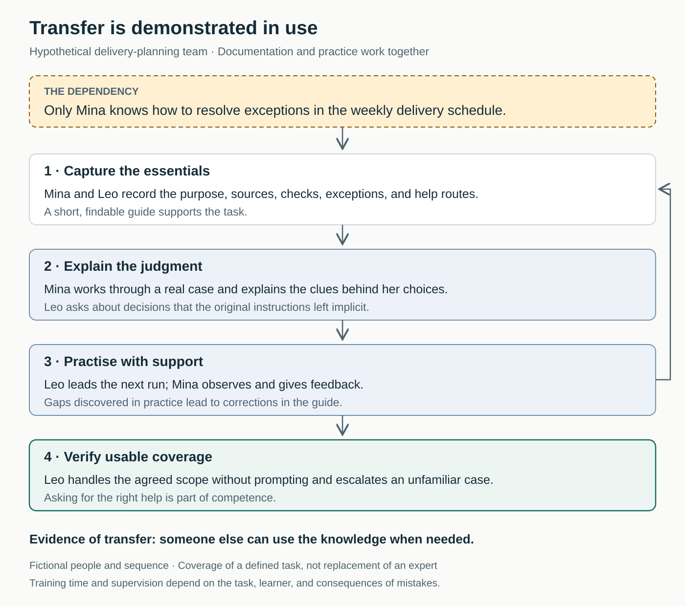

## The team has a process—until one person is away

Mina takes a week off. Her colleagues can prepare the delivery schedule, but an unfamiliar exception stops them. The instructions say “resolve exceptions before sending.” Everyone knows Mina normally handles that part.

They search old messages, postpone the schedule, and eventually contact her on holiday.

Afterward, the manager asks Mina to document more. She adds several pages, but nobody tries using them. The dependency remains, now accompanied by a longer document.

The missing step is establishing whether someone else can find, understand, and apply the knowledge when it matters.

## The core move: transfer usable capability

**Identify knowledge whose loss would seriously disrupt the work. Combine accessible guidance with supported practice until other people can use it within an agreed scope.**

The established practices include **knowledge transfer**, **knowledge continuity**, and **cross-training**. “Share Critical Knowledge” brings them together around a practical question: what must remain usable when the usual expert is unavailable?

NASA’s knowledge-continuity guidance asks leaders to identify critical knowledge held by a sole owner, make it accessible, and build transfer into everyday work rather than waiting for a departure. It recommends complementary approaches including documentation, mentoring, and cross-training. [NASA, *Knowledge Continuity: A Guide for Supervisors*](https://www.nasa.gov/wp-content/uploads/2025/09/knowledge-continuity-supervisors-guide.pdf)

The objective is dependable coverage of important work. Specialists can retain deep expertise while colleagues learn enough to handle common situations, recognize exceptions, and obtain appropriate help.

## Why knowledge stays concentrated

Concentration often begins innocently. Someone becomes particularly good at a task. Colleagues route difficult cases to them. Under deadline pressure, doing the work feels faster than explaining it.

The expert then gets more practice, while everyone else gets fewer opportunities to learn. A reasonable short-term choice repeatedly reproduces the dependency.

Some knowledge is also difficult to articulate. Experienced people notice warning signs, distinguish similar-looking cases, and remember why an apparently obvious solution failed previously. A procedure may record their actions without exposing those judgments.

Organizational knowledge also includes relationships and context: who can clarify an unusual request, where authoritative information lives, and why a previous decision was made. NASA’s transition guidance explicitly includes experience, relationships, contacts, and process knowledge when assessing gaps. [NASA, *Sustaining Knowledge Through Transitions*](https://www.nasa.gov/wp-content/uploads/2025/10/sustaining-knowledge-through-transitions.pdf)

These sources provide organizational and practitioner guidance. The approach below is a practical synthesis, not a standardized intervention with a guaranteed result.

## A colleague takes the lead

*The following example is hypothetical.*

Mina coordinates equipment deliveries. Leo can prepare the routine schedule, but only Mina confidently resolves orders with conflicting status information.

Their manager chooses this task for knowledge transfer because a delay affects several partner depots. The team postpones a dashboard improvement to create time for Mina and Leo to work together.

They begin with the existing instructions. Leo points to “resolve exceptions” and asks what that means in practice.

Mina demonstrates a recent case. An order appears ready in a summary sheet, but the supplier’s confirmation shows that one item remains unavailable. She explains which source takes precedence and why she checks the confirmation before including the order.

Together, they create a short guide covering the task’s purpose, authoritative sources, readiness checks, common exceptions, and escalation contacts. Leo writes the explanation in language he can follow; Mina checks its accuracy.

During the next run, Leo operates the process while Mina observes. He initially includes an order she would have held. Rather than immediately correcting it herself, she asks what evidence supports his choice. They discover that their guide does not explain a status label clearly enough.

They revise it.

Mina finds the process slow. Leo feels exposed when explaining his reasoning. The manager treats this time as part of delivery preparation and keeps other requests from consuming it.

On a later run while Mina is unavailable, Leo completes the routine work using the guide. An unfamiliar exception goes to the agreed operations contact. He does not guess, and Mina is not interrupted.

The team has evidence of useful coverage for a defined task. Leo has not acquired all of Mina’s experience, and the next unusual case may reveal another gap.

## What changes in everyday work

Start with one important dependency. A useful choice combines consequence and vulnerability: work that matters, knowledge concentrated in very few people, and difficulty replacing it when needed.

Describe the capability specifically. “Understand operations” is too broad. “Prepare the delivery schedule, resolve these common exceptions, and recognize cases requiring escalation” gives people something they can teach and observe.

Then connect three forms of support.

**A usable reference.** Capture purpose, essential steps, decision criteria, examples, limitations, and where to get help. Put it where colleagues will look while doing the task. Arrange appropriate access to the tools and information it references.

**An explanation of judgment.** Work through actual cases together. Ask what the experienced person noticed, what alternatives they rejected, and what would change their decision. A recorded demonstration may help, but an unanswered question should not become a permanent mystery inside a video.

**Practice with feedback.** Let the recipient perform the task while support is available. Watching demonstrates exposure; leading the work reveals what they can apply.

Google’s account of training reliability engineers combines structured learning, practical exercises, shadowing, and sometimes **reverse shadowing**, where the learner leads while an experienced colleague remains available to help. This is a documented practitioner approach from a technical setting, which other teams can adapt to their own work. [Google SRE, *Accelerating SREs to On-Call and Beyond*](https://sre.google/sre-book/accelerating-sre-on-call/)

An individual can make reasoning explicit and invite a colleague into the next suitable task. Team support is needed to arrange coverage and opportunities to practise. Leadership must protect learning time and recognize teaching as a contribution. NASA explicitly recommends building knowledge capture into plans and processes. [NASA, supervisor guide](https://www.nasa.gov/wp-content/uploads/2025/09/knowledge-continuity-supervisors-guide.pdf)

## Match the transfer to the knowledge

A stable procedure may need a concise reference and a supervised attempt. A task involving substantial judgment may require repeated cases over a longer period.

For rare but important situations, waiting for the next live occurrence may be impractical. Google’s training account describes contained, realistic failures and group disaster exercises. The transferable principle is to practise difficult situations with appropriate supervision before relying on someone to handle them under pressure. [Google SRE](https://sre.google/sre-book/accelerating-sre-on-call/)

Some knowledge travels through relationships. For example, a hypothetical account team might introduce a backup to a partner’s operations contact and discuss which questions that person can resolve. A name in a directory offers less context than a working introduction.

This pattern helps when absences repeatedly interrupt delivery, onboarding depends on private explanations, or departures threaten an important capability.

It does not make everyone interchangeable. Complex professional expertise can take years to develop. Where capability remains limited, maintain access to specialists and make those limits explicit. Confidential information should reach the people who need it through suitable channels.

## Failure modes and signs of progress

**Document dumping.** A large archive is handed over without priorities, navigation, or opportunities to use it. Start from the recipient’s actual work.

**Permanent shadowing.** The learner watches indefinitely while the expert retains every consequential action. Progress toward supported participation.

**The expert repeatedly takes over.** Sometimes intervention is necessary, but always rescuing the task can conceal the learner’s remaining difficulties.

**Training is added to an unchanged workload.** Teaching and learning require capacity. Rushing both can produce documentation that nobody trusts and practice that never happens.

**The reference becomes stale.** Give users a clear route to correct it. Knowledge-Centered Service guidance recommends fixing an article when confident and authorized, or flagging it for someone qualified when uncertain. This ties maintenance to actual use. [Consortium for Service Innovation, “Flag It or Fix It”](https://library.serviceinnovation.org/KCS/KCS_v6/KCS_v6_Practices_Guide/030/030/040/030)

Judge progress through capability and continuity:

- Colleagues can find the relevant guidance when needed.
- Someone else can perform the agreed work to an acceptable standard.
- They can explain important decisions and recognize when to escalate.
- Ordinary absences cause fewer avoidable interruptions.
- Use reveals gaps that the team corrects.

These are suggested indicators, not a validated scorecard. Attendance, document counts, and hours of training show activity. They do not establish that knowledge is usable.

Fewer questions alone are also ambiguous. People may be learning—or becoming reluctant to admit uncertainty. Asking for the right help is part of competence.

## Connections to neighboring patterns

[[teamwork-experience-each-others-work|Experience Each Other’s Work]] develops understanding of another role’s conditions and constraints. Sharing critical knowledge goes further by building usable coverage for selected responsibilities.

[[teamwork-make-the-work-visible|Make the Work Visible]] reveals where work waits for a particular expert and makes transfer effort part of the team’s commitments.

[[teamwork-make-it-safe-to-speak-up|Make It Safe to Speak Up]] enables learners to expose confusion and experienced colleagues to acknowledge that instructions are incomplete.

## Best starting source

[NASA’s *Knowledge Continuity: A Guide for Supervisors*](https://www.nasa.gov/wp-content/uploads/2025/09/knowledge-continuity-supervisors-guide.pdf). This short guide connects critical-knowledge risks with everyday documentation, mentoring, cross-training, and protected time for transfer.
