You have a dozen photographs from someone preparing a meal. Each is pleasant, but most show
the same person at the same counter. Adding them together does not reveal much more than
the first image did. A wider kitchen view, hands mixing ingredients, a close detail, and
the table afterward would give the viewer different kinds of information.

Choose complementary images that create a progression. An establishing view can orient the
reader, an action can show what happens, a detail can make the experience specific, and
an ending can provide a place to stop. Treat that as an adaptable approach, not a four-picture
formula every event must satisfy.

[Source sheet and event descriptions](https://commons.wikimedia.org/wiki/File:Ford_A5015_NLGRF_photo_contact_sheet_(1975-06-11)(Gerald_Ford_Library).jpg).
Selected and cropped for this guide; source frame order remains available in the original.

## Give each image a different job

Think of the sequence as a set of contributions. One picture answers “where?” Another shows
a relationship or action. A detail can reveal material, effort, or a small consequence.
An ending changes the pace or leaves an appropriate question. An image earns its place
by contributing something the others do not already provide.

These roles can overlap. A wide view can contain the key action; a close detail can also
serve as an ending. Some stories need only two images, while others need more room. The
important distinction is between repetition that adds rhythm and repetition that merely
repeats the same information.

[[select-the-strongest-frame|Select the Strongest Frame]] chooses an image for a purpose. In
a sequence, the purpose also depends on neighboring images. Your favorite standalone frame
may duplicate another image's job, while a quieter view can make the whole set understandable.

## A visit with changing distances

The archival visit provides a room, people interacting, closer gestures, and a departure.
A broad first view helps readers understand the setting before concentrating on expressions.
Moving toward closer information can make the visit feel more specific. Ending with departure
signals a change of phase rather than adding one more similar conversation portrait.

The photographs do not tell us everything that happened between frames. A sequence is selective
by nature. Factual captions should identify what the archive establishes and distinguish it
from an interpretation of body language or mood. An expressive ordering must not imply that
an unrelated reaction happened in response to a neighboring event.

This is especially important when drawing from different dates or locations. You can create
a thematic essay from such material, but tell the reader that it is thematic. Do not present
it as one continuous afternoon merely because the colors and compositions fit well together.

## A simple activity at home

For bread making, a wide view might show the person and their small kitchen. Hands folding
dough explain the action. A close view of flour on a sleeve makes the work tangible. A
loaf cooling beside a used bowl can close the sequence without requiring a smiling final
portrait.

If the person dislikes being photographed, the sequence can concentrate on hands, tools, and
results with their agreement. Do not treat the establishing image as an entitlement to a
full view of their home. Collaboration includes deciding what stays private. [[give-people-something-to-do|Give People Something to Do]] explains why an activity should be welcome rather than imposed.

A missing stage does not need to be fabricated. If you arrive after the dough is mixed,
begin with what you actually observe. A caption can supply context without pretending you
photographed the beginning. A sequence can start in the middle and remain coherent.

## A walk can become a visual essay

During travel, you might connect an open square, a close exchange at a stall, a texture
of painted shutters, and the square becoming quiet in the evening. The progression can concern
changing activity rather than a single person's story. A repeated color or shape can provide
continuity while distance and subject change.

Avoid making every frame equally dramatic. If each demands maximum attention, the set can
feel exhausting and its main event becomes hard to identify. A quieter transition may give
the viewer enough space to understand the stronger image. [[limit-the-color-palette|Limit the Color Palette]] can help create coherence, but matching color is not a substitute for a
meaningful relationship.

## Check the joins

Read the sequence in order at its intended size. Does the viewer understand where they
are before a detail becomes abstract? Do two similar portraits create a useful comparison,
or does one merely delay the next contribution? Does the last picture offer closure, contrast,
or a deliberate open question?

Cropping can clarify an image's role, but it can also remove evidence that limits the story.
[[crop-with-a-purpose|Crop with a Purpose]] explains those tradeoffs. Captions can bridge gaps
honestly; they should not have to explain away a sequence whose visual order implies a
different event from the one recorded.

This pattern helps with family events, travel, craft, documentary observation, and small
personal essays. Phones and cameras can both vary distance, viewpoint, and timing. The reusable
approach is to seek complementary information and inspect how adjacent images influence one
another. A sequence becomes coherent when its parts support an understandable progression,
not when it has filled four predetermined slots.
