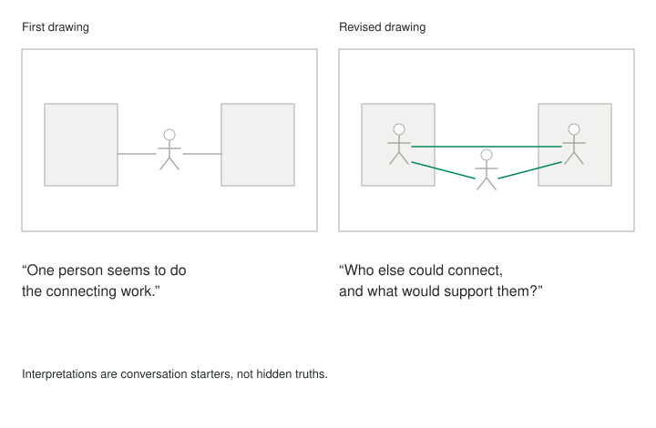

A project lead repeatedly describes a transition as a coordination problem. Asked to draw it, she places a small person between two large blocks and puts the goal outside the page's busiest area. A colleague looking at the drawing sees someone carrying a bridge rather than using one. That was not the intended story, but it makes a neglected question available: who is doing the connecting work, and what supports them?

## Core idea

Drawing can interrupt an explanation that has become too familiar to inspect. Position, scale, distance, and repetition make different relationships visible. Another person's interpretation adds a second perspective before the artist restores their intended account. Neither picture nor interpretation reveals a hidden truth automatically.

## When to use it

Use this pattern when verbal explanations repeat without producing new questions, when relationships are difficult to describe, or when another mode of expression could open a conversation.

## How it works

The **Drawing Together** Liberating Structure uses five symbols: circle for wholeness or self, rectangle for support, triangle for aspiration, spiral for change, and a star person for relationships. Participants make and revise a wordless story, hear another person's interpretation while remaining silent, then explain their intended meaning and encounter further interpretations. These are shared drawing conventions for the activity, not a universal psychological code.

A limited vocabulary reduces the temptation to make the exercise a test of illustration skill. Someone can explore an experience through a few shapes and their relationships. A small circle crowded by large rectangles might invite a question about support or pressure, but only the artist can say what they intended. An observer should ask rather than diagnose.

The constraint against words also matters. Labels can close interpretation quickly by telling a viewer what to see. Without them, both artist and viewer may notice a relationship they had not already named. The eventual conversation can recover precision, including what the visual representation obscures or simplifies.

Revision should therefore be exploratory. Alter size, placement, or repetition and notice how the account changes. A polished final image is optional. The most valuable part may be a feature that felt awkward or did not fit the original description. Keep enough ambiguity for something new to emerge while preserving the person's authority over their own account.

An artist often wants to correct a viewer immediately. A short period of listening lets the viewer complete an interpretation that may otherwise never become explicit. The artist can later distinguish what resonates, what differs, and what needs clarification. Silence during that interval is a participation agreement, not a duty to accept an intrusive reading.

The viewer's task is to describe an interpretation tentatively and with attention to the picture. A claim that the artist secretly fears responsibility exceeds what the activity can establish. A statement that the central person appears unsupported identifies an observable relationship in the drawing and leaves room for a different intended meaning.

## Worked examples



### A project transition

The project lead initially draws the two departments as stable blocks and herself as the connection. A second version makes the blocks smaller and adds people within each. That change reveals a possibility: the departments contain potential relationships that her usual explanation treats as a single channel through her.

The drawing has generated an inquiry, not established a solution. Perhaps the lead has access that others genuinely lack. Perhaps responsibility is formally centralized. Before proposing a distributed arrangement, she can ask which connections already exist and what prevents others. The visual shift is useful because it changes the question she is prepared to investigate.

### A learning transition

A learner returning to formal study draws a large triangle above a small rectangle and several distant people. Their first verbal explanation concerns time management. A partner sees an ambitious goal resting on little support. The learner recognizes that their schedule includes study hours but no reliable way to get feedback or ask basic questions.

The next step might be finding a study partner or clarifying office-hour access. The drawing has not proven that time management is irrelevant. It has introduced another dimension worth examining. A subsequent drawing can show what changed after that inquiry, without turning the activity into a score of personal growth.

## Pitfalls and limits

Sharing is a choice. People can use a fictional or low-stakes situation, decline to explain a personal detail, or keep the drawing private. Permission to view an image does not imply permission to photograph, store, or circulate it. The practice asks for selected discoveries rather than requiring the full drawing to enter the app.

This pattern is useful when verbal explanations repeat without producing new questions, when relationships are hard to describe, or when a group needs another mode of expression. It will not suit everyone or every setting. Offer a paper-based alternative activity when drawing or visual interpretation creates a barrier, and avoid equating willingness to draw with willingness to participate.

## Related patterns

[[re-encode-the-idea]] explores moving an idea into a different representation. This pattern adds wordless story-making and an external interpretation. [[make-space-before-making-sense]] uses drawing for private preparation, while [[enact-a-possibility-before-committing]] explores an idea through action. Each changes what becomes available to notice; none replaces evidence about the world outside the exercise.

## Sources and attribution

[Drawing Together](https://www.liberatingstructures.com/drawing-together), credited by the source to Henri Lipmanowicz and Keith McCandless. Source procedure reviewed 21 October 2026. This article and practice use independently written examples and are shared under [CC BY-SA 4.0](https://creativecommons.org/licenses/by-sa/4.0/), following the current [Liberating Structures license](https://www.liberatingstructures.com/cc-license). Personal worksheets and facilitator guides are labeled adaptations, not official implementations.

## Practice — Draw, Listen, and Discover

**Format:** Paper-based drawing and interpretation guide. **Time:** About 35 minutes; external activities may take longer.

```patternverse-language
:language 1
:title "Draw, Listen, and Discover"
:output result

!show {
Work on paper with a willing partner. The symbols are drawing conventions, not diagnostic signs. You choose what to share; the app does not need the drawing or its private story.
}
context = !form {
:title "Choose an appropriate story"
situation = !ask {
What challenge or transition is suitable to explore?
}
permission = !ask {
Who is willing to exchange interpretations, and what remains private?
}
}
!show {
Practice five symbols: circle (wholeness or self), rectangle (support), triangle (aspiration), spiral (change), star person or equidistant cross (relationships). Make a wordless visual story, then a revised drawing using size, position, and color. Let a partner interpret while you listen before explaining your intended meaning. The full method repeats interpretation with new partners; do so only with willing people and permission.
}
drawing_cue = !timer {
:duration 600
:blocking false
:sticky false
Optional ten-minute drawing cue; the drawing remains on paper.
}
activity = !choose {
What are you recording?
- performed: "The activity happened; I can reflect on it"
- planned: "Preparation only; the activity has not happened"
- passed: "I chose not to carry out the activity"
}
?match activity {
:case performed {
reflection = !form {
:title "Record selected discoveries"
intended = !ask {
What intended meaning do you choose to retain here?
}
heard = !ask {
What did the viewer actually notice or interpret?
}
difference = !ask {
What difference or surprise deserves attention, without treating it as a diagnosis?
}
next_step = !ask {
What question or action follows?
}
}
}
:case planned {
reflection = {intended: "", heard: "", difference: "", next_step: ""}
}
:case passed {
reflection = {intended: "", heard: "", difference: "", next_step: ""}
}
}
result = {context: context, activity: activity, selected_discoveries: reflection}
!show {
Activity status: {{activity}}
Selected discovery: {{reflection.difference}}
Next question: {{reflection.next_step}}
The drawing itself is not part of this result.
}
-> end
```
