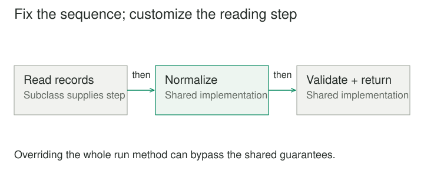

## Purpose and problem

Several importers perform the same sequence: open a source, read records, normalize them, validate them, write the result, and close resources. CSV and line-oriented text differ mainly in how records are read. Copying the entire workflow into each importer means every validation or cleanup fix must be repeated.

## Core idea

Template Method puts the stable sequence in a base implementation and exposes selected steps for subclasses to customize. The template operation controls the overall algorithm. Specialized methods provide the parts that genuinely vary.



## How it works

A base Importer might implement run and call read_records, normalize, validate, and write_result in a defined order. Some steps have a shared implementation. Others are abstract or overridable. Optional hooks can support behavior at specific points without requiring every subclass to implement them.

The inversion of control is important: the base algorithm calls the extension, rather than the extension reconstructing the algorithm. This lets a framework preserve invariants such as validation before writing and cleanup after either success or failure.

Whether the language can prevent overriding the template operation varies. A design may use a final method, a non-overridable boundary, or a documented convention. The invariant sequence needs a clear enforcement model rather than an assumption that subclasses will always behave.

## Worked example

### Importers that share correctness work

Suppose CsvImporter implements reading CSV records, while JsonLinesImporter implements reading one structured value per line. Both use the base normalization, validation, and output sequence. A new rule rejecting duplicate record identifiers changes the shared validation step.

Before the pattern, duplicate checks appear in separate importer workflows and can drift. Afterward, all importers participate in the same required check. The specialized reader remains responsible for format-specific parsing and errors.

Resource cleanup needs to surround the workflow correctly. If read_records raises an error, the base operation should still release the opened source according to its ownership contract. A hook called only at the successful end of run is not an adequate cleanup mechanism.

The step interface should also avoid hidden prerequisites. If normalize expects a subclass to set an internal field while reading, that dependency should be explicit. Passing records and returning normalized values can be clearer than relying on ambient mutable state between hooks.

### A small implementation

The base importer owns the sequence and the shared validation. Subclasses supply how records are read. Both are in-memory formats here, allowing the code to focus on the template without inventing a file lifecycle.

```python
from abc import ABC, abstractmethod


class Importer(ABC):
    def run(self, text):
        records = self.read_records(text)
        normalized = [record.strip() for record in records]
        if any(not record for record in normalized):
            raise ValueError("Empty records are not allowed")
        return normalized

    @abstractmethod
    def read_records(self, text):
        pass


class LineImporter(Importer):
    def read_records(self, text):
        return text.splitlines()


class SemicolonImporter(Importer):
    def read_records(self, text):
        return text.split(";")


print(LineImporter().run(" Alpha\nBeta "))
print(SemicolonImporter().run(" Alpha;Beta "))
# ['Alpha', 'Beta']
# ['Alpha', 'Beta']
```

Neither subclass repeats normalization or validation. The semicolon example is a deliberately tiny format, not a CSV parser. When imports use resources, the base workflow also needs a defined cleanup path on exceptions. Overriding the entire run method would bypass the shared sequence.

### A test harness with constrained variation

A performance harness prepares an environment, runs a workload, records measurements, and tears the environment down. Different benchmark subclasses supply setup details and the workload, while the base harness owns measurement boundaries and reporting.

This keeps each benchmark from timing a different portion of the operation accidentally. It also makes teardown behavior consistent when a workload fails.

Yet the skeleton must fit the benchmark family. If one benchmark needs repeated warm-up and another needs interleaved setup during execution, a rigid template may become misleading. Extra hooks added to accommodate every unusual case can make the base class harder to understand than separate explicit workflows.

The useful shared sequence is discovered from real commonality. It should not be imposed merely because several operations can be described with generic words such as prepare, run, and finish.

## When to use it

- Several processes share an invariant sequence with specific variation points.
- An inheritance-based framework needs constrained extension hooks.

Consider a simpler design when runtime composition fits the variation better than inheritance, or when subclasses must frequently bypass the fixed sequence.

## Tradeoffs and common mistakes

Template Method is useful in frameworks where subclassing is already an intentional extension mechanism and the process order is part of correctness. It can reduce duplication and give users a limited, understandable set of customization points.

Its cost is coupling between the base class and subclasses. Changes to hook timing, arguments, or assumptions can break extensions even when their public names stay the same. The hook contract is therefore part of the framework's API.

Protected mutable fields can increase that coupling. Subclasses may depend on internal implementation details and constrain future base-class changes. Narrow method contracts and explicit values often preserve a more stable extension boundary.

Another risk is an override that calls the base operation only under some conditions or skips required behavior. If preserving the sequence matters, exposing an unrestricted override of the whole operation weakens the design. Conversely, if subclasses repeatedly need to skip the sequence, the template may be the wrong abstraction.

Runtime variation is awkward when it requires changing an object's subclass. Composition can be a better fit when a user selects a parser or validator dynamically, or when several independent steps need interchangeable policies.

## Related patterns

[[factory-method|Factory Method]] often appears as a step within a template: the base workflow creates a collaborator through an overridable method. Factory Method focuses on object creation, while Template Method focuses on the overall sequence.

[[strategy|Strategy]] moves interchangeable behavior into a collaborator and can replace it through composition. Template Method customizes inherited behavior. A hybrid can keep a stable process while injecting a parser strategy, avoiding a subclass for every independent combination.

[[state|State]] delegates according to a lifecycle condition rather than using a fixed inherited algorithm skeleton. Both can organize conditional behavior, but they expose different forms of variation.

## Sources

Template Method is one of the 23 patterns in Gamma, Helm, Johnson, and Vlissides, [*Design Patterns: Elements of Reusable Object-Oriented Software*](https://www.informit.com/store/design-patterns-elements-of-reusable-object-oriented-9780201633610). The examples, code, and illustrations here are original educational explanations.
