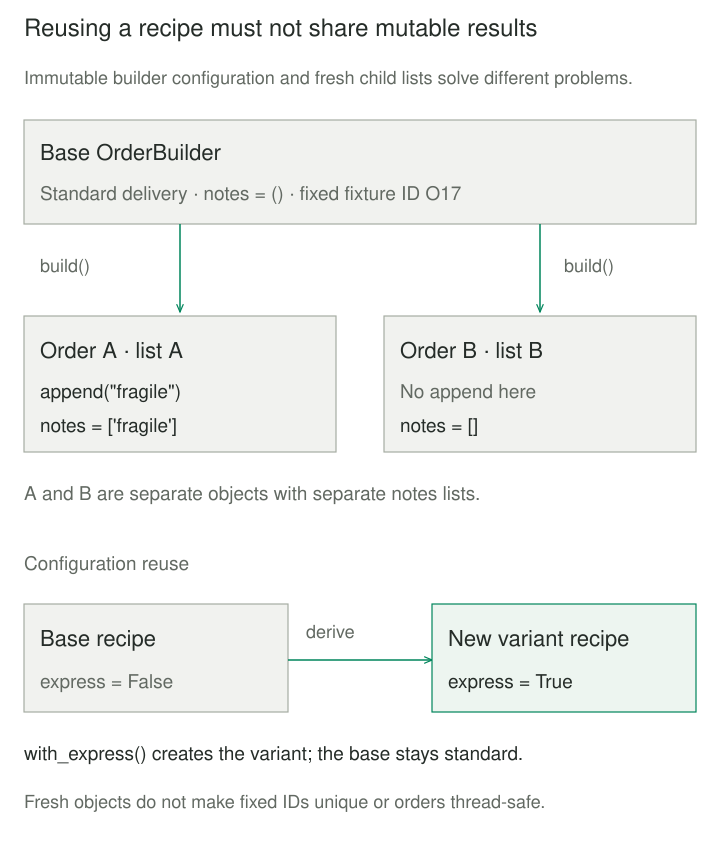

## Purpose and problem

A test checks whether an order qualifies for free delivery. Before reaching the assertion, it constructs a customer, chooses identifiers, fills address fields, supplies delivery options, and creates an empty notes list. Another test copies that setup and changes only the subtotal. When an order gains a required field, dozens of tests need editing even though their delivery scenarios have not changed.

The setup must produce usable objects, but the test also needs to communicate what makes this case different. Repeating every constructor argument hides that distinction. Sharing one mutable order reduces duplication while letting one test's changes affect another. A useful fixture mechanism must reduce construction noise without concealing the condition under test.

## Core idea

**Start with a usable example; make the important difference explicit.** A Test Data Builder holds defaults, accepts selected changes, and constructs the real input object. Each test describes its scenario through those changes rather than restating incidental construction details.

The established name appears in Freeman and Pryce's *Growing Object-Oriented Software, Guided by Tests*, Chapter 22. [Pryce's own implementation](https://github.com/npryce/make-it-easy) shows defaults, selected properties, fresh construction, and variations derived from a common builder. A fluent method chain is one interface choice; a small function with named overrides can express the same intent.


## How it works

### Separate the recipe from the object

The **test** chooses relevant inputs and owns assertions. The **builder** owns default construction choices and how overrides are applied. The **domain object or input validator** still owns production invariants. The **code under test** decides the result. Keeping those responsibilities separate prevents a builder from calculating the same answer that a test then congratulates it for producing.

Defaults should be deterministic and suitable for the builder's stated context. They are not universal business truths. A builder for a normal domestic order can choose a country and delivery mode; a test about either property should specify it explicitly. When two fields must agree, composing nested builders can make the relationship visible. Do not silently change an explicit override to make construction succeed.

Reuse needs an ownership rule. A mutable builder may be convenient if each test gets a fresh instance. An immutable builder can instead return a modified recipe while preserving its starting point. Neither approach automatically protects mutable children: `build()` must create independent mutable collections, or deliberately share only values that cannot change. Copying the outer object alone is insufficient.

Keep construction and persistence distinguishable. Building an order need not insert it into a database, reserve inventory, or open connections. If a test explicitly persists the result, its fixture owns cleanup and identifier allocation. Fixed identifiers that are harmless in separate in-memory objects can collide in a shared database or parallel test run.

## Worked example

### Make the delivery boundary readable

The original setup repeats six constructor arguments to vary one number. Here a builder supplies those details while each delivery test chooses its subtotal. This complete Python 3 program uses only the standard library; save it as `test_data_builder.py` and run `python3 test_data_builder.py`.

Amounts are integer USD cents, with types validated upstream. The invented policy charges 500 cents for standard delivery below 5000 cents, zero from 5000 cents, and 1200 cents for express or non-US delivery. Construction rejects negative subtotals.

```python
from dataclasses import dataclass, replace


@dataclass
class Order:
    order_id: str
    customer_id: str
    country: str
    subtotal_cents: int
    express: bool
    notes: list[str]

    def __post_init__(self):
        if self.subtotal_cents < 0:
            raise ValueError("negative subtotal")


def delivery_fee(order):
    if order.express or order.country != "US":
        return 1200
    return 0 if order.subtotal_cents >= 5000 else 500


@dataclass(frozen=True)
class OrderBuilder:
    order_id: str = "O17"
    customer_id: str = "C7"
    country: str = "US"
    subtotal_cents: int = 1000
    express: bool = False
    notes: tuple[str, ...] = ()

    def with_subtotal(self, cents):
        return replace(self, subtotal_cents=cents)

    def with_express(self):
        return replace(self, express=True)

    def with_note(self, note):
        return replace(self, notes=self.notes + (note,))

    def build(self):
        return Order(
            self.order_id, self.customer_id, self.country,
            self.subtotal_cents, self.express, list(self.notes)
        )


if __name__ == "__main__":
    base = OrderBuilder()
    below = base.with_subtotal(4999).build()
    boundary = base.with_subtotal(5000).build()
    express = base.with_subtotal(5000).with_express().build()
    fees = [delivery_fee(o) for o in (below, boundary, express)]
    assert fees == [500, 0, 1200]
    print("fees:", fees, "USD cents")

    left, right = base.build(), base.build()
    left.notes.append("fragile")
    assert right.notes == [] and base.notes == ()
    assert base.with_note("gift").build().notes == ["gift"]
    print("notes:", left.notes, right.notes)

    try:
        base.with_subtotal(-1).build()
    except ValueError:
        print("negative subtotal rejected")
    else:
        raise AssertionError("construction should fail")
```

The output is `fees: [500, 0, 1200] USD cents`, then `notes: ['fragile'] []`, then `negative subtotal rejected`. The 4999/5000 pair exposes the inclusive threshold. Express stays chargeable at that threshold. The real `delivery_fee` runs on real `Order` instances; there is no replacement delivery implementation.

`replace` creates a new builder, so configuring express delivery does not alter `base`. Each build turns the immutable notes tuple into a fresh list. This is sufficient because the notes contain immutable strings; it is not a general deep-copy strategy. Negative data reaches the real constructor and fails there. A malformed transport payload needing different validation would call for a payload builder rather than bypassing this domain constructor.

A second context is an event-import request containing a nested organizer and venue. Their builders can compose to provide unrelated fields while a validation test explicitly supplies an empty event title. Preserve that invalid value: automatically filling it would erase the scenario the test intends to exercise.



## When to use it

Use a builder when many tests repeat substantial construction, differ in a few meaningful values, or need related object graphs. It is especially useful when constructor changes repeatedly obscure otherwise stable scenarios. A named starting recipe can also make a recurring context recognizable without adding a factory method for every possible combination.

For a two-field value, a direct constructor with named arguments is usually clearer. Introduce a builder when it improves the tests' communication, not simply because the suite contains objects. A handful of fixed fixtures may also be sufficient when variation is rare.

## Tradeoffs and common mistakes

**Hidden defaults become hidden dependencies.** A test that relies on the default country or subtotal can change meaning when those defaults change. Make a value explicit whenever the assertion depends on it, and review affected tests when changing a shared recipe.

**The builder can become another application.** Avoid duplicating pricing, authorization, or validation rules inside it. Prefer real construction paths and small, transparent overrides. A test about rejected input must reach the relevant rejection point; silently repairing input proves little.

**Fresh objects do not imply complete isolation.** Nested lists, global counters, clocks, files, and stored records can still couple tests. Random defaults make failures harder to reproduce unless controlled and recorded. This example performs no I/O and allocates fresh lists, but it does not establish database isolation, thread safety for mutable orders, or globally unique identities.

## Related patterns

[[builder|Builder]] separates construction from the result. Test Data Builder specializes that idea around default test fixtures and scenario-specific overrides; it does not require the GoF director structure.

[[test-double|Test Double]] replaces a collaborator's behavior for testing. A data builder normally creates real input objects and need not substitute any behavior.

[[prototype|Prototype]] creates from an existing exemplar. A builder holds a construction recipe; copying it or a prototype still requires explicit decisions about mutable children and identity.

## Sources

- Steve Freeman and Nat Pryce, [*Growing Object-Oriented Software, Guided by Tests*](https://www.informit.com/store/growing-object-oriented-software-guided-by-tests-9780321503626), Chapter 22: established Test Data Builder terminology and complex test data construction.
- Nat Pryce, [Make It Easy](https://github.com/npryce/make-it-easy): the pattern author's implementation with defaults, overrides, construction, and derived variants.
- Martin Fowler, [Object Mother](https://martinfowler.com/bliki/ObjectMother.html): named standard fixture factories and coupling to canned values; a related approach, not an alias for this pattern.
- [Python `dataclasses` documentation](https://docs.python.org/3/library/dataclasses.html): frozen dataclasses, `replace`, and construction through `__init__`/`__post_init__`.
- Martin Fowler, [Eradicating Non-Determinism in Tests](https://martinfowler.com/articles/nonDeterminism.html): isolation, shared state, time, and resource ownership.

The delivery policy, order model, event-import comparison, code, and illustrations are original teaching examples.
