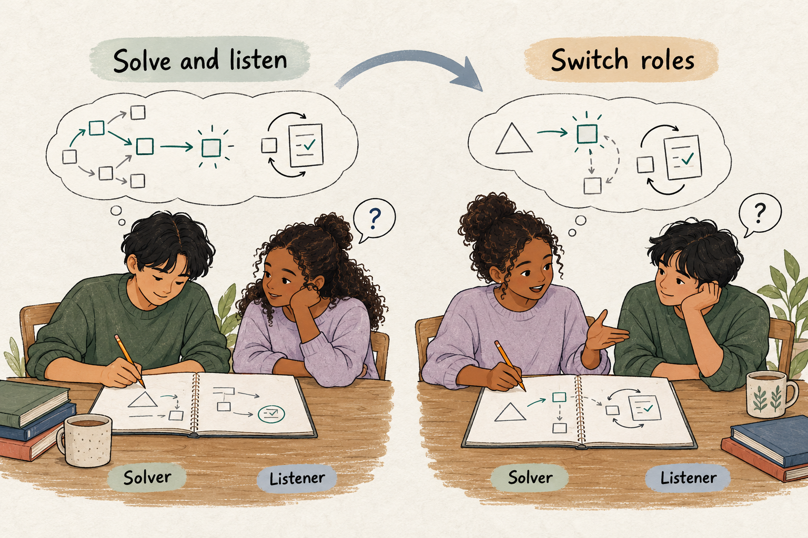

## Make the decisions behind a solution available for examination

Two learners hand in the same answer. One understood the problem, selected a suitable approach, and checked the result. The other followed a familiar procedure that happened to work.

Their written solutions look almost identical.

In another pair, both answers are wrong, but for different reasons. One learner misunderstood the task; the other understood it and made a calculation error. The teacher needs different responses to those difficulties, yet the finished work reveals little about either.

Think-Aloud Pair Problem Solving makes some of that hidden work audible. One learner solves while explaining their thinking. A partner listens, follows the reasoning, and offers questions or feedback. They exchange roles for another problem.

The central idea is to give solving and examining the reasoning distinct, complementary responsibilities.

## Two roles with different work to do

The **solver** works through the problem aloud: interpreting the task, identifying relevant information, choosing an approach, noticing uncertainty, and checking the result.

The **listener** follows that account closely enough to identify an unclear step, unsupported assumption, or missing check. Listening is an intellectual task. It requires understanding how the solver’s decisions connect.

[Concordia University’s teaching guidance](https://www.concordia.ca/ctl/resources/teaching-pedagogy/active-learning/think-aloud-pair-problem-solving.html) describes the method as a turn-based exchange in which learners explain solutions and reasoning, receive feedback, and reverse roles for a new problem.

The roles need boundaries. If the listener supplies each next step, the activity becomes guided completion. If the listener merely waits for an answer, an opportunity to examine reasoning is lost.

The solver should retain responsibility for the attempt while the listener helps make it understandable.

## Explain choices, not just actions

“I’m dividing by three” describes an action.

“There are three readings, and I’m finding the mean, so I’m dividing their total by three” explains a decision.

Useful thinking aloud includes what the learner believes the problem requires, why a particular operation or strategy fits, and what would make them reconsider. Uncertainty belongs in the account: “I’m not sure whether this value should be included” gives the listener something important to follow.

The teacher can model this briefly before pairs begin. A demonstration should include an ordinary hesitation or check, rather than present fluent expertise as the expected standard.

Solvers also need permission to pause. Continuous speech is not the objective. The aim is to make consequential decisions available for examination.

## A classroom example: the missing zero

Imagine a beginner programming class. Learners have studied loops, conditions, and arithmetic means. Their task is to diagnose a short routine intended to calculate the average of all supplied numeric temperature readings.

For the readings 0, 4, and 8 degrees, the routine returns 6. The expected mean is 4.

Leah takes the solver role. Sam listens.

Leah begins: “The result is too high. I’ll check the division first, because the average is calculated at the end.”

She traces the final calculation aloud. The total is 12, but the routine divides by two.

“So the division is doing what it was told,” she says. “The count must be wrong.”

Sam waits until she reaches that pause, then asks, “How does the routine decide which readings to count?”

Leah examines the condition. It includes a reading only when its value is greater than zero.

“I thought that was checking whether there was a reading,” she says. “But zero is a temperature. This condition excludes it.”

She proposes counting every supplied reading. Before changing the routine, she predicts that the count will become three and the result will become four.

Sam then asks, “Would that condition also exclude anything else?”

Leah notices that negative temperatures would be omitted too. She selects another test containing a negative reading and explains what result she expects.

The teacher hears more than a diagnosis. Leah initially suspected the arithmetic, traced the values, revised her suspicion, identified an assumption about valid data, and tested its consequences.

For the next problem, Sam becomes the solver. Leah now has to follow someone else’s decisions without taking control of the solution.

## Teach the listener’s craft

Listeners often need more guidance than solvers. Knowing an answer does not automatically make someone helpful at examining another person’s reasoning.

Useful questions stay close to the attempt: “What does that value represent?” “What makes this approach fit?” “How could you check that?” A listener can also summarize a step and ask whether they understood it correctly.

Feedback should identify a specific issue. “I followed your calculation, but I still don’t understand why that case is excluded” gives the solver something actionable.

Timing matters. Constant interruption can fragment the attempt. Waiting until a natural pause often allows the solver to complete a thought or notice a problem independently. [Berkeley’s guidance](https://teaching.berkeley.edu/teaching-strategies/teaching-your-course/active-learning) allows supportive input during the explanation or afterward, depending on the activity’s design.

## What thinking aloud can reveal

The method offers evidence about expressed reasoning. It does not provide a complete recording of everything happening in a learner’s mind.

Research also distinguishes simply voicing current thoughts from being asked to generate explanations. A meta-analysis of 94 studies found no average accuracy effect for concurrent thinking aloud under the procedures examined, while explanatory verbalization affected performance. Verbal reporting generally increased completion time. [Fox, Ericsson, and Best, 2011](https://pubmed.ncbi.nlm.nih.gov/21090887/)

That distinction matters here. Classroom partners ask questions and invite explanations, so the activity may change how the solver approaches the problem. Its educational purpose includes helping reasoning develop.

The meta-analysis is evidence about verbal reporting procedures, not direct proof that this paired teaching method improves long-term learning.

## Choose manageable problems and useful adaptations

The method suits tasks with decisions worth examining: diagnosing an error, interpreting evidence, selecting a mathematical approach, or revising an argument.

Learners need enough background to attempt the task. A problem far beyond their knowledge can produce speculation; a fully automatic task may offer little to discuss.

Use reasonably comparable problems when roles switch. Otherwise, one learner may receive substantially more opportunity to practise.

Diagrams, annotations, and shared documents can support the spoken account. Online pairs can examine the same workspace. Where simultaneous speaking and solving becomes burdensome, learners can explain at meaningful checkpoints.

## Watch for performance replacing reasoning

Common mistakes include polished explanations prepared after the solution, listeners taking over, and rewarding fluency as though it established understanding.

A confident account still needs checking. A hesitant account may contain careful reasoning. The teacher should attend to decisions, evidence, and verification, while allowing different communication styles.

**Worked Examples** provide a model to examine. **[[peer-instruction|Peer Instruction]]** compares reasoning behind different answers. **[[think-pair-share|Think–Pair–Share]]** begins with independent responses before discussion.

Think-Aloud Pair Problem Solving is especially useful when the route through a problem matters: where the learner started, what they assumed, and what prompted them to change direction.
