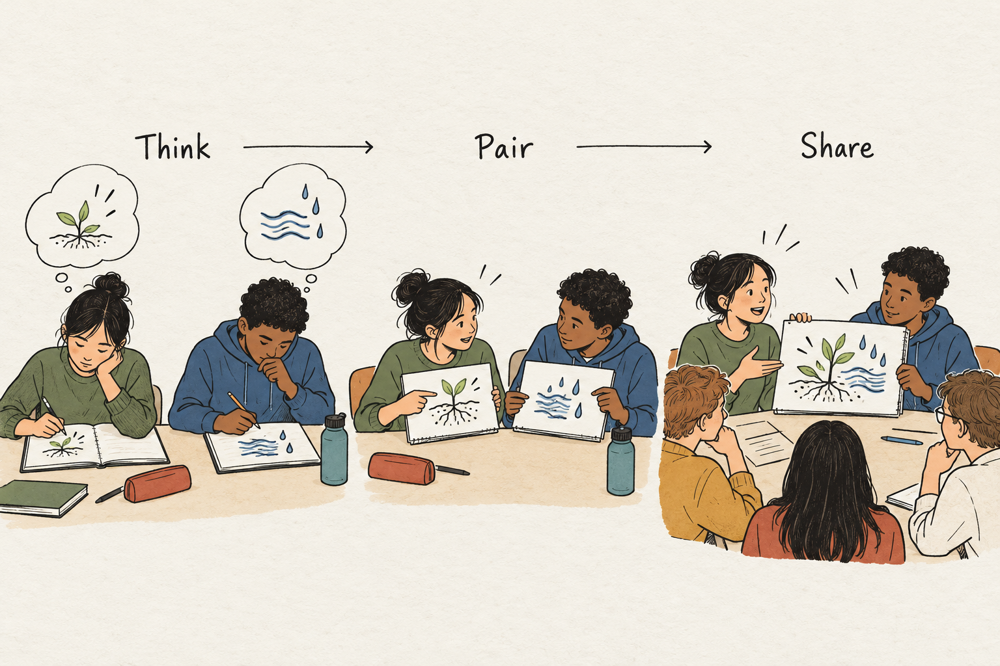

## Give ideas time to form

The teacher asks a question. Three hands rise almost immediately. Several other learners look down at their notes. One has noticed something interesting but cannot yet put it into words. Another is still deciding what the question means. Before either is ready, someone answers and the discussion moves on.

The teacher has heard a response, but most learners have had little opportunity to develop one.

Think–Pair–Share changes the timing of that exchange. Learners first consider a question independently, then discuss their thinking with a partner, and finally contribute to a wider conversation. Its central move is simple: give everyone an opportunity to form an idea before asking them to discuss it publicly.

## Three stages, three different jobs

During **Think**, learners develop an initial response. They might write a sentence, identify evidence, sketch a relationship, or make a prediction. The important feature is protected individual thinking time. Announcing a question and immediately inviting conversation skips this work.

During **Pair**, learners explain their responses to one another. A useful pair task asks them to compare reasons, identify a disagreement, or improve an explanation. “Discuss your answers” can work, but a more precise instruction gives the conversation direction: “Find one point you agree on and one you interpret differently.”

During **Share**, selected ideas become material for the wider group. The teacher connects contributions, examines disagreements, and addresses misunderstandings. This stage needs a purpose beyond reporting that discussion happened.

[Carnegie Mellon’s teaching guidance](https://www.cmu.edu/teaching/designteach/inclusiveexcellence/activelearning/index.html) describes this progression and emphasizes clear instructions, opportunities to prepare, and clarification during the final discussion.

## Why the order matters

When conversation begins immediately, one person’s answer can become the starting point for everyone else. Individual thinking creates an alternative: each learner brings something of their own to the exchange.

The pair stage then creates an opportunity to examine that thinking. Explaining a claim may expose an unsupported step. Hearing another interpretation may reveal an assumption. These are plausible mechanisms, rather than guaranteed outcomes of putting two people together.

Research on a closely related approach provides more specific evidence. In an undergraduate genetics course, Smith and colleagues found that peer discussion supported performance on a subsequent, similar conceptual question answered individually. Their results suggest that discussion can develop understanding rather than merely spread an answer. This was a study of concept-question peer instruction, however, not proof that every Think–Pair–Share activity produces the same benefit. [Smith et al., 2009](https://pubmed.ncbi.nlm.nih.gov/19119232/)

## A classroom example: what can one letter tell us?

Imagine a history class examining a fictional letter from a factory worker to a manager. The letter praises newly introduced workplace rules. Learners already know that the rules followed a dispute over working conditions.

The teacher asks:

*“How convincing is this letter as evidence that workers supported the new rules? Identify one strength and one limitation.”*

Learners have two minutes to write. The question remains visible.

Maya writes that the letter is convincing because its author experienced the rules firsthand. Daniel writes that it is weak evidence because a worker might avoid criticizing a manager.

The pair instruction gives their disagreement a task:

*“Compare your reasons. Then write one sentence explaining what the letter can establish and what it cannot.”*

Maya asks whether Daniel thinks the worker must be lying. Daniel realizes that his objection goes further than the evidence supports. He does not know that the author was dishonest; he knows that the intended audience could have influenced the account.

Maya also revises her position. Firsthand experience makes the letter relevant, but one worker’s statement cannot establish what all workers believed.

Their joint sentence reads: “The letter records one worker expressing support, but its audience and limited perspective make it insufficient evidence of general support.”

While pairs talk, the teacher listens for useful distinctions. With their agreement, she invites Maya and Daniel to explain theirs. Another pair argues that even a carefully worded letter reveals something about relations between workers and management.

The teacher connects these contributions: a source can be valuable while supporting a narrower conclusion than first assumed.

The pair has done more than rehearse an answer. Its members have examined and qualified their claims.

## Choose a question worth discussing

Think–Pair–Share is especially useful when learners have enough background to begin and the task leaves meaningful reasoning to do.

Comparing interpretations, evaluating evidence, predicting an outcome, and explaining a choice all offer material for discussion. A question with one correct answer can also work if learners might reach competing conclusions for understandable reasons.

A simple factual question may need only a brief retrieval response. An unfamiliar problem may require explanation or a worked example first. The format cannot supply missing knowledge by itself.

The question should also fit the available time. A broad invitation such as “Discuss the causes of the revolution” may produce less focused thinking than asking which of two explanations a particular source supports.

## Make sharing purposeful

The whole-group stage deserves particular care. Hearing from a few volunteers does not reveal what everyone understood.

Cooper, Schinske, and Tanner’s examination of Think–Pair–Share questions assumptions about the benefits of public sharing. It highlights possible participation inequities and anxiety, and considers alternatives. This is a scholarly analysis of evidence and practice, rather than a controlled test establishing one best format. [Cooper et al., 2021](https://pmc.ncbi.nlm.nih.gov/articles/PMC8108495/)

Depending on the goal, the teacher might invite contrasting responses, collect short written answers, or summarize themes heard while circulating. Public sharing should serve the learning task; every pair need not report.

## Adapt the format without losing its purpose

Writing can help preserve an initial thought, but drawing, annotating, or recording an idea may suit the task better. In an online class, private notes can precede a breakout conversation, followed by a shared response.

Where one partner tends to dominate, give each person an initial turn to explain before opening the exchange. Avoid making the pair’s objective automatic agreement. Sometimes its most useful contribution is a clearly stated disagreement.

Do not rush the thinking stage simply because a few learners finish quickly. Equally, avoid extending every stage mechanically. Allow time according to the intellectual work required.

## Know its limits and its neighbors

A lively room is not sufficient evidence of learning. Partners can reinforce a misconception or accept the more confident speaker’s account. The teacher still needs to examine responses and provide clarification.

Think–Pair–Share also does not replace sustained inquiry, extended writing, or explicit teaching. It provides a structure within those activities.

**[[peer-instruction|Peer Instruction]]** adds an individual answer before and after discussion. **[[snowball-groups|Snowball Groups]]** extend the conversation into progressively larger groups. **[[jigsaw-learning|Jigsaw Learning]]** gives participants different material to prepare and teach.

Think–Pair–Share suits a particular moment: everyone encounters the same question, but each learner needs room to develop a response before entering the conversation.
