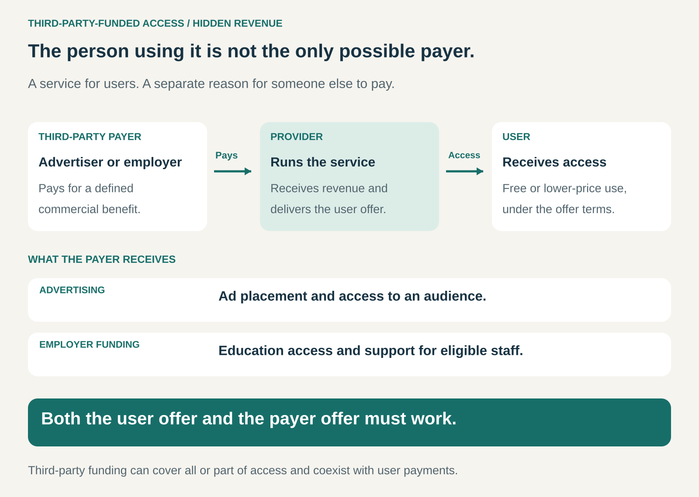

## What it is for

A useful service may attract many people who cannot—or will not—pay enough to support it. Another organization may still have a reason to finance their access.

An advertiser wants to reach the audience. An employer wants employees to develop skills. A sponsor wants a service available to a particular community.

Third-Party-Funded Access separates the person using an offering from the organization paying for some or all of it.

It is useful when access creates value for someone beyond the immediate user, and that value can support a dependable source of revenue.

## The core idea

Provide users with free or subsidized access while earning revenue from another party that benefits from the arrangement.

There are three roles:

- **The user** receives a product, service, or experience.
- **The provider** creates and operates the offering.
- **The payer** funds access in exchange for a defined benefit.

Business Model Navigator calls this **Hidden Revenue**, describing models in which third-party income supports a free or low-priced user offering. Advertising is a prominent example. [Business Model Navigator: Hidden Revenue](https://www.businessmodelnavigator.com/pattern?id=21)

“Hidden” refers to revenue outside the user’s direct payment. The funding relationship can be openly explained.

The provider needs two convincing offers: something users value and something payers consider worth financing.

## How it works

The provider identifies a user need and a separate reason for another organization to pay.

In an advertising model, users receive content or a service. Advertisers purchase placements, audience reach, or responses such as clicks.

In an employer-funded model, employees receive access to education or another benefit. The employer purchases that access to support its workforce.

In a sponsorship model, an organization finances an offering in exchange for recognition, association, or reaching an intended community.

These arrangements can cover the entire user price or only part of it. They can also coexist with subscriptions, purchases, and other revenue sources.

The central design question is what the payer receives—and whether providing it remains compatible with a worthwhile user experience.

## Why it works

**It lowers the financial barrier to participation.** People can use a service without paying its full cost themselves. This can broaden access and increase use.

**It connects payment to a different source of value.** A learner values education personally; an employer may value a more capable workforce. Those benefits can support different willingness to pay.

**It can make an audience commercially valuable.** A service that attracts relevant users offers advertisers an opportunity to reach prospective customers.

**It can coordinate spending for a group.** One organization can purchase access for many eligible users, reducing the need to acquire and bill each person separately.

The arrangement succeeds when the payer’s benefit is sufficiently valuable and the provider can deliver it without eroding the service people came to use.

## Famous examples

### Google Search: advertisers fund access to information

People can use Google Search without paying a search subscription. Google sells advertising placements that help businesses reach potential customers.

Google explains that advertising helps finance free access to products including Search, Maps, and Gmail. Its advertising arrangements include payment for placements or performance, such as a click. [Google: How our business works](https://about.google/company-info/how-our-business-works/)

The user and advertiser seek different benefits. One wants useful information; the other wants an opportunity to reach someone who may become a customer.

The provider must make those benefits work together. A service that loses users’ confidence also weakens the audience advertisers want to reach.

### JCDecaux: advertising finances physical amenities

JCDecaux demonstrates that this pattern extends beyond digital services.

Its street-furniture model uses advertising revenue to finance amenities such as bus shelters, including their installation and maintenance. Advertisers purchase visibility in public locations, while people benefit from the infrastructure. [JCDecaux’s explanation of its activities](https://www.jcdecaux.com/investors/company-information)

The company traces this model to its advertising-funded bus shelter introduced in Lyon in 1964. [JCDecaux’s history](https://www.jcdecaux.co.uk/our-vision/our-story)

The passenger receives shelter; the advertiser receives exposure. Municipalities also participate through the arrangements governing public space and service provision.

This illustrates how third-party funding can support a tangible service with continuing operating obligations.

### Walmart’s Live Better U: an employer funds education

Walmart’s Live Better U supports eligible employees’ access to selected education programs with little or no out-of-pocket cost for tuition and required books. Walmart states that applicable federal or state grant aid is applied first, with the program covering the remaining eligible costs. [Walmart: Live Better U](https://corporate.walmart.com/about/working-at-walmart/live-better-u)

From the education provider’s perspective, the learner and funding organization occupy different roles. Employees receive education; Walmart supports access as part of its investment in workforce development.

This is a broader application of the same separation between user and payer. The employer is purchasing a benefit for an eligible group, rather than buying advertising around a public service.

## The economics

Free access still has a cost.

The provider must cover delivery, infrastructure, support, content or product development, and the work required to attract and retain payers.

A useful relationship is:

**Third-party revenue + user revenue − delivery and operating costs.**

For advertising, revenue depends on factors such as the audience reached, available placements, advertiser demand, and campaign performance. A large audience alone does not establish a viable business.

Consider a hypothetical service with 10,000 monthly active users and variable delivery costs of $0.50 per user. Serving them costs $5,000 that month. If third-party revenue is $3,000, the service has a $2,000 shortfall before fixed costs.

Growth improves the economics only if revenue and costs develop favorably.

Institutional funding has a different challenge: contract income must cover the promised access and service level. A fixed-price agreement can become expensive if actual usage substantially exceeds expectations.

Payment timing matters too. A provider may incur delivery costs before receiving sponsor or advertiser payments.

## Useful when

This pattern is particularly useful when:

- Users value the offering but direct payment would substantially restrict access.
- Another organization benefits from reaching or supporting those users.
- The payer’s benefit can be clearly defined and demonstrated.
- Serving additional users has manageable costs.
- The provider can maintain trust while meeting payer expectations.

It is less suitable when prospective payers have little reason to finance access, delivery costs exceed plausible funding, or payer demands compromise the offering’s main value.

## Common mistakes and limits

**Treating an audience as a revenue model.** User growth creates an opportunity to earn revenue. It does not establish who will pay, how much, or for how long.

**Confusing free trials with third-party funding.** A service offered free in anticipation of later user payments has different economics. The defining feature here is another party funding access.

**Letting payer objectives overwhelm user value.** Excessive advertising, intrusive promotion, or sponsor-driven priorities can make the offering less useful and drive people away.

**Obscuring paid influence.** Users need to understand when placements, recommendations, or content reflect a commercial relationship. Clear presentation helps preserve the trust on which the service depends.

**Assuming advertising requires one particular data model.** Advertising can be based on location, context, broad audiences, or targeting. Data collection and sharing are separate design choices that should be explained clearly.

**Depending on a single payer.** Losing a major sponsor, employer contract, or advertising partner can threaten access for many users at once.

**Underestimating the work of serving payers.** Sales, account management, reporting, and contract renewal form a second set of operating responsibilities.

## Related patterns

[[freemium|Freemium]] — Freemium supports a free offering through paid upgrades. Third-party funding can operate alongside it, adding revenue from organizations with a different role.

**Two-Sided Market** — Advertising-funded services often connect users and advertisers. Third-party funding describes who finances access; the marketplace structure describes how the participating groups interact.

[[affiliate-commerce|Affiliation]] — Referral commissions can help finance a service when another business pays for customers or completed transactions.

[[blended-value|Blended Value]] — Sponsors or institutions may fund access for social outcomes alongside commercial benefits. The provider needs to demonstrate the outcomes its funders value.
