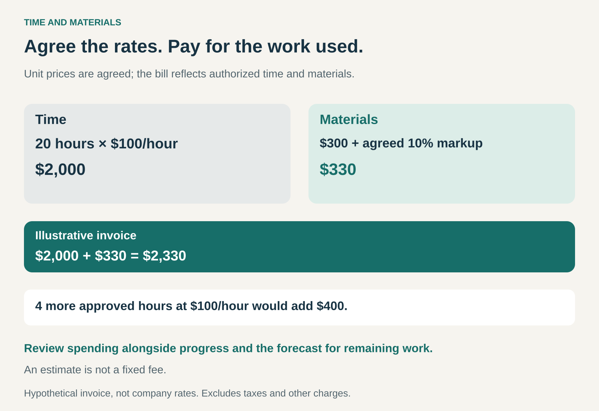

## What it is for

Use Time and Materials when work needs to begin before its full scope or effort can be estimated confidently.

A repair technician may need to investigate before knowing which components require replacement. A software team may uncover unexpected dependencies while modernizing an old system. An engineering assignment may evolve as site conditions become clearer.

Trying to fix the entire price beforehand can lead to inflated estimates, repeated negotiations, or disagreement about what was included.

Time and Materials provides another basis for working together: agree the rates and charging rules, then pay for the authorized effort and resources actually used.

## The core idea

The customer’s bill follows the inputs used to perform the work:

**Billable time × agreed rates + chargeable materials and expenses.**

Different people or activities can have different rates. Materials might be charged at cost, at an agreed markup, or according to a price schedule. Travel, equipment, and other expenses depend on the arrangement.

For knowledge work, physical materials may be negligible. The main charge can be specialist hours or days, with approved expenses added separately.

The important distinction is between an agreed **unit price** and a fixed **total price**. Knowing the hourly rate does not establish how many hours the assignment will require.

## Why it works

Some work becomes understandable only through doing it.

Investigation reveals the problem. Early implementation exposes dependencies. Customer feedback changes which features matter. Time and Materials allows the commercial arrangement to accommodate that learning.

It can also reduce the need for a supplier to price every uncertainty into an initial quotation. The customer accepts more uncertainty about total expenditure in exchange for flexibility over the work.

The supplier gains protection against underestimating the effort required, within the agreed charging rules. It still needs to deliver competent work, manage its costs, and justify its invoices.

The model works best when flexibility is accompanied by visibility: both parties can see what has been done, what it cost, and what remains.

## Famous examples

### Accenture: one pricing model within a broader services business

Accenture’s annual report identifies Time and Materials alongside fixed-price, transaction-based, and mixed-fee contracts across its consulting and managed services business. It also describes routine contract modifications when requirements, specifications, or duration change. [Accenture’s 2025 annual report](https://www.sec.gov/Archives/edgar/data/1467373/000146737325000217/acn-20250831.htm)

This illustrates how a large services company can use different pricing arrangements for different assignments.

Time and Materials provides a basis for charging specialist effort. Other parts of an engagement can use different measures. The example supports treating the pattern as a choice about an engagement, rather than a label for everything a company sells.

### IBM: different specialists, different rates

A publicly available IBM statement of work for Michigan, covering a planned 2023 QRadar engagement, sets out estimated hours and hourly rates for an engagement manager, senior consultant, and consultant. It separately prices instructor-led training at a fixed fee. [IBM’s Michigan contract documents, page 156](https://www.michigan.gov/dtmb/-/media/Project/Websites/dtmb/Procurement/Contracts/MiDEAL-Media/005/071B1300071.pdf?hash=22620170780805F029F9D509939E5582&rev=063a0f22f87a401bae0508c048435f8b#page=156)

The document makes the mechanism visible: the estimated time charge is built from particular roles, quantities, and rates.

It also demonstrates a useful hybrid. Consulting activities can use Time and Materials while a more clearly defined training component has a fixed price. One project does not need a single billing method for every component.

### Jacobs: ongoing engineering capacity

Public council records from Tucker, Georgia, describe a Time and Materials arrangement with Jacobs for three embedded roles: a city engineer, an engineer, and a senior field services superintendent. [Tucker council records](https://pub-tuckerga.escribemeetings.com/filestream.ashx?DocumentId=13503)

Here, the arrangement concerns professional capacity supporting a continuing stream of engineering work.

It illustrates another application of the pattern: customers can obtain access to specialist effort as requirements arise, rather than defining every task as a separate fixed-price project.

The billing basis still needs boundaries around the work, authorized staffing, and expenditure.

### What the customer and supplier are taking on

Time and Materials places more of the uncertainty about the quantity of work with the customer.

If an authorized task takes longer, the customer will generally pay more under the agreed terms. If it takes less time, the time charge can be lower.

The supplier still carries risks. Agreed rates may become inadequate as employment costs rise. Some work may be disputed or unbillable. Available staff may spend time between assignments, and invoices may be paid well after wages and expenses fall due.

Responsibility for quality also remains. A time-based charging method does not automatically make every hour chargeable or remove commitments about deliverables and performance.

The arrangement needs to distinguish legitimate additional work from avoidable rework and unauthorized activity.

### Estimates, budgets, and caps

An estimate describes expected expenditure based on current information. It can change as the work becomes clearer.

A budget establishes how much the customer is prepared to spend. A contractual ceiling can limit what may be charged without further authorization.

Those concepts need to be distinguished from a promise to complete a defined result for a fixed price.

A capped Time and Materials arrangement should explain what happens as the limit approaches. Work might pause, priorities might change, or additional expenditure might require approval. The agreement determines whether the supplier has any obligation to continue within the existing amount.

Useful reporting connects spending to progress. “We have used 70 percent of the budget” means little without knowing what has been completed and what the remaining work is likely to require.

### The economics behind the hourly rate

An hourly charge is not the worker’s wage.

It may need to cover benefits, equipment, supervision, training, administration, sales effort, time between assignments, and profit.

For the supplier, profitability depends on both the rate and how much paid working time becomes billable. Material markups may cover procurement, handling, or other costs; they should be understood rather than assumed.

The model also creates an incentive tension. Completing work faster can reduce billable hours, even when it improves the customer’s result.

A sustainable relationship therefore needs reasons to reward efficiency: trust, repeat business, appropriate rates, or an agreed way to share productivity gains.

## Useful when

Time and Materials is especially useful for investigation, evolving requirements, unfamiliar systems, and continuing specialist support.

It fits situations where the customer can review progress, make timely decisions, and adjust priorities as information emerges.

It is less attractive when the work is highly repeatable, the result can be specified confidently, or the customer needs strong certainty about total expenditure while having little ability to oversee the assignment.

## Common mistakes and limits

**Starting without a defined purpose.** Uncertainty about effort does not remove the need for an objective and boundaries.

**Treating an estimate as a guaranteed price.** Different expectations can turn an otherwise reasonable invoice into a dispute.

**Tracking hours without tracking progress.** Detailed timesheets cannot establish whether the work is producing useful results.

**Leaving charging rules unclear.** Travel, overtime, procurement, expenses, and materials markups can materially change the bill.

**Assuming flexibility means unlimited authorization.** Changes still need decisions about priority, spending, and responsibility.

## Related patterns

- **Fixed Price:** agrees a total price for defined work, placing more estimation risk with the supplier.
- [[outcome-based-pricing|Outcome-Based Pricing:]] connects payment to agreed results rather than primarily to effort.
- [[retainer|Retainer:]] can reserve continuing access or capacity; additional work may still be billed through Time and Materials.
- **Cost Plus:** reimburses defined costs and adds a fee or markup. Time and Materials commonly uses agreed labor rates that already include overhead and profit.
