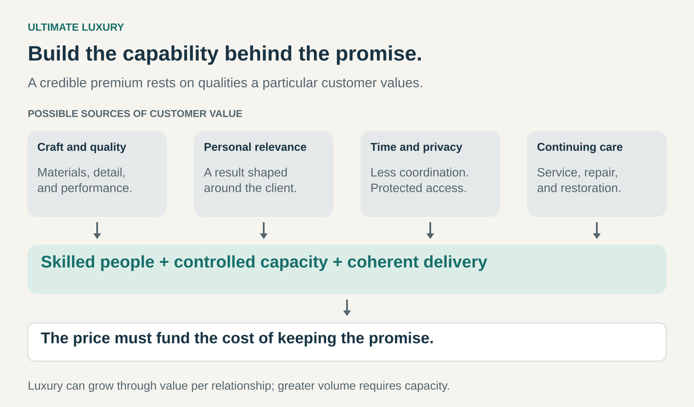

## What it is for

Use this pattern when a particular group of customers is willing and able to pay substantially for exceptional quality, personal attention, distinctive experiences, or access that is difficult to obtain elsewhere. It helps a business organize its offering around demanding preferences and a high level of service, with prices that can support the capabilities required to deliver them.

The opportunity is to create something customers consider unusually valuable—and build an operation capable of keeping that promise.

## The core idea

Imagine two businesses arranging a special journey.

One offers a well-designed itinerary with comfortable accommodation and dependable transport. The other develops the trip around one household’s interests, coordinates the transitions, arranges private experiences, and remains available when plans change.

The second business takes on a different obligation. It must understand the customer in greater depth, coordinate more details, and preserve capacity for requests that cannot be predicted completely.

Ultimate Luxury makes those additional commitments central to the offer. Customers may be purchasing exceptional workmanship, personal expression, privacy, recognition, or freedom from coordination. The relevant combination depends on the audience.

The [Business Model Navigator describes Ultimate Luxury](https://www.businessmodelnavigator.com/explore) as an approach centered on customers at the upper end of the market, supported by exceptional quality or exclusive privileges. Its usefulness as a pattern lies in connecting that positioning to the resources and decisions behind it.

## What customers may value

Several sources of value can support this position.

**Craft and quality** give customers reasons to care about materials, construction, performance, and detail. Expertise becomes visible through the object or experience.

**Personal relevance** connects the offering to an individual’s preferences, circumstances, or identity. It may involve a commission, careful selection, or adjustments that make the result feel specifically considered.

**Time, privacy, and access** concern the conditions surrounding consumption. A customer may value a quiet environment, discreet service, a protected appointment, or someone taking responsibility for a complicated arrangement.

**Continuing care** extends the relationship beyond purchase. Maintenance, repair, restoration, and responsive assistance can support confidence in long-term ownership.

These sources of value can reinforce one another, but their importance varies. Some customers seek visible recognition; others prefer discretion. A business needs a specific understanding of its audience rather than assuming that every affluent customer wants the same experience.

## Rolls-Royce: commissioning as part of the offering

Rolls-Royce illustrates how personalization can become an organized commercial capability.

Its Bespoke offering connects customers with designers and craftspeople to develop individual specifications. The company describes its Private Offices as spaces for consultation and collaboration. At the more individualized Coachbuild level, it offers an invitation-only design relationship between selected clients and its artisans. [Rolls-Royce’s description of Bespoke and Coachbuild](https://www.rolls-roycemotorcars.com/en_GB/bespoke/discover.html).

Through this pattern’s lens, the customer relationship forms part of what is purchased. Consultation, interpretation, material choices, and the development of a personal commission sit alongside the finished vehicle.

That arrangement requires expertise that can translate wishes into workable decisions. It also requires coordination between the people making the promise and those responsible for producing the result.

The transferable mechanism is the ability to make individual attention productive: understanding a client, defining the commission, and delivering it consistently.

## Hermès: craftsmanship with continuing care

Hermès presents a related configuration built around creation, craftsmanship, and controlled distribution. Its published strategy connects design and production with objects intended for long use and repair. It also describes investment in craft training and a distribution network largely operated through its own stores. [Hermès’ account of its strategy](https://finance.hermes.com/en/strategy/).

The company’s maintenance and repair services give that long-term proposition a practical expression. Its published services include work on leather goods, watches, jewelry, clothing, and household objects, with examples such as replacing zippers and repairing seams. [Hermès maintenance and repair](https://www.hermes.com/us/en/content/326386-maintenance-repair/).

For Ultimate Luxury, the connection matters: the promise of enduring workmanship is supported by people and services that can care for an object after its sale.

These are documented elements of the company’s model. They do not explain every customer’s purchasing motivation or establish that every product delivers identical value.

## Aman: tailoring access and coordination

Aman’s private-travel offering illustrates luxury through the organization of an experience. The company offers tailored private-jet journeys incorporating its destinations, as well as exclusive bookings of selected camps. [Aman’s private-travel offering](https://www.aman.com/private-travel).

Here, the offering extends across several activities: travel, accommodation, access, scheduling, and individual preferences. The customer can purchase a coordinated arrangement spanning those components.

The relevant capability is the ability to make a complex journey feel coherent. Transitions between providers and locations become part of the product’s quality.

This also creates operational dependencies. A well-designed itinerary needs dependable execution, communication, and responses to changes throughout the journey.

## The economics behind the promise

High prices create room to fund expensive capabilities. They can also be absorbed by those capabilities.

Skilled labor, low production volumes, exceptional locations, careful sourcing, client consultation, and continuing service all carry costs. A commission may require substantial work before delivery. A hospitality business may need staff and facilities available even when demand is uneven.

The economic question is whether the price covers the full relationship: acquisition, consultation, production, delivery, support, and the capacity held in reserve.

Capacity is particularly important. Additional customers can place pressure on the attention or expertise that makes the offer valuable. Growth may require training people, developing suppliers, improving coordination, or increasing value per relationship.

The model therefore benefits from clear decisions about how much work the organization can accept while maintaining its standards.

## When it helps

Ultimate Luxury is useful when customers can identify qualities that matter enough to justify substantial expenditure, and the business can demonstrate those qualities credibly.

It is particularly relevant where expertise, personal interpretation, unusual access, or responsibility for detail contributes materially to the experience.

A focused specialist may apply the pattern without becoming a large luxury house. A small workshop, accommodation provider, or commissioning business can organize itself around exceptional service for a narrow audience. Its credibility must come from evidence customers can encounter: the work, the people, the process, and the reliability of delivery.

## Common mistakes and limits

One mistake is setting an ambitious price before establishing a convincing reason to pay it. Presentation can communicate value, but the customer eventually encounters the product and service.

Another is accumulating expensive details that add little to the experience. More materials, features, or ceremony can introduce complexity while leaving the customer’s real priorities unattended.

Scarcity also requires interpretation. Limited materials, skilled labor, locations, or production time can constrain supply. An arbitrary restriction provides little explanation of why the underlying offer is desirable.

A further mistake is expanding faster than the supporting capabilities. Personal attention becomes difficult to sustain when the people delivering it are overcommitted.

Finally, established luxury brands bring accumulated recognition and relationships into each sale. Their examples help explain configurations of the pattern; they do not establish that a new business can reproduce their demand, reputation, or economics.

## Related patterns

[[experience-selling|Experience Selling]] makes the surrounding experience part of the offering. Ultimate Luxury can combine that experience with exceptional workmanship, access, and continuing care.

[[mass-customization|Mass Customization]] delivers variation through standardized modules. A luxury offering may use those systems while also funding work that extends beyond the available configurations.

[[membership|Membership]] can organize continuing access, privileges, and relationships. Its value depends on the benefits members actually receive.

[[repair-and-maintenance|Repair and Maintenance]] supports long-term ownership. Within Ultimate Luxury, continuing care can help make an enduring-quality promise tangible.
