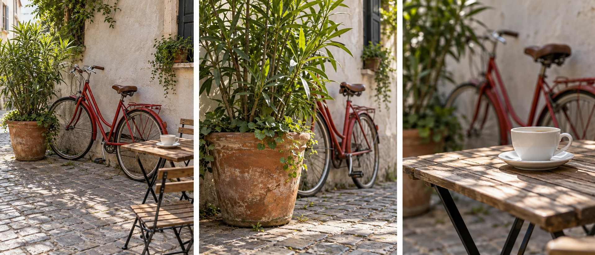
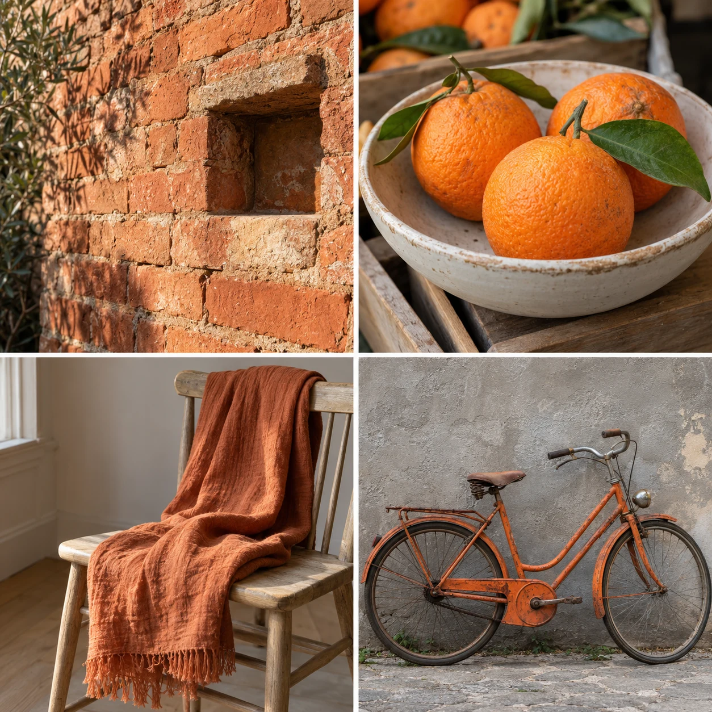

You walk through a neighborhood looking for anything worth photographing. The possibilities
are so broad that you keep making the same general street views. Staying with one café
corner changes the problem. Now you notice the bicycle's geometry, leaves against plaster,
and a cup's relationship to the table shadow. Fewer available subjects can make more differences
visible inside the ones that remain.

Choose a temporary constraint that narrows one part of the task. It might limit location,
subject, color, viewpoint, or equipment. The restriction is useful when it directs attention
toward choices you usually overlook. It is not a test of discipline, a permanent style,
or a reason to ignore a better possibility outside the rule.

## Close one door to inspect the others

Think of a constraint as reducing the number of decisions competing at once. If the location
is fixed, you can spend more attention on light, distance, and relationships. If the color
family is fixed, you can inspect differences in shape and material. The constraint does
not supply the final picture. It creates conditions in which a particular kind of exploration
becomes easier.

A useful constraint leaves meaningful freedom. “Only photograph blue objects” still permits
many positions and relationships. “One exact object, angle, light, crop, and moment” may leave
almost nothing to explore. Conversely, a rule so broad that it changes none of your decisions
will probably do little work.

[[work-the-scene|Work the Scene]] develops deliberate variations during capture. A constraint
can give that process a boundary. [[review-one-thing-at-a-time|Review One Thing at a Time]]
can identify the particular choice you want the boundary to help you understand.

## Stay inside a small location

At the café corner, begin by accepting that you will not search the whole street for a
more dramatic subject. The bicycle can become a shape against the wall. The plant can become
a study of organic growth and a weathered pot. The cup can turn the same surroundings
into a quieter, more intimate view.

You are not required to make the three images look identical. Their coherence can come
from the shared place while each has a different center of attention. A change in viewpoint
may reveal another relationship without violating the location constraint. [[choose-your-subject|Choose Your Subject]] and [[find-a-relationship|Find a Relationship]] explain those decisions independently.

If the location becomes crowded or someone asks you to stop, the constraint has reached
a practical limit. Permission, comfort, and access take priority. A creative boundary is
something you choose for your own attention, not a demand that the world remain available
for your exercise.

## Limit color while varying subject

You might notice warm orange and terracotta colors during a walk. A brick wall, a fruit
stall, and a bicycle can become a coherent set even though the subjects differ. The color
restriction encourages you to see connections that ordinary subject categories might conceal.

Watch for a common failure: including any object that meets the color rule regardless of
the photograph. A small orange label on a cluttered shelf technically qualifies but may
offer little visual interest. The constraint is a search aid, not a substitute for intention.
[[limit-the-color-palette|Limit the Color Palette]] explains how color relationships work
inside individual frames.

A different choice would restrict each frame to one main color family while allowing that
family to change between images. Those are different constraints with different effects
on the set. State the boundary clearly enough that you understand what you are exploring,
without turning it into a complex contract.

## Keep one field of view

Using one camera or one phone camera module for a while can reduce equipment decisions.
You may begin to recognize how much scene fits and which camera positions create useful
relationships. A fixed field of view can encourage moving your body when movement is practical,
rather than repeatedly zooming from the same place.

That does not mean a fixed lens teaches better photography by definition. Some subjects
cannot be approached safely, and some people cannot change position easily. A zoom can be
a practical tool. The value lies in temporarily narrowing a decision you find distracting,
not in proving that one kind of equipment is morally or artistically superior.

Similarly, a phone's ordinary Photo mode can be a useful boundary while you explore framing.
Later you can examine what its other modes contribute. [[photography-foundations|Photography Foundations]] distinguishes optical controls from computational effects so the constraint
remains a conscious choice rather than a misunderstanding of the device.

## Release the rule when it has done its job

This pattern helps when too many choices produce repetition, when a familiar place seems
exhausted, or when learning becomes dominated by gear changes. It can also become avoidance:
a comfortable rule may protect you from exploring portraits, timing, or another uncertainty
you actually care about.

Review whether the boundary revealed something specific. Perhaps you discovered how much
camera height changes overlaps, or how one accent color connects separate scenes. Keep
that observation and change or remove the constraint when it no longer helps. [[return-to-the-same-place|Return to the Same Place]] can provide continuity without requiring every visit to follow the
same rule. A successful constraint eventually leaves you with more deliberate choices,
even after the restriction itself is gone.
