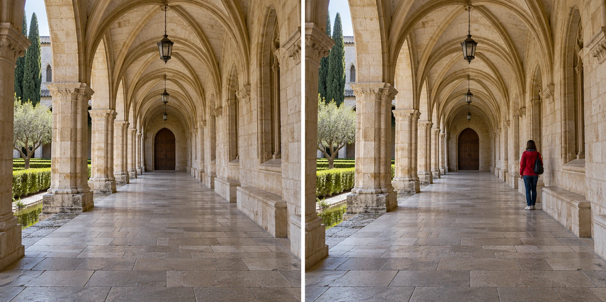

You photograph a long stone corridor. The floor joints, column bases, and overhead arches all
recede toward a distant doorway. Even before noticing the details, you can understand how the
space continues. From another position, those same lines might leave the frame or converge
behind a pillar. The architecture has not changed; its role in the photograph has.

Use visible or implied lines to connect elements and make the frame easier to explore. A
path can connect foreground to destination. A railing can link a near figure to a distant
building. A row of glances can suggest a direction without any physical line at all. Decide
where the connection goes and whether that destination matters.

## Trace a connection, not a formula

Think of a line as a possible connection between parts of the frame. Your first job is
to notice its direction. Your second is to decide what that direction does. A strong diagonal
can bring attention inward, create a boundary, divide two areas, or pull attention out of
the picture. Calling it a leading line does not make it helpful automatically.

Perspective makes parallel edges appear to approach one another as they recede. Roads, corridors,
and rows of posts can therefore suggest depth. Contrast and repetition can make these directions
conspicuous. But viewers also respond to faces, bright areas, colors, and personal interests.
Avoid treating composition as a mechanism that forces everyone's gaze through the same route.

[[build-layers|Build Layers]] concerns distinct near, middle, and far elements. Leading lines can
connect those regions, but a photograph can have depth without an obvious line, and a line
can organize a flat abstract surface without suggesting depth at all.

## Give the path somewhere useful to go

At a seaside walkway, a handrail runs from the lower corner toward a small fishing hut.
If the hut matters, you might choose a position that leaves its shape clear at the end
of that direction. If the rail instead disappears behind a bright rubbish bin, it may organize
attention around the wrong thing. Move slightly or reframe before assuming a stronger diagonal
will improve the picture.

The destination need not be an object. A path disappearing into fog can make uncertainty the
subject. A line ending outside the frame can imply continuation beyond what you show. Those
choices become more convincing when the rest of the photograph supports them. [[choose-your-subject|Choose Your Subject]] helps distinguish a meaningful open ending from an accidental one.

Keep access and safety practical. Do not stand on roads or tracks to achieve converging lines.
A pavement edge, a legal footpath, or an ordinary building interior can teach the same relationship
without placing you or anyone else in danger.

## Lines can connect people

At a family table, several people look toward someone opening a present. Their gazes and
body orientations form an implied connection. A photograph that includes both the observers
and the recipient can show shared attention. A tighter portrait of the recipient may capture
an expression but lose that social relationship.

Hands, pointing fingers, and objects being passed can provide similar links. Wait until the
gesture is readable rather than relying on a caption to explain it. If hands overlap completely,
the line of action may become a tangle. [[anticipate-the-moment|Anticipate the Moment]] helps
you recognize when the useful gesture is about to emerge.

These implied lines are interpretive clues. A person looking toward something does not prove
what they think or feel about it. Keep factual captions separate from the associations a
composition invites.

## Use curves and boundaries too

A winding stream can connect several areas without pointing directly at a single subject.
Its changes of direction create successive relationships between banks, trees, and distant hills.
A high viewpoint might reveal that curve clearly; a low viewpoint might hide it behind the
nearest bank. [[change-your-position|Change Your Position]] is often more useful than changing
exposure settings here.

In an abstract photograph of a wall, a painted stripe may divide warm and cool surfaces.
The stripe is doing organizational work even if it leads nowhere. Describing every visible
line as a route can obscure its actual role. Sometimes the subject is a boundary, a rhythm,
or a collision of directions. Let the description fit what the picture demonstrates.

## When the line overwhelms the subject

This pattern helps when a wide scene feels disconnected, a foreground needs a relationship
to the distance, or an activity contains a readable direction. Phones often make nearby lines
prominent because their usual wide view includes plenty of foreground. That can be helpful,
but an oversized rail or path can also dominate a small distant subject.

Watch the ends of lines at the frame boundary. A railing entering awkwardly beside a person's
face can compete with the relationship you intended. [[check-the-edges|Check the Edges]] helps
you notice these entry and exit points. Be equally willing to omit a line entirely if
it adds complexity without clarity. The reusable choice is to understand and use the connection,
not to find a diagonal in every photograph.
