A small red beacon stands at the end of a harbor wall. You can fill the frame with it,
or include a broad expanse of gray sky and sea. In the close version, you notice paint,
shape, and construction. In the wide version, the same beacon feels exposed and solitary.
The extra area is not merely space you failed to fill. It changes what the picture says.

Use relatively empty areas deliberately. Negative space is the quieter region around or between
more prominent elements: sky, water, a plain wall, deep shade, or even a softly detailed surface.
It can emphasize a small subject, suggest distance, allow a gesture room, or give the image
a particular pace. Its usefulness depends on its relationship to the subject.

## Empty space still has a job

Think of the quieter area as a supporting part of the composition. It has a shape, a
brightness, and a position. A pale wedge of sky on the left can balance a dark building
on the right. A strip of empty pavement can separate two people. A large blank wall can
make a small window feel significant.

Fewer competing details can make a subject easier to notice, but the effect is not automatic.
A tiny low-contrast subject may disappear into an enormous bright area. Negative space works
when the relationship remains readable at the final viewing size. The subject does not need
to be large, but it usually needs enough distinction to be found.

[[separate-subject-and-background|Separate Subject and Background]] concerns that distinction.
Negative space concerns the role of the quieter area itself. A crowded background can still
separate a subject through color; a large blank area can still fail to help if its shape
or brightness pulls attention away from what matters.

## The harbor: isolation or description

In the beacon photograph, a wide crop leaves much more sea to the left than to the right.
That imbalance can make the beacon feel like an outpost beside a large open area. A taller
crop with generous sky may emphasize weather or exposure instead. If the sky is genuinely
featureless, both choices can remain quiet without becoming visually inactive.

Move to a tighter crop and the beacon becomes an object to inspect. The image loses some
sense of open distance but gains detail in the structure. A close version can be more
appropriate for a travel guide explaining what the beacon looks like. A spacious version
may better convey your experience of the harbor. [[crop-with-a-purpose|Crop with a Purpose]]
develops these after-capture decisions; you can also make them while photographing.

Do not expect empty space alone to establish physical size. Without a recognizable reference,
the beacon may be a miniature or a large building. [[show-the-scale|Show the Scale]] addresses
that separate problem. Negative space communicates an impression of extent more readily than
an exact dimension.

## Leave room for a direction

A person looks out of a window. Placing some quiet wall or window area in the direction
of their gaze can let the viewer imagine what holds their attention. A tight crop in front
of their face may instead feel enclosed. That can be effective if enclosure is the intention.
“Leave space in front” is therefore a useful experiment, not a rule about all portraits.

The same applies to movement. A cyclist approaching an open stretch of road can feel as
though they have somewhere to go. A cyclist close to the edge can feel about to leave
the picture. The area behind can suggest where they came from. Choose which relationship
helps the photograph rather than mechanically putting more space ahead of every moving subject.

## Quiet surfaces can contain texture

At home, a single dark cup sits on a pale wooden table. The grain is visible, but at
the intended display size it remains less conspicuous than the cup. That table can function
as negative space. There is no need to blur it until all material character disappears.

A bright knot in the wood might disrupt the quiet. Moving the camera a few centimeters
can place it outside the frame or behind the cup. Alternatively, include it as a second
element and make the relationship intentional. [[check-the-edges|Check the Edges]] is useful
when a quiet area contains a small bright distraction near a boundary.

## When space becomes an avoidance

This pattern helps with simple subjects, expansive scenes, portraits, and compositions meant
to feel calm, exposed, small, or unresolved. It works with any camera. Phones can include
large areas easily; the harder choice is deciding whether those areas contribute. You can
often turn slightly or change orientation without changing equipment.

A common mistake is to treat every uncluttered image as thoughtful simply because it contains
little. If the quiet area neither supports attention nor contributes atmosphere or relationships,
it may be accidental padding. The opposite mistake is cropping away all space because it
contains no named object. That can remove the very quality you wanted to photograph.

Compare versions against your intention. [[explore-the-rule-of-thirds|Explore the Rule of Thirds]]
offers one way to distribute subject and space, while [[use-symmetry|Use Symmetry]] shows why
central placement can be equally useful. Negative space does not prescribe a position. It
asks you to see the supposedly empty part as something you are composing too.
