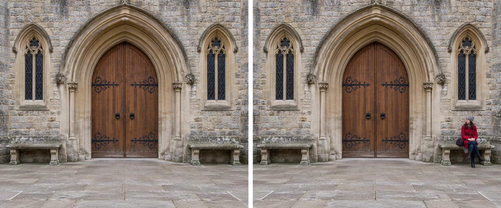

A stone doorway has matching windows on either side. You photograph it from almost the middle,
but one window sits closer to the edge and one bench appears larger. The result feels slightly
unsettled without an obvious reason. A small sideways movement brings the halves into balance.
Now the repeated forms are easy to recognize, and the doorway becomes an anchor.

Use symmetry when mirrored or repeated arrangements are part of what interests you. Find the
axis, align the camera carefully, and decide how much of the surrounding structure belongs
in the frame. You can preserve the balance or introduce an interruption. Both work better
when the underlying order is clear enough for the viewer to perceive.

## Establish an expectation

Think of symmetry as a visual expectation. When shapes repeat around an axis, viewers can
anticipate the arrangement. The repetition can feel steady, formal, playful, or imposing depending
on the subject and light. It can also make a small difference conspicuous. One red coat
among matching stone surfaces attracts attention partly because the rest of the arrangement
has established a pattern.

Exact mathematical symmetry is uncommon outside controlled setups. Trees differ on either side
of a path; old walls lean; reflected water ripples. Photographic symmetry can remain convincing
when the main structure balances while smaller details differ. Decide which elements establish
the order rather than trying to make every leaf match.

[[explore-the-rule-of-thirds|Explore the Rule of Thirds]] offers a different placement experiment.
A central subject is often useful here because the axis itself matters. Moving a doorway
to an intersection merely to follow thirds can obscure the arrangement you wanted to show.
Neither pattern has priority before you know the intention.

## Align the camera, then inspect the sides

For the doorway, begin by finding the midpoint between its vertical edges. Place the camera
on that centerline rather than merely pointing it toward the center from one side. Sideways
position changes perspective, so turning the camera from an off-center position cannot always
produce equal-looking halves.

Keep the camera level if you want vertical edges to remain upright. Tilting upward can make
them converge; that may communicate height, but it changes the arrangement. If you cannot include
the whole entrance from a level position, move farther back when possible, or accept a tighter
frame. [[change-your-position|Change Your Position]] explains why location matters more than a
grid correction for these relationships.

Compare the margins around the windows, benches, and arch. A small unwanted fragment at one
edge can weaken an otherwise careful alignment. [[check-the-edges|Check the Edges]] is especially
valuable in a picture whose subject is order. A grid or camera level can help you inspect;
it cannot decide whether the building's own irregularity should remain visible.

## Use a reflection without assuming perfection

At a lake, a mountain and its reflection can balance around the waterline. A central horizon
may be exactly right because both halves matter. Include enough of the reflected shape that
the connection is apparent. A foreground branch may add depth, but it can also interfere
with the doubled outline. Compare a clear view with the branch included.

Ripples introduce a purposeful difference between the halves. They may make the image feel
more alive than a perfectly still reflection. If a breeze destroys the recognizable shape,
the picture may become a study of color and texture instead. You can wait for a quieter
moment, or change the intention. Symmetry is an available structure rather than a condition
that the landscape owes you.

## Interrupt the arrangement deliberately

In the entrance illustration, adding a figure near one bench shifts attention away from the
axis. The doorway still provides order, while the person gives the picture a point of tension
and a reference for size. If the person stood exactly on the axis, they would reinforce
the central structure instead. If they obscured the doorway entirely, they might replace it
as the subject.

At home, the same idea works with three cups. Matching cups in a repeated arrangement can
show rhythm. Turning one handle away creates a small departure from it. Whether that departure
helps depends on what the picture concerns: uniformity, variation, or perhaps the evidence that
someone has just used one cup. Avoid assigning a real story to an arrangement you staged.

## Order has limits

This pattern helps with architecture, reflections, repeated objects, radial forms, and portraits
where directness suits the person. Any camera can use it. A phone's wide lens can include
an entire entrance, but placing it extremely close and tilting upward may complicate alignment.
Lens correction tools can help with some distortions; they also crop and stretch image areas.
They do not replace choosing a useful viewpoint.

A common mistake is making alignment the only criterion. A technically balanced photograph
can still contain an unhelpful expression, dull light, or meaningless empty margins. Conversely,
a small asymmetry can be the most interesting part. [[find-a-relationship|Find a Relationship]]
helps when the departure becomes the subject. Use the underlying order to make that difference
legible, and let the photograph retain the particular character of what was actually there.
