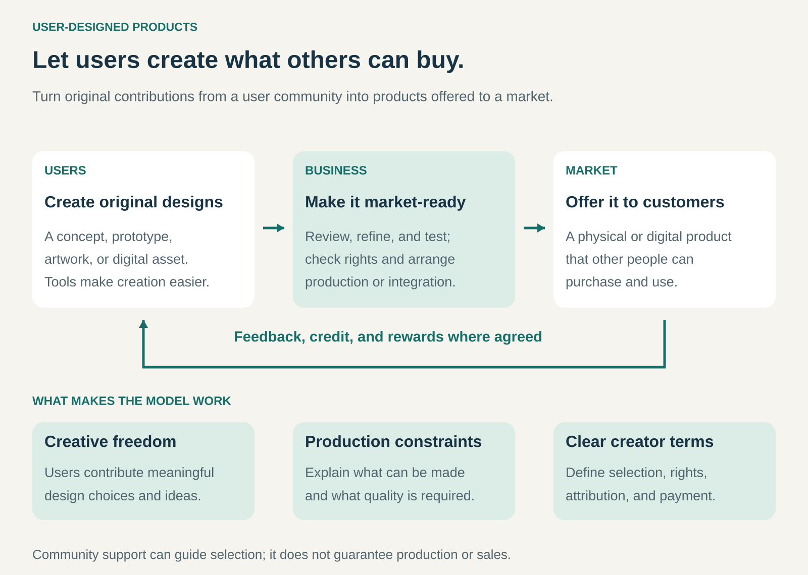

## What it is for

User-Designed Products helps a business turn the creativity and practical knowledge of its users into products it can bring to market.

It is useful when customers and enthusiasts have ideas, tastes, or specialized needs that an internal design team might overlook. Some already create their own versions, modifications, or prototypes. Others could contribute if they had suitable tools and a route to production.

The business provides that route: helping users turn original designs into something other people can buy and use.

## The core idea

**Let users contribute meaningful product designs, then provide the capabilities needed to develop, produce, and distribute them.**

Users might create a product concept, a working prototype, an illustration, a digital item, or an improvement to an existing product. The business supplies complementary capabilities such as engineering, manufacturing, quality control, distribution, and customer service.

The defining contribution is creative authorship. Users help determine what the offering becomes.

The pattern can operate through several arrangements:

- **Selected submissions:** the business chooses user designs for its product range.
- **Collaborative development:** users and professional designers refine a concept together.
- **Creator storefronts:** users publish designs that the business produces and fulfills.
- **Integrated digital products:** user-created assets become items or content within an existing product.

The creator may also be a customer, but the resulting product can serve a much wider audience.

## How it works

The process connects creative freedom with a practical production system.

**Make creation accessible.** Templates, design tools, sample files, component libraries, and clear specifications help users express ideas in a form the business can evaluate.

**Define the contribution.** A program might accept complete artwork, detailed models, prototypes, or early concepts. The earlier the submission stage, the more development work the business will need to supply.

**Evaluate and develop.** Community feedback can help identify promising designs. The business still needs to assess quality, feasibility, rights, cost, and commercial fit. Selected designs may change substantially during development.

**Bring the product to market.** The business manufactures the physical product or integrates the digital asset, then handles the relevant sales and delivery arrangements.

**Recognize the creator’s role.** Attribution, payment, royalties, prizes, or other agreed benefits give contributors a reason to participate. Clear terms also establish how designs can be adapted and used.

## Why it works

Users experience products in contexts that a design team cannot fully observe.

They encounter unusual requirements, invent workarounds, and develop strong preferences. A committed enthusiast may explore a narrow interest much more deeply than a business could justify doing internally.

The pattern also expands the range of creative approaches available. Different users bring different visual styles, cultural references, technical backgrounds, and ideas about what is missing.

Meanwhile, the business can reuse its production and distribution capabilities across many contributions. A creator does not need to establish an entire manufacturing operation or customer service team to bring one design to market.

Participation may also create an initial audience. Creators can explain and promote their work to people who share their interests. That provides a useful starting point, although enthusiasm and community votes still require testing against actual purchases.

## Famous examples

### LEGO Ideas — turning fan models into official sets

LEGO Ideas gives fans a route from their own models to an official LEGO product. Proposals that reach 10,000 supporters enter review and may be selected for production. Reaching that threshold qualifies the idea for consideration rather than guaranteeing a launch. [LEGO’s review process](https://www.lego.com/en-us/service/help-topics/article/what-happens-to-my-product-idea-after-i-reach-10-000-supporters).

A concrete example is the _Research Institute_, created by fan designer Ellen Kooijman and released as an official set in 2014. LEGO’s history describes the program’s development from earlier experiments in involving consumers in product creation. [LEGO Ideas history](https://www.lego.com/en-us/history/articles/j-lego-ideas).

The user contributes the original concept and model. LEGO provides the development and commercial system needed to turn selected contributions into products for a broader market.

### Threadless — making community artwork into merchandise

Threadless enables artists to contribute designs for apparel and other products. Its design challenges use community scoring as an input into selection. Through Artist Shops, creators can also offer their artwork on products while Threadless handles printing, shipping, and customer service. [How Threadless works](https://support.threadless.com/article/138-how-does-threadless-work), [Threadless Artist Shops](https://www.threadless.com/artists).

Artist Shops and the central marketplace are distinct routes. Products from participating shops can be considered for the marketplace, where Threadless curates designs for its audience; opting in does not guarantee inclusion. [Threadless marketplace guidance](https://artistshopshelp.threadless.com/article/802-how-does-the-marketplace-work).

Here, users design the artwork rather than the underlying garment. That creative layer is still a substantial part of what customers choose and buy. A shared production system supports many independent styles.

### Counter-Strike Workshop — integrating community designs into a digital product

Counter-Strike’s Workshop invites community members to create content such as cosmetic weapon finishes and stickers. Valve provides creation guidance and tools, while other community members can give feedback and rate submissions. Selected designs can become part of the game. [Counter-Strike Workshop](https://www.counter-strike.net/workshop/workshop).

Valve’s Steamworks documentation explains the broader curated Workshop model: developers approve items, perform any necessary integration, and control how accepted items reach customers. Submission alone does not make an item an official product. [Steam Workshop documentation](https://partner.steamgames.com/doc/features/workshop).

This illustrates the pattern in a digital setting. Users contribute original assets, while the business maintains the technical environment, selection process, and distribution system that make those assets usable within its product.

## The economics

User-designed products can expand a business’s creative supply, but they still require development and commercial investment.

Consider an illustrative physical product:

| Per unit sold                                    | Amount |
| ------------------------------------------------ | -----: |
| Selling price                                    |    $30 |
| Production and fulfillment                       |   −$16 |
| Creator payment                                  |    −$3 |
| Payment fees and expected returns                |    −$3 |
| **Contribution before launch and program costs** | **$8** |

Suppose selection, prototyping, launch work, and an allocated share of program costs total **$25,000**.

At 5,000 units sold, the product generates $40,000 in contribution, leaving **$15,000 after those costs**, before remaining business overhead and tax.

At 2,000 units, contribution is $16,000, leaving a **$9,000 shortfall** against the same costs. The break-even point is **3,125 units**.

These are hypothetical figures. They show why abundant submissions do not automatically produce attractive economics. Sales, development effort, fulfillment costs, and creator compensation all matter.

## Useful when

- Users already modify products or create their own alternatives.
- Tastes and needs vary widely across communities.
- A business has production capabilities that individual creators lack.
- Design tools and constraints can make submissions manageable.
- Original designs can be evaluated, developed, and distributed at reasonable cost.
- The business can offer credible recognition or financial benefits to contributors.

The pattern is particularly useful when a reusable product platform can support substantial creative variety.

## Common mistakes and limits

**Offering only superficial participation.** Asking for opinions can inform design, but a user-designed product requires users to contribute meaningful creative decisions.

**Confusing customization with authorship.** Selecting predefined colors and sizes primarily uses Mass Customization. Creating original artwork, geometry, functionality, or a product concept gives users a different role. Both patterns can coexist.

**Treating votes as confirmed demand.** Popularity can reflect visibility, campaigning, or an existing following. Purchase behavior still needs separate evaluation.

**Underestimating professional development.** A compelling concept may require extensive engineering, testing, sourcing, or adaptation before it becomes viable.

**Leaving creator terms unclear.** Contributors need understandable arrangements covering ownership, permitted adaptations, attribution, payment, and rejected submissions.

**Assuming submission clears rights.** Designs can incorporate material belonging to others. Review remains necessary before commercial use.

**Expanding the catalog beyond operational capacity.** More designs bring more moderation, product information, support, and quality-control work. A growing creative community needs a production system that can keep pace.

## Related patterns

- [[crowdsourcing|Crowdsourcing:]] organizes contributions from a distributed group; User-Designed Products focuses specifically on contributions that shape the offering.
- [[mass-customization|Mass Customization:]] adapts products to individual preferences and can supply the production infrastructure for user-created designs.
- [[bounties|Bounties:]] can reward selected designs or solutions to a defined product challenge.
- [[revenue-sharing|Revenue Sharing:]] can compensate creators through an agreed share of the income their designs generate.
