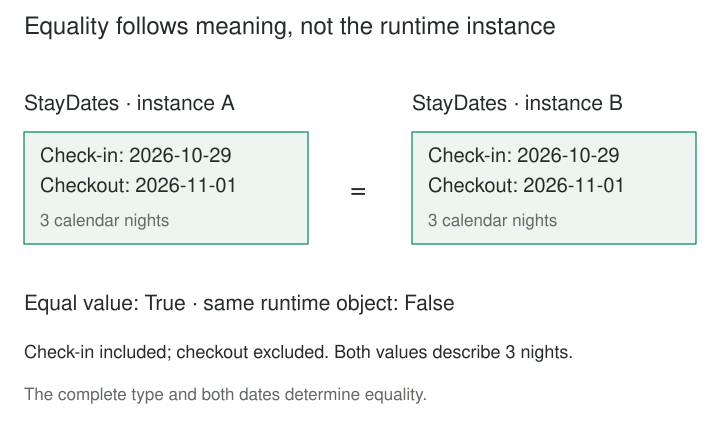

## Purpose and problem

A reservation screen edits a proposed stay using the same mutable date-range object stored on a booking. Moving the proposal two days also changes the booked dates. Elsewhere, callers compare separately loaded ranges by object reference, so identical dates unexpectedly appear different.

Both problems come from treating a descriptive value like a mutable thing with a continuing identity. The application needs coherent dates, agreed equality, and operations that cannot change another owner's view of the same value.

## Core idea

A **Value Object** represents a concept that matters through its attributes and associated rules, rather than an independent business identity. Equivalent values are interchangeable within the model. Changes produce replacement values instead of altering an existing value shared by callers.

The mental model is **meaningful value, valid whole, replace rather than mutate**. Evans's [DDD Reference, Value Objects](https://www.domainlanguage.com/wp-content/uploads/2016/05/DDD_Reference_2015-03.pdf) combines attributes, behavior, and immutability. Fowler's [Value Object](https://martinfowler.com/bliki/ValueObject.html) explains property-based equality and the aliasing bugs that mutation can introduce.

Domain Value Object and Value Object Pattern refer to this pattern here. A language's `struct`, record, or value type is an implementation facility, not automatically a domain Value Object. Older Java material also used the name for [Data Transfer Objects](https://martinfowler.com/eaaCatalog/dataTransferObject.html). That transport role is separate: carrying fields alone does not establish domain rules, value semantics, or immutability.



## How it works

### Model the complete meaning

Choose attributes and operations that express one coherent concept. A stay needs both endpoints and a rule about what they include. A bare pair of dates leaves every caller to rediscover whether checkout is inclusive and whether an empty interval is allowed.

Validate that relationship at construction. A valid object then communicates more than a tuple of unchecked fields. Operations such as shifting a stay preserve its rules by constructing another valid value.

Microsoft's [value-object guidance](https://learn.microsoft.com/en-us/dotnet/architecture/microservices/microservice-ddd-cqrs-patterns/implement-value-objects) discusses identity-free domain descriptions and equality based on their components. Attributes and policies still come from the modeled problem.

### Specify equality and representation

Define which components make values equivalent, including type and units. Two ranges with the same length but different endpoints are different stays. A distance in meters is not interchangeable with an unqualified number merely because their numeric fields match.

Normalization follows domain semantics: a case-insensitive code may need a canonical form; an opaque identifier may need exact comparison. Approximate equality can violate equality and hashing contracts, so choose a representation appropriate to the required precision.

The example compares exact calendar dates and both endpoints. It deliberately provides no general ordering between stays: “earlier” or “shorter” would be separate operations with different meanings.

### Preserve immutability through the object graph

A read-only reference to a mutable list does not make the contained data immutable. Use immutable components, defensively copy mutable inputs where appropriate, and avoid exposing mutable internals. Python's [frozen dataclass documentation](https://docs.python.org/3/library/dataclasses.html#frozen-instances) makes clear that frozen fields emulate immutability rather than deeply freezing everything reachable from them.

An owner can replace its reference to a value. Other owners retain the previous value, which remains valid. This reduces aliasing surprises and makes pure operations easier to reason about. It does not synchronize replacement of shared application state or make an external write atomic.

 returns a new value; assigning it to proposed leaves the original value and booked reference unchanged.")

## Worked example

### Replace a proposal without changing booked dates

Before separation, setters alter a shared range one endpoint at a time. Afterward, `StayDates` validates both dates together and supplies operations whose results are new values. A booking owner could store that value without giving a proposal editor a way to mutate it through the normal API.

Save these two files together and run `python3 demo.py` with Python 3.10 or later and its standard library. Check-in is included and checkout excluded: `[check_in, check_out)`. A stay must contain at least one calendar night.

**model.py — one validated immutable value**

```python
from dataclasses import dataclass
from datetime import date, timedelta


@dataclass(frozen=True)
class StayDates:
    check_in: date
    check_out: date

    def __post_init__(self):
        if type(self.check_in) is not date or type(self.check_out) is not date:
            raise TypeError("Use calendar dates, not timestamps or text")
        if self.check_in >= self.check_out:
            raise ValueError("Checkout must be after check-in")

    @property
    def nights(self):
        return (self.check_out - self.check_in).days

    def shifted(self, days: int):
        if type(days) is not int:
            raise TypeError("Shift must be a whole number of days")
        offset = timedelta(days=days)
        return StayDates(self.check_in + offset, self.check_out + offset)

    def overlaps(self, other):
        if type(other) is not StayDates:
            raise TypeError("StayDates required")
        return self.check_in < other.check_out and other.check_in < self.check_out
```

**demo.py — compare, replace, and look up by value**

```python
from datetime import date
from model import StayDates


booked = StayDates(date(2026, 10, 29), date(2026, 11, 1))
equivalent = StayDates(date(2026, 10, 29), date(2026, 11, 1))
print("equal, same object:", booked == equivalent, booked is equivalent)
proposed = booked
proposed = proposed.shifted(2)
print("booked:", booked.check_in, booked.check_out, booked.nights)
print("proposed:", proposed.check_in, proposed.check_out, proposed.nights)
adjacent = StayDates(date(2026, 11, 1), date(2026, 11, 3))
print("adjacent overlaps:", booked.overlaps(adjacent))
nights_cache = {booked: booked.nights}
print("lookup:", nights_cache[equivalent])
# equal, same object: True False
# booked: 2026-10-29 2026-11-01 3
# proposed: 2026-10-31 2026-11-03 3
# adjacent overlaps: False
# lookup: 3
```

Both independently constructed originals are equal. The two-day shift replaces only the proposal; the booked dates stay unchanged. Both ranges contain three calendar nights. The adjacent stay begins exactly at checkout, so the half-open intervals do not overlap. A cache of the pure night-count calculation recognizes an equivalent key.

This is not a booking registry: separate reservations can legitimately have equal date values. A reservation's identity and room availability belong elsewhere. `overlaps` only compares its two supplied values; it does not coordinate concurrent reservations.

Python's dataclass generates equality from the concrete type and both fields, and a compatible hash for this frozen class. [Python's data model](https://docs.python.org/3/reference/datamodel.html#object.__hash__) requires equal hashable objects to have equal hashes. The fields contain immutable [date objects](https://docs.python.org/3/library/datetime.html#date-objects), so no nested mutable collection compromises this implementation.

Empty or reversed stays fail during construction. Timestamps are rejected even though Python's `datetime` subclasses `date`; this model handles dates only. Negative shifts are allowed; Boolean and fractional shifts are rejected. Shifting beyond Python's supported date range raises `OverflowError` without changing the original. Calendar nights are not elapsed hours; time-zone-aware instants require a different model.

## When to use it

Use this pattern when several fields form one meaning, shared validation is repeatedly copied, and callers should treat equivalent descriptions interchangeably. Examples include ranges, coordinates, quantities with units, and typed identifiers.

A color specification offers another context: changing a proposed color should not alter every document that references the original specification. Conversely, a tracked paint batch may need entity identity and history. The classification depends on what matters in that model, not the noun alone.

A primitive is sufficient when it expresses the meaning clearly without scattered validation or unit ambiguity. Wrapping every field in a class can add ceremony without improving the model.

## Tradeoffs and common mistakes

**A frozen bag of invalid data.** Immutability does not establish validity, useful behavior, or the right equality components. Define those decisions explicitly.

**Shallow immutability.** Setters may be absent while nested objects still mutate. Copying or freezing the outer object alone does not protect shared contents.

**Confusing persistence identity with domain identity.** Storage may require a row key even for an embedded value. Microsoft's guidance illustrates that persistence detail; it need not become the value's business equality rule.

**Replacing a shared value without coordination.** Immutability protects existing values, not a mutable owner's concurrent update. Version checks, transactions, and authorization remain application responsibilities. Reconstruction must also validate incoming data rather than silently bypassing constructors.

## Related patterns

[[entity|Entity]] follows a continuing thing through changing attributes. An entity can contain and replace value objects; an immutable entity is still an entity if its identity defines sameness.

[[domain-model|Domain Model]] combines business rules and state. Value Objects concentrate meaningful attributes, validation, and calculations within that model.

[[functional-core-imperative-shell|Functional Core, Imperative Shell]] separates pure decisions from effects. Immutable values are useful inputs and outputs for that core.

[[flyweight|Flyweight]] shares intrinsic state to save resources. Equal Value Objects may be safely shared, but this pattern requires neither interning nor a shared-instance cache.

## Sources

Evans's [DDD Reference, Value Objects on printed page 12](https://www.domainlanguage.com/wp-content/uploads/2016/05/DDD_Reference_2015-03.pdf) establishes the domain distinction and immutable operations. Fowler's [Value Object](https://martinfowler.com/bliki/ValueObject.html) explains equality, aliasing, and contextual modeling. His [DTO catalog](https://martinfowler.com/eaaCatalog/dataTransferObject.html) supports the transport distinction; [Microsoft](https://learn.microsoft.com/en-us/dotnet/architecture/microservices/microservice-ddd-cqrs-patterns/implement-value-objects) covers implementation and persistence context. Official Python sources support the language behavior linked above.

The stay policy, Python implementation, and diagrams are original teaching material. No reservation system, database persistence, or universal date-range convention is implied.
