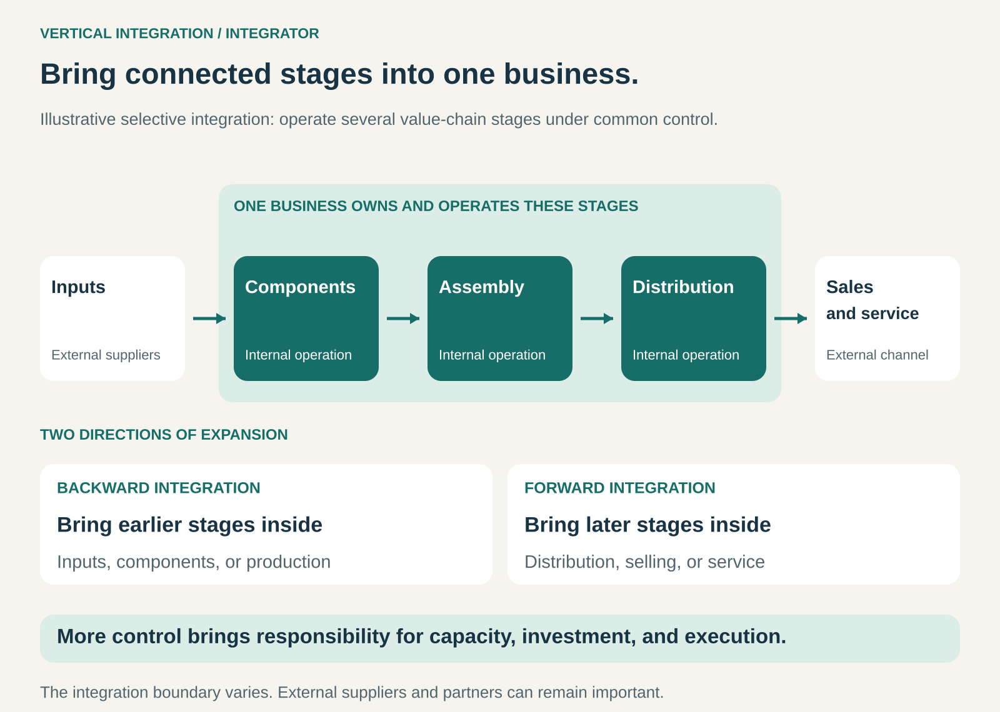

## What it is for

A manufacturer depends on a supplier whose production schedule does not match its needs. A brand struggles to deliver the experience it wants through independent retailers. A distributor wants more influence over the products it sells.

Vertical Integration brings connected stages of the value chain inside the same business.

It is useful when closer control over production, distribution, or customer access can create enough value to justify the investment, operating responsibility, and additional risk.

## The core idea

**Own and operate successive stages of creating and delivering an offering.**

A business might develop components, manufacture the finished product, distribute it, sell it, and provide ongoing service.

Integration can move in two directions:

- **Backward integration:** bringing earlier stages inside, such as producing a component previously purchased from a supplier.
- **Forward integration:** bringing later stages inside, such as operating distribution or selling directly to customers.

The Integrator model extends this control across a substantial part of the value chain. Integration can also be selective: a business may operate several important stages while continuing to use external suppliers elsewhere.

The defining change is the organizational boundary. Activities become internal operations or controlled subsidiaries. Coordinating an independent supplier closely is a different arrangement.

The business can build the capability itself or acquire an existing operation.

## How it works

Integration changes who makes decisions and carries the consequences.

**Select the stages where control matters.** Some activities determine quality, speed, availability, or access to customers. Others may be performed more effectively by specialists serving many businesses.

**Establish internal capability.** The business acquires or develops the people, assets, knowledge, and operating processes required for the new activity.

**Coordinate decisions across stages.** Product design can account for manufacturing constraints. Production schedules can respond to demand. Distribution and service information can influence future improvements.

**Manage the combined system.** Each stage needs to work well, but the purpose is performance across the chain. A decision that makes one department appear efficient can create inventory, delays, or costs elsewhere.

The business gains authority to coordinate these choices. It also becomes responsible for operating capabilities that an external specialist previously maintained.

## Why it works

Some improvements are difficult to achieve through separate commercial agreements.

A supplier may hesitate to invest in equipment useful mainly to one customer. A manufacturer may optimize large production batches while the retailer needs smaller, more frequent deliveries. Separate organizations may each protect their own margin or timetable.

Integration allows one business to make coordinated investments and tradeoffs.

It can also retain important knowledge. Design, production, service, and customer feedback can inform one another without repeatedly crossing organizational boundaries.

In some cases, integration reduces duplicated handling, contracting, or margins charged between stages.

Those savings are not automatic. Internal operations still have costs, and external specialists may have better technology, greater scale, or more varied demand. Integration replaces market coordination with internal management; the quality of that management matters.

## Famous examples

### Tesla: combining engineering, manufacturing, sales, and service

Tesla’s 2025 annual report describes activities spanning vehicle design and development, manufacturing, sales and leasing, maintenance, collision services, and paid charging.

It also describes substantial internal engineering capabilities and investments across manufacturing, retail, service, and charging infrastructure. [Tesla 2025 annual report](https://www.sec.gov/Archives/edgar/data/1318605/000162828026003952/tsla-20251231.htm)

These activities connect several stages of providing and supporting a vehicle. Product engineering, manufacturing decisions, customer access, and service can be coordinated within the business.

The example illustrates the scope of integration, rather than proving that integration alone explains the company’s results. Each activity still requires investment and competent execution.

### Inditex / Zara: integrated operations with external production partners

Inditex, the group behind Zara and other brands, combines retail operations with logistics infrastructure and connected online channels. Its 2025 reporting describes investment in stores, digital commerce, and logistics capacity. [Inditex 2025 CEO statement](https://annualreport.inditex.com/anrpxxvui/en/ceo-statement)

At the same time, its supply-chain reporting describes an extensive network of factories and supplier controls. [Inditex 2025 supply-chain reporting](https://annualreport.inditex.com/anrpxxvui/en/the-how-matters)

This makes Inditex a useful example of selective integration. Internal retail and logistics capabilities coexist with external manufacturing relationships.

The important lesson is choosing which activities to operate and which to coordinate through partners. An integrated business need not perform every production step internally.

### Netflix: moving from distribution into content production

Netflix combines its streaming service with its own studio operations and produced content. Its 2025 annual report separately identifies licensed content and produced content, and discusses the capabilities required to expand original production. [Netflix 2025 annual report](https://www.sec.gov/Archives/edgar/data/1065280/000106528026000034/nflx-20251231.htm)

For a distributor, establishing production capability is backward integration: the business takes on an earlier stage in creating the offering.

Netflix continues to license content as well. Internal production and external sourcing operate together.

The additional control also brings production commitments, creative uncertainty, and organizational complexity. Producing content creates a different set of responsibilities from acquiring distribution rights.

## The economics

A supplier’s price includes more than its profit. It also funds equipment, staff, maintenance, capacity, expertise, and risk.

Bringing the activity inside means taking on those costs.

Consider a hypothetical component available externally for $20 per unit. Internal production would require $12 in variable operating costs per unit plus $400,000 in annual fixed operating costs.

| Annual volume | External purchase cost per unit | Internal operating cost per unit |
| ------------- | ------------------------------: | -------------------------------: |
| 100,000 units |                             $20 |                              $16 |
| 25,000 units  |                             $20 |                              $28 |

These figures exclude initial capital investment, financing, and transition costs.

At high volume, the internal operation spreads fixed costs across more units. At low volume, unused capacity makes it more expensive.

On these assumptions, operating costs are equal at 50,000 units annually—before considering the excluded costs.

The broader decision also includes quality, lead times, reliability, and the return required on invested capital. A lower internal operating cost does not establish that building or buying the operation is a worthwhile investment.

## Useful when

- **Coordination between stages materially affects the offering.** Quality, design, speed, or availability depend on decisions being made together.
- **A critical external dependency limits performance.** Suppliers or channels cannot reliably support the required service.
- **Important investments are difficult to arrange through contracts.** Dedicated capabilities need long-term commitment.
- **Demand can support the internal operation.** Capacity and investment have a credible economic purpose.
- **The business can develop the required expertise.** Ownership is accompanied by operating competence.

## Common mistakes and limits

**Treating the supplier’s margin as available savings.** The business must replace the supplier’s capabilities and absorb its operating risks.

**Integrating without enough volume.** Capacity that looks economical at full utilization can become expensive when demand falls.

**Assuming ownership guarantees coordination.** Internal departments can still protect budgets, withhold information, or optimize conflicting measures.

**Confusing expansion with integration.** Adding capacity at the same stage increases scale. Taking on an earlier or later stage changes the business’s position in the chain.

**Losing access to specialist innovation.** An internal operation may become less competitive if external suppliers improve faster.

**Concentrating risk.** A production failure can affect several connected stages, while weak demand can leave multiple assets underused.

**Making the boundary permanent by habit.** Technologies, supplier markets, and customer needs change. An activity worth operating internally today may deserve a different arrangement later.

## Related patterns

[[direct-to-customer|Direct to Customer / No Middle Man]] can be a form of forward integration when a producer takes on selling to end customers.

[[solution-provider|Solution Provider]] takes responsibility for a broader customer outcome. It may coordinate independent partners, while vertical integration brings selected activities inside the business.

[[demand-driven-production|Demand-Driven Production / From Push to Pull]] coordinates production with demand. Integration can support that coordination, but ownership alone does not create it.

[[monetize-existing-capabilities|Monetize Existing Capabilities / Make More of It]] can generate external revenue from an internal capability, provided serving other customers remains compatible with its original role.
