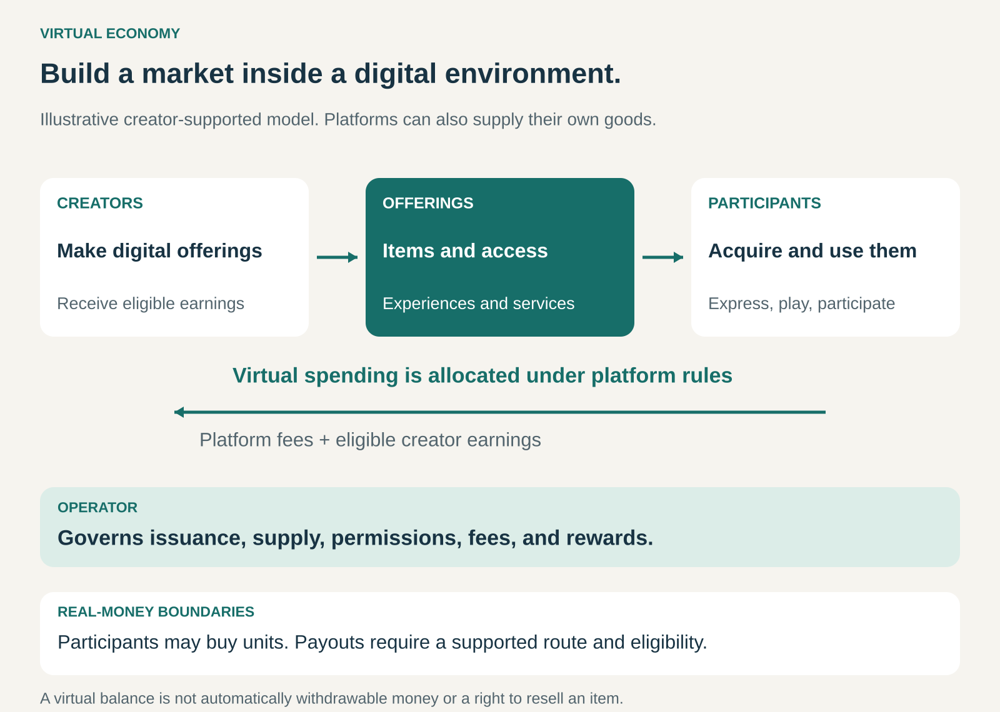

## What it is for

People spend time in a digital environment and begin to care about what they can do, express, build, and collect there. An avatar’s appearance matters. Access to an experience becomes desirable. A creator makes something other participants want.

Virtual Economy turns those activities into an organized system of value and exchange.

It is useful when a business can support continuing demand for digital goods, services, or experiences—and establish rules that make producing, acquiring, and using them worthwhile.

## The core idea

**Build an economic system around things that have value within a digital environment.**

The offering might include avatar clothing, virtual furniture, tools, consumable resources, access to experiences, or services performed for other participants.

People value these things for different reasons: usefulness, enjoyment, identity, convenience, collecting, or participation in a community.

The operator provides the environment and governs its economy. It determines what can be created, how goods become available, what participants can earn or buy, and which exchanges are permitted.

Some economies are supplied mainly by the operator. Others allow participants to become creators, merchants, or service providers.

A dedicated virtual currency is common, but optional. So are participant-to-participant trading, resale, and conversion into real money. Blockchain technology is also optional.

The defining feature is a connected system of digital offerings, incentives, and exchange. Adding a points balance to an otherwise unchanged product does not, by itself, create a substantial virtual economy.

## How it works

A virtual economy brings together several design decisions.

**What creates value?** Participants need reasons to want the offerings. A decorative item may support self-expression; a tool may enable construction; an experience may provide entertainment or social connection.

**Who supplies the offerings?** The operator can produce everything itself, license content, or provide tools that let participants create and sell. Creator participation adds variety while introducing questions about discovery, quality, compensation, and permitted content.

**How do participants acquire purchasing power?** They may buy virtual units, earn them through activity, receive rewards, or obtain proceeds from permitted sales. These routes can coexist, with different restrictions.

**Where does spending go?** Spending might transfer units to a creator, pay the operator, or remove units from circulation under the system’s rules. Purchasing from another participant and purchasing a consumable directly from the operator can have different effects.

**What can leave the system?** Using an item, gifting it, reselling it, transferring currency, and withdrawing real money are separate permissions. Supporting one does not automatically imply the others.

The operator continues to manage these relationships as participation changes. New rewards, items, prices, and trading rules affect the existing economy.

## Why it works

Digital goods can deliver meaningful value without having a physical form.

An avatar outfit can be visible to friends. A virtual venue can host shared experiences. A building tool can help someone produce something new. Their usefulness depends on the surrounding environment and the people participating in it.

Digital production can also support substantial variety. Once an item has been developed, distributing additional copies may cost relatively little, although creation, hosting, moderation, and support still require resources.

When participants create offerings, another mechanism becomes possible: attractive content brings in users; user demand creates earning opportunities; those opportunities encourage further creation.

That cycle depends on participants finding worthwhile experiences and creators having a reasonable opportunity to reach an audience. Simply issuing more currency or adding more products does not ensure demand.

The business sustains the economy by maintaining an environment people want to inhabit.

## Famous examples

### Fortnite: spending on identity and experiences

Fortnite’s V-Bucks can purchase offerings such as outfits, emotes, pickaxes, and passes. These goods provide ways to customize participation and access particular content.

Epic’s published rules distinguish spending from transfer: V-Bucks are not transferable between accounts, although participants can gift eligible items through the shop. [Fortnite V-Bucks information](https://www.fortnite.com/vbuckscard?lang=en-US)

This illustrates a virtual economy that does not require a general marketplace for participants to resell their purchases. The player-facing currency supports transactions within Fortnite’s rules.

The value of an outfit comes from using and displaying it in the environment. It need not offer a route to financial returns to attract buyers.

### Roblox: linking participant spending with creator earnings

Roblox participants can buy Robux and use them for digital items and experiences. Creators can earn Robux through eligible forms of platform activity, including monetizing the items and experiences they make. [Roblox: ways to acquire Robux](https://en.help.roblox.com/hc/en-us/articles/203313200-Ways-to-Get-Robux)

Its Developer Exchange program allows eligible creators to exchange qualifying **Earned Robux** for real money, subject to requirements and review. Purchased Robux do not automatically qualify, and neither do all forms of trading or resale proceeds. [Roblox Earned Robux rules](https://en.help.roblox.com/hc/en-us/articles/27984458742676-Earned-Robux-Earned-Robux-Balance-and-DevEx-Rates)

The distinction matters: a participant’s spending balance and a creator’s eligible payout balance are different concepts. The economy connects them through platform rules, rather than treating every unit as freely redeemable cash.

### Second Life: a participant-created market with an exchange route

Second Life supports creators selling offerings such as fashion, environments, scripts, performances, and experiences, both in-world and through its Marketplace. Linden dollars can be bought and sold through the LindeX. [Second Life for creators](https://secondlife.com/create)

Selling Linden dollars produces account credit. Eligible proceeds can then be withdrawn through a supported payout process, subject to the applicable requirements. [Linden Lab withdrawal guidance](https://lindenlab.freshdesk.com/support/solutions/articles/31000135224-process-credit-withdrawal-requests)

This illustrates a more extensive connection between internal commerce and real-money proceeds. Creating an offering, selling it, exchanging currency, and withdrawing proceeds remain distinct steps.

## The economics

A virtual economy can support several revenue streams: virtual-unit purchases, direct digital sales, transaction fees, subscriptions, paid creation tools, or charges for hosting and operating virtual spaces.

The financial model needs to distinguish real-money receipts from internal activity.

Consider a hypothetical platform with 10,000 monthly participants. If 5% buy $12 of virtual units during the month:

- There are 500 paying participants.
- Gross cash collected is $6,000.
- Creator payouts, distribution charges, refunds, hosting, moderation, and other costs still need to be covered.

The $6,000 is not profit. Nor does the virtual transaction volume necessarily equal new cash collected. Units may circulate, be earned, or remain unspent.

The business also needs to account for obligations associated with balances and purchases. Cash collection, delivery of an offering, and accounting revenue can occur at different times.

Creator economics require similar care. A stated share of virtual spending does not automatically equal that percentage of the original real-money purchase. Acquisition prices, platform deductions, payout rates, and eligibility rules can intervene.

## Useful when

- **People return to a meaningful digital environment.** Goods have a continuing context in which to be used.
- **Customization or creation matters.** Participants value different ways to express themselves or build.
- **Digital offerings have clear uses.** Purchases improve enjoyment, capability, convenience, or participation.
- **Creators can extend the available variety.** The operator can support their tools, discovery, and compensation.
- **The business can maintain economic rules over time.** Supply, rewards, spending, and permissions need continuing attention.

## Common mistakes and limits

**Creating currency before creating value.** Units need worthwhile uses. A balance alone gives people little reason to participate or spend.

**Confusing digital abundance with costless operation.** Copies may be inexpensive to distribute, while content development, infrastructure, moderation, and support remain substantial expenses.

**Assuming scarcity creates demand.** A limited item still needs to be desirable. Restricting supply cannot substitute for usefulness or appeal.

**Destabilizing existing rewards and purchases.** Issuing large quantities of units or replacing valuable items with easily obtained alternatives can change incentives and expectations.

**Making spending difficult to understand.** Multiple currencies, bundles, and conversion steps can obscure real costs. Clear prices and spending information help participants make informed choices.

**Letting monetization damage the experience.** Purchases that undermine fairness, interrupt participation, or make ordinary progress frustrating can weaken the environment that gives the goods their value.

**Leaving permissions unclear.** Participants need to understand whether an item can be used, modified, gifted, transferred, or resold—and what happens when the service or its rules change.

## Related patterns

[[credits|Credits]] provides units used to pay for offerings. Virtual Economy includes the broader system of goods, incentives, production, and exchange.

[[marketplace|Marketplace]] applies when participants offer digital goods or services to one another.

[[multi-sided-platform|Multi-Sided Platform]] explains the interdependence between creators, users, and other participant groups.

[[freemium|Freemium]] can provide broad access to the environment while paid digital offerings support revenue.
