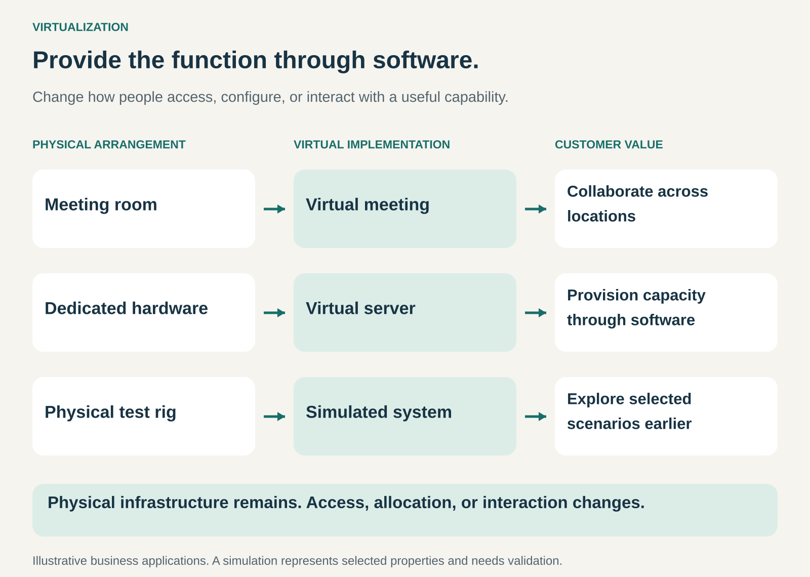

## What it is for

Providing useful functions through software-based environments, reducing dependence on a particular location, piece of equipment, or physical setup.

A team can collaborate without gathering in one room. A business can obtain computing capacity without purchasing a server for each workload. Engineers can investigate selected machine behaviors before assembling the physical equipment.

Virtualization changes how customers access and interact with a capability.

The commercial opportunity comes from making that capability more accessible, configurable, repeatable, or economical.

## The core idea

**Separate the function customers need from the physical arrangement traditionally used to provide it.**

The customer may need a conversation, computing capacity, or a place to test a design. A software-based environment can provide some or all of that function.

The Business Model Navigator describes Virtualization as reproducing traditionally physical processes in virtual environments, with customers obtaining access to the resulting service. [Business Model Navigator: Virtualization](https://edit.businessmodelnavigator.com/pattern?id=57)

This article uses that broader business meaning. Hardware virtualization—creating virtual computing resources—is one specific application.

A virtual environment need not resemble a physical space visually. A video meeting can support collaboration without displaying a three-dimensional conference room.

The important question is whether the environment provides the function the customer values.

## How it works

The pattern connects three decisions.

**Identify the essential function.** Establish what the customer needs from the physical arrangement.

A meeting room supports communication and shared attention. A server supplies computing resources. A test setup allows people to investigate behavior under particular conditions.

Not every physical characteristic needs to be reproduced.

**Create a virtual implementation.** Software supplies the relevant interaction, resource, or model.

That might mean shared video and documents, configurable virtual servers, or a simulation connected to control software.

The implementation must reproduce the properties that matter for its intended purpose. A simulation useful for checking movement may be inadequate for predicting material wear.

**Provide a workable access model.** Customers need reliable ways to enter, configure, use, and leave the environment.

The provider may charge through subscriptions, usage fees, session fees, software licenses, or project-based services. Support and operational responsibilities form part of the offer.

Servers, networks, devices, and energy remain necessary. Virtualization changes how the capability is organized and accessed.

## Why it works

Physical arrangements often create constraints.

People must travel. Equipment takes time to purchase and configure. A test rig may be unavailable while another team uses it. Changing a physical prototype can require rebuilding components.

Virtual implementations can loosen some of those constraints.

A remote meeting connects participants across locations. A virtual resource can be configured through software. A simulation can support repeated experiments without reconstructing the physical setup for every scenario.

Providers may also reuse infrastructure and software across customers, spreading development and operating costs.

These advantages depend on the task. Virtual access can introduce latency, connection requirements, software costs, or limitations in what participants can observe and do.

The value comes from reproducing the right function with acceptable tradeoffs.

## Famous examples

### Zoom: collaboration without requiring a shared room

Zoom Meetings supports remote participation, screen sharing, annotation, and collaboration across desktop, mobile, and room systems. Its offering includes free and paid plans. [Zoom Meetings](https://www.zoom.com/en/products/virtual-meetings/)

The virtual environment provides several functions associated with gathering in a meeting room: conversation, shared visual material, and coordinated discussion.

The customer buys access to capabilities that make distributed participation practical.

This does not establish that every meeting works equally well online. Workshops involving physical materials, sensitive conversations, or informal relationship building may have different requirements.

The example illustrates selective substitution: some purposes can be served effectively without everyone traveling to the same place.

### Amazon EC2: computing resources configured through software

Amazon describes EC2 as providing on-demand computing capacity through virtual servers, with different combinations of processing, memory, storage, and networking resources. Customers can increase or reduce capacity as requirements change. [AWS: how EC2 works](https://docs.aws.amazon.com/AWSEC2/latest/UserGuide/concepts.html)

A customer can provision a computing environment without purchasing and installing a corresponding physical server itself.

The physical infrastructure remains in the provider’s operation. The customer accesses configurable resources through software and pays under the selected commercial arrangement.

This example concerns EC2’s virtual-server offering. AWS also provides dedicated and other infrastructure options; cloud computing does not imply that every resource uses the same virtualization model.

### Siemens: testing selected machine behavior before physical commissioning

Siemens offers virtual commissioning tools and services that connect machine models with control systems. Its description explains how teams can test agreed scenarios and identify issues before operating the physical machine. [Siemens: virtual commissioning](https://www.siemens.com/en-us/products/industrial-digitalization-services/virtual-commissioning/)

The virtual environment supplies an earlier place to investigate programming problems, movement conflicts, and aspects of system behavior.

Its value depends on the model’s purpose and accuracy. Siemens’ technical guidance explicitly discusses simplifications and the tradeoff between simulation detail and the resources required. [Siemens’ virtual commissioning guidance](https://support.industry.siemens.com/cs/attachments/109963864/Guideline_VC_SIMIT_PSA_MCD_V1.0.0.pdf)

Virtual testing can therefore supplement physical engineering work. It does not establish that every real-world condition has been reproduced.

## The economics

Consider a hypothetical business running **24 workshops annually**.

Each physical workshop incurs **$3,000 in travel and rented-space costs**, giving an annual total of:

**24 × $3,000 = $72,000.**

Suppose the business determines that **12 workshops** can achieve their purpose virtually.

Each virtual workshop costs **$400**, including allocated platform, technical support, and additional facilitation costs.

The revised annual cost is:

| Workshop format                | Annual cost |
| ------------------------------ | ----------: |
| 12 physical workshops × $3,000 |     $36,000 |
| 12 virtual workshops × $400    |      $4,800 |
| Total                          | **$40,800** |

The annual saving is **$31,200**.

If setup and training cost **$6,000**, the first-year saving becomes **$25,200**.

This comparison includes the specified cost differences and assumes comparable results for the workshops moved online. It does not assign a value to travel time or include costs common to both formats.

For the provider, platform revenue must cover software development, infrastructure, support, and customer acquisition. Customer savings and provider profit are separate calculations.

## Useful when

- Customers need access across locations.
- Physical capacity is expensive, scarce, or slow to configure.
- A function can be reproduced adequately through software.
- Repeated scenarios or experiments are valuable.
- Demand varies enough that configurable access improves resource use.
- A hybrid arrangement can combine virtual convenience with physical capabilities.

It is less suitable when touch, physical presence, very low latency, or detailed real-world behavior is central to the task and cannot be reproduced adequately.

## Common mistakes and limits

**Confusing a digital representation with a working substitute.** A drawing of a machine does not simulate it. A virtual environment needs the behavior required for its purpose.

**Assuming complete equivalence.** Communication cues, physical interactions, and operating conditions may be missing or simplified.

**Ignoring the remaining infrastructure.** Devices, networks, computing resources, and support still have costs and capacity limits.

**Treating simulated results as unconditional predictions.** Conclusions depend on assumptions, input data, and model validation.

**Assuming access is effortless.** Setup, connectivity, accessibility, and user skills affect whether customers can participate successfully.

**Counting savings without checking outcomes.** Lower delivery costs can be offset by poorer collaboration, additional rework, or unmet customer needs.

**Virtualizing the whole activity unnecessarily.** A combination may work better: virtual preparation and follow-up around a physical workshop, or simulated testing followed by physical validation.

## Related patterns

- [[digitization|Digitization:]] Creates digital representations; virtualization uses software to provide an environment, resource, or function.
- [[access-over-ownership|Access over Ownership:]] Lets customers obtain capabilities without owning all the underlying physical assets.
- [[pay-per-use|Pay per Use:]] Can price virtual resources according to consumption.
- [[managed-service|Managed Service:]] Adds ongoing operation and support around the virtual environment.
