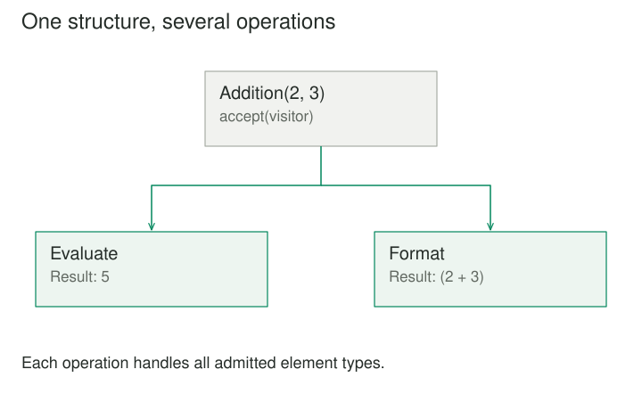

## Purpose and problem

A language tool represents expressions as NumberLiteral, Addition, and VariableReference nodes. The node classes initially evaluate expressions. Then they gain formatting, validation, dependency analysis, and code generation. Each class becomes a meeting place for unrelated operations, and adding another analysis means editing every node type.

## Core idea

Visitor organizes behavior by operation. A formatting visitor contains the formatting behavior for all relevant node types. A dependency visitor contains dependency analysis. The element structure stays focused on representing the expression, while visitors supply operations that vary over that structure.



## How it works

In the classic form, each element exposes accept(visitor). NumberLiteral.accept calls visitor.visit_number(self), while Addition.accept calls visitor.visit_addition(self). The selected visitor determines which operation is performed, and the element's accept implementation selects the type-specific visit method.

This is commonly called double dispatch: behavior depends on the visitor and the concrete element type. Language details vary, and explicit method names are useful where overloaded-method dispatch would not otherwise select by runtime argument type.

The distinctive benefit is that a complete operation can live together. Formatting rules are no longer scattered across every expression class. Adding a new visitor can add an operation without changing the existing element definitions, provided their visitation interface already covers the structure.

## Worked example

### Dependency analysis over expressions

Suppose an expression is Addition(VariableReference('subtotal'), NumberLiteral(5)). A DependencyVisitor adds a variable name when it visits VariableReference, does nothing for NumberLiteral, and visits both children of Addition. The result is the set of referenced variables.

A separate PrettyPrintVisitor formats the same expression. NumberLiteral emits a number, VariableReference emits a name, and Addition combines its child representations with the appropriate operator and parentheses.

Before Visitor, both behaviors are methods spread across the node classes. Afterward, each operation has a coherent implementation that can be reviewed and tested as a whole. The node family still supplies the dispatch entry points.

Traversal ownership must be clear. A visitor may recursively visit children itself, or a separate traversal mechanism may visit nodes in a defined order. If both do so, nodes can be processed twice. If neither does so, compound nodes can hide their children from the operation.

### A small implementation

Each expression node routes accept to its type-specific visitor method. The operation lives in the visitor. In this example, each visitor explicitly owns recursive traversal, so children are visited once.

```python
from dataclasses import dataclass


@dataclass(frozen=True)
class Number:
    value: int

    def accept(self, visitor):
        return visitor.visit_number(self)


@dataclass(frozen=True)
class Addition:
    left: object
    right: object

    def accept(self, visitor):
        return visitor.visit_addition(self)


class Evaluate:
    def visit_number(self, node):
        return node.value

    def visit_addition(self, node):
        return node.left.accept(self) + node.right.accept(self)


class Format:
    def visit_number(self, node):
        return str(node.value)

    def visit_addition(self, node):
        return f"({node.left.accept(self)} + {node.right.accept(self)})"


expression = Addition(Number(2), Number(3))
print(expression.accept(Evaluate()))
print(expression.accept(Format()))
# 5
# (2 + 3)
```

Adding formatting did not require adding format methods to each element. Adding a new element type would require a corresponding method on both visitors. The node selects the type-specific visit operation; the supplied visitor selects which overall operation is performed.

### Several reports over a document structure

A document model includes paragraphs, code blocks, and images. A PlainTextVisitor produces an accessible textual export. A ResourceInventoryVisitor collects image paths and other referenced assets. Each needs type-specific behavior, but those operations need not become permanent responsibilities of every document element class.

The plain-text operation renders a paragraph's text, formats code blocks with a clear boundary, and represents images through meaningful alternative text. The inventory operation ignores ordinary text and records image references. Their concerns are easier to understand when grouped by purpose.

Some operations need access to element data that was previously private. A visitor should receive an appropriate read interface rather than unrestricted access to all internals. The pattern can otherwise trade method clutter for weakened encapsulation.

The document structure should also be stable enough to justify the arrangement. If new element types arrive every week, every visitor must learn about them or have an explicit fallback policy. That maintenance cost is the other side of easy operation extension.

## When to use it

- A stable object structure needs many different operations.
- Type-specific operations should not all live inside the element classes.

Consider a simpler design when element types change frequently while operations remain stable, or when traversal or pattern matching can express the operation more simply.

## Tradeoffs and common mistakes

Visitor makes adding operations easier and adding element types more coordinated. A new visitor implements the existing visit methods. A new element type commonly requires a new accept implementation and changes across the visitor interface and its implementations.

This tradeoff should match the expected change direction. It fits a stable syntax tree with many evolving analyses better than a rapidly growing plugin-defined type family with just one operation.

Default visitor methods can soften the cost of new types, but they can also hide omissions. A validation visitor that silently ignores an unfamiliar node may report a false sense of completeness. Fallback behavior should reflect whether missing type-specific handling is acceptable for that particular operation.

Visitors can be stateful, collecting results during traversal. Reusing such a visitor without resetting its state may leak results between documents. Separate instances or an explicit lifecycle keep the ownership clear. Concurrent use likewise depends on the chosen state model.

## Related patterns

Some languages offer pattern matching over a closed family of data types. A standalone function with exhaustive matching can organize behavior by operation without accept methods or visitor objects. Multimethods and other dispatch facilities can also change the implementation shape.

Those alternatives do not erase the underlying tradeoff between adding types and adding operations. They may simply express it more directly in the language at hand. A custom Visitor hierarchy is not automatically preferable to native dispatch features.

[[composite|Composite]] often provides the tree that a visitor processes. [[iterator|Iterator]] can supply traversal separately. [[interpreter|Interpreter]] gives expression structures evaluation meaning; visitors may implement additional evaluation or analysis operations over those structures.

## Sources

Visitor is one of the 23 patterns in Gamma, Helm, Johnson, and Vlissides, [*Design Patterns: Elements of Reusable Object-Oriented Software*](https://www.informit.com/store/design-patterns-elements-of-reusable-object-oriented-9780201633610). The examples, code, and illustrations here are original educational explanations.
