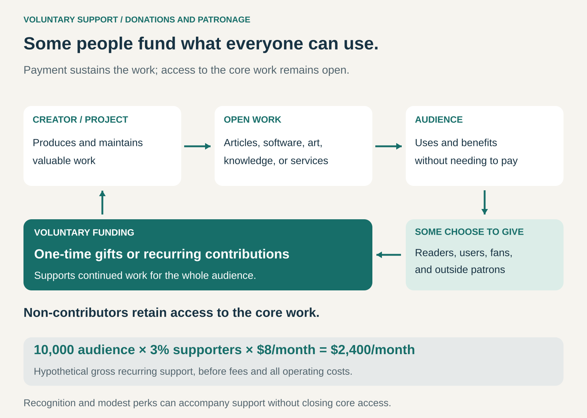

## What it is for

You create something people value: independent reporting, free software, educational material, art, or a community service. Charging everyone would restrict access, undermine the mission, or exclude people you want to reach. Yet producing and maintaining the work still costs money.

Voluntary Support funds that work through people and organizations who choose to contribute, while keeping the core offering available to people who do not pay.

The invitation is simple: **help this continue to exist.**

## The core idea

Separate the decision to support the work from the right to benefit from it.

A conventional sale asks, “Will you pay to receive this?” Voluntary Support asks, “Will you help sustain this—for yourself, for others, or because you believe it should exist?”

Support can take several forms:

- **One-time donations:** occasional contributions, often prompted by appreciation or a funding appeal.
- **Recurring contributions:** regular payments that support continuing operations.
- **Patronage:** a sustained relationship with a creator, institution, or mission, sometimes accompanied by recognition, updates, or access to the people doing the work.

Supporters may be users, admirers, former beneficiaries, businesses that depend on the work, or people who care about its wider contribution.

They do not all need the same motivation. One person gives because a resource helped them yesterday. Another wants it to remain available to someone who cannot afford to contribute.

## How it works

The organization produces useful work and makes it accessible. It then gives people a clear opportunity to support its continuation.

A strong invitation connects three things: the value already created, the work still required, and what financial support makes possible. For software, that might mean maintenance and bug fixes. For journalism, it might mean reporters’ time and investigations that take months.

Recurring support creates a continuing relationship. Supporters receive evidence that their contribution matters: finished work, progress reports, explanations of difficult choices, or a clearer picture of what happens behind the scenes.

Recognition and modest benefits can strengthen that relationship. However, as exclusive benefits become the main reason to pay, the offer increasingly combines patronage with Membership or Subscription.

The question is what the payment primarily sustains or purchases.

## Why it works

People can value an activity beyond their immediate consumption of it.

A reader may want independent reporting to remain available even when they are not reading. A studio may support an open-source tool because its continued development benefits the whole production ecosystem. A former student may fund learning material for the next generation.

Voluntary Support makes room for gratitude, identification, shared purpose, and concern for the future.

It also allows contributions to vary. Someone who can comfortably give a substantial amount can support the same work as someone who gives a little—or nothing. Broad access does not require equal financial participation.

The model can be especially effective when the work reaches many people without delivery costs increasing proportionally with every additional user. Nevertheless, a large audience alone does not establish a viable funding base. People must understand the value, trust the organization, and actually choose to contribute.

## Famous examples

### Wikipedia: supporting a shared knowledge resource

The Wikimedia Foundation, which hosts Wikipedia and other free knowledge projects, says its funding comes primarily from one-time and monthly donations from individuals. It also receives institutional support and a smaller amount of revenue from Wikimedia Enterprise services. Readers do not need to donate to continue using Wikipedia. [Wikimedia Foundation donor FAQ](https://wikimediafoundation.org/give/donor-frequently-asked-questions/)

The mechanism is collective maintenance: people help sustain a resource they use and want others to have.

That support operates alongside volunteer contributions of knowledge and editorial work. Financial donations and volunteered effort are complementary inputs; neither makes infrastructure, technical support, or organizational work costless.

The transferable lesson is that the resource itself can demonstrate the reason to give. A useful article creates an immediate example of what continued support preserves.

### The Guardian: voluntary contributions alongside paid benefits

The Guardian invites readers to contribute once or regularly. It also sells digital packages with benefits such as ad-free reading and expanded app access. These are related but distinct offers: supporting journalism and buying additional services can coexist. [Guardian support options](https://support.theguardian.com/)

Its Patrons programme makes the continuing support relationship explicit. Patrons help fund accessible journalism and can receive benefits including events and newsroom updates. The programme also allows supporters to forgo benefits and contribute the whole amount. [Guardian Patrons](https://patrons.theguardian.com/)

The lesson is that voluntary funding need not be the organization’s only income stream. A mixed model can preserve an accessible core while offering additional reasons to pay.

It also shows why recurring reader payments should not automatically be treated as identical transactions. Some primarily fund the work; others purchase a defined package of benefits.

### Blender: patronage for shared infrastructure

Blender’s free, open-source 3D software is supported through Development Fund memberships and one-time donations. The fund finances work including development, documentation, maintenance, and bug fixes. Individuals and organizations can contribute while the software remains freely available. [About Blender](https://www.blender.org/about/), [Blender Development Fund](https://fund.blender.org/about/)

For a professional user or studio, supporting Blender can be a practical investment in a tool they depend on, alongside support for its broader mission.

Blender’s funding policy states that contributions do not purchase decision-making power over the project. The project retains responsibility for its roadmap and deliberately balances individual and corporate support. [Blender funding policy](https://fund.blender.org/funding-policy/)

The lesson extends beyond software: patronage works best when supporters understand both what their money enables and where their influence ends.

## The economics

A simple starting point is:

**Gross recurring support = relevant audience × supporter share × average recurring contribution.**

Suppose a project has a monthly audience of 10,000 people. If 3% contribute an average of $8 per month, it receives **$2,400 in gross monthly recurring support**.

These are hypothetical figures, not a benchmark.

That money must cover payment and platform fees, fundraising, supporter communication, production, maintenance, administration, and any benefits promised. The creator’s own time belongs in the cost calculation.

One-time gifts can add substantial income, but a large appeal does not necessarily establish a dependable monthly budget. Recurring contributions improve visibility without guaranteeing permanence: supporters cancel, payments fail, and circumstances change.

The important measures therefore include net funds available for the work, supporter retention, the cost of attracting support, and dependence on the largest donors.

## Useful when

- Broad access is central to the purpose of the work.
- People develop trust through repeated use or a continuing relationship.
- Supporters can see a credible connection between contributions and useful work.
- Some beneficiaries or patrons have greater willingness or ability to pay than others.
- The organization can sustain fundraising and supporter relationships.
- The cost structure allows a contributing minority to support a wider audience—or voluntary funding can complement other income.

## Common mistakes and limits

**Assuming appreciation becomes income automatically.** Praise, downloads, and audience growth show interest. They do not pay operating costs. A donation button still needs a credible invitation and a workable funding base.

**Making every appeal an emergency.** Genuine urgency can matter. Repeated crisis messaging can weaken trust when supporters cannot understand the organization’s finances or longer-term plan.

**Creating expensive patron obligations.** Personal calls, bespoke rewards, and frequent events consume time. A generous contribution can leave little funding for the core work if servicing it becomes too demanding.

**Confusing support with control.** Large contributors may expect influence even when none was promised. Clear boundaries and a broader funding base help protect the work’s purpose.

**Treating non-contributors as failures.** An accessible offering is intended to reach people who do not pay. Financial viability depends on sufficient support overall, rather than universal participation.

## Related patterns

[[pay-what-you-want|Pay What You Want]] lets customers choose the price associated with a particular offering. Voluntary Support emphasizes sustaining the work, often separately from any individual transaction.

[[membership|Membership]] creates an ongoing relationship with defined belonging or benefits. Patronage can use a membership structure while retaining support for the mission as its central purpose.

[[sponsorship|Sponsorship]] exchanges funding for agreed association, visibility, or other commercial rights. Patronage may include recognition, but the extent of promised commercial benefits determines how closely the arrangements overlap.

[[crowdfunding|Crowdfunding]] gathers contributions from many people, often around a defined project or campaign. Donation crowdfunding can establish support that later develops into continuing patronage.
