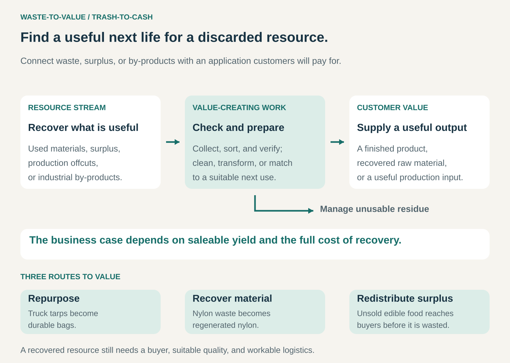

## What it is for

Waste-to-Value creates revenue or reduces costs by finding useful applications for discarded materials, surplus products, and production by-products.

It is useful when something has lost its value in one setting but retains properties that matter elsewhere. A retired truck tarp can become a durable bag. Discarded nylon can become raw material for new textiles. Unsold food can reach buyers before it becomes waste.

The business opportunity lies in connecting an overlooked resource with a viable use—and organizing the collection, preparation, and delivery needed to make that connection work.

## The core idea

**Turn a waste or surplus stream into a useful offering whose value exceeds the cost of recovering it.**

The resource does not have to be free. Some businesses purchase discarded materials because their properties, appearance, or availability suit a valuable application.

Several routes are possible:

- **Repurpose:** give an existing material or object a different use.
- **Recover material:** process waste into a usable raw material.
- **Use by-products:** supply outputs from one production process as inputs to another.
- **Redistribute surplus:** find buyers for usable products before they are discarded.

Value can come from product sales, processing fees, avoided disposal costs, or replacing purchased inputs. Different parties may receive different benefits.

The central question is whether the complete recovery system creates sufficient value. A technically possible transformation can still be commercially unattractive.

## How it works

The pattern connects five elements.

**A suitable resource stream.** The business needs to understand what is available, where it comes from, and how its quantity and condition vary. A reliable stream of relatively consistent material is easier to use than scattered, contaminated, unpredictable supply.

**A valuable application.** The recovered resource must meet a practical need. Buyers still care about performance, appearance, convenience, price, and reliability.

**Collection and preparation.** Transport, sorting, disassembly, cleaning, storage, and testing can determine whether the model works. These activities often require more coordination than the transformation itself.

**A repeatable conversion or matching process.** Some resources need substantial processing. Others primarily need a new design, a different buyer, or a faster route to consumption.

**Management of what remains.** Recovery rarely makes every incoming item usable. Rejects, contaminants, processing losses, and unsold outputs still need an appropriate destination.

## Why it works

A resource can lose value because its original owner no longer has a use for it—not because all its useful properties have disappeared.

A worn industrial material may remain strong enough for another application. A production by-product may contain useful components. A perishable product may still be valuable if someone can buy it within a short window.

Waste-to-Value businesses address the gap between those remaining properties and a customer’s requirements.

They may also combine several benefits. A supplier can reduce disposal expenditure while a processor earns revenue from recovered material. A finished product can gain distinctive characteristics from its previous life.

These benefits require coordination. Resources must reach the right destination in usable condition, at a cost the resulting offering can support.

## Famous examples

### FREITAG — retired truck tarps become distinctive bags

FREITAG purchases used truck tarps and turns suitable sections into bags and accessories. Its production process includes sourcing, testing, disassembly, washing, cutting, sewing, and quality control.

Designers work with the colors, markings, and condition of individual tarps to create distinctive products. The recovered material becomes part of the product’s character as well as its construction. [FREITAG’s production process](https://freitag.ch/en_US/mission/about-freitag/production).

The supply arrangement also reveals the operational work behind the idea. FREITAG pays for usable material, covers collection and transport, and excludes unsuitable sections. [FREITAG’s tarp purchasing requirements](https://freitag.ch/en_US/service/tarp-supply).

The saleable offering combines recovered material with design, durability, preparation, and craftsmanship. Its value depends on the finished bag meeting customer expectations.

### Aquafil’s ECONYL — nylon waste becomes a new material input

Aquafil’s ECONYL regeneration system uses selected nylon waste, including material from fishing nets, carpets, fabric scraps, and industrial sources.

After collection, sorting, and cleaning, a chemical process breaks nylon 6 down into its constituent building block. The recovered material is then used to produce regenerated nylon for applications such as textiles and interiors. [Aquafil’s explanation of the ECONYL system](https://econyl.aquafil.com/sustainability/).

Material selection matters. Aquafil explains that its facilities process nylon 6; fishing nets made from other materials require different treatment routes. [Aquafil’s account of fishing-net recovery](https://econyl.aquafil.com/fishing-nets-from-aquaculture-and-fish-industry-and-ghost-nets/).

This illustrates Waste-to-Value as an industrial supply system. Collection, identification, separation, and processing make a discarded resource suitable for another manufacturer’s requirements.

### Too Good To Go — surplus food reaches customers before disposal

Too Good To Go connects customers with restaurants, bakeries, cafés, and stores offering unsold food through “Surprise Bags.” Customers reserve through the app and collect during a designated pickup window. [How Too Good To Go works](https://www.toogoodtogo.com/en-us/how-does-the-app-work).

The food businesses obtain a channel for selling surplus that might otherwise go unsold. Customers accept a less predictable assortment and a specified collection time in exchange for a discounted offer. [Too Good To Go’s business offering](https://www.toogoodtogo.com/en-us/food-waste-solution).

This route preserves an existing product’s usefulness. The food remains food; the value-creating work is matching available surplus with nearby demand while there is still time to consume it.

## The economics

Consider an illustrative processor accepting **100 tonnes of material per month**, with **70 tonnes becoming saleable output**:

| Monthly activity                            |     Amount |
| ------------------------------------------- | ---------: |
| Acceptance fees: 100 tonnes at $50          |     $5,000 |
| Recovered material sales: 70 tonnes at $300 |    $21,000 |
| Collection, transport, and sorting          |    −$6,000 |
| Processing                                  |   −$10,000 |
| Residue disposal: 30 tonnes at $100         |    −$3,000 |
| Quality control and selling costs           |    −$3,000 |
| **Remaining contribution**                  | **$4,000** |

These hypothetical figures leave $4,000 before equipment investment, financing, other overhead, and tax.

Yield makes a substantial difference. If only 50 tonnes become saleable, revenue falls to $20,000, including acceptance fees. If residue disposal rises to $5,000 and the other costs remain unchanged, the operation produces a **$4,000 shortfall**.

Avoided disposal costs can improve the proposition for the resource’s original owner, but they are not automatically revenue for the processor. Each benefit belongs in the economics of the party that actually receives it.

## Useful when

- A discarded or surplus resource retains useful properties.
- Supply can be collected in sufficient quantity and suitable condition.
- A buyer has a credible application for the recovered output.
- Preparation and conversion costs leave an adequate margin.
- Quality and traceability can meet the intended use.
- Collection and delivery distances are manageable.

The pattern becomes especially attractive when a consistent resource stream can serve an established customer need.

## Common mistakes and limits

**Assuming waste is free.** Useful discarded materials may have competing buyers. Collection, sorting, testing, and preparation also carry costs.

**Counting incoming volume as useful output.** Revenue depends on saleable yield. Contamination, moisture, damage, and mixed materials can reduce recovery substantially.

**Starting with a process instead of a buyer.** Producing a recovered material does not establish demand for its grade, price, or delivery schedule.

**Ignoring variability.** Changes in source materials can affect quality, processing requirements, and customer acceptance.

**Underestimating storage and timing.** Bulky materials consume space. Perishable surplus loses value quickly. Logistics can overwhelm an otherwise attractive margin.

**Assuming profitability proves environmental benefit.** Environmental performance needs separate assessment of processing, transport, resource use, and the alternative being displaced.

**Making avoidable waste necessary to the model.** Recovery should coexist with prevention. The U.S. EPA’s hierarchy places source reduction and reuse ahead of recycling and disposal. [EPA’s materials management hierarchy](https://www.epa.gov/smm/sustainable-materials-management-non-hazardous-materials-and-waste-management-hierarchy).

## Related patterns

- [[industrial-symbiosis|Industrial Symbiosis:]] connects organizations so one operation’s by-products or surplus resources serve another.
- [[ingredient-branding|Ingredient Branding:]] can make a recovered material recognizable and valuable within another company’s product.
- [[marketplace|Marketplace:]] connects fragmented sources of surplus with suitable buyers.
- [[blended-value|Blended Value:]] combines financial returns with environmental or social benefits, which still need to be assessed separately.
