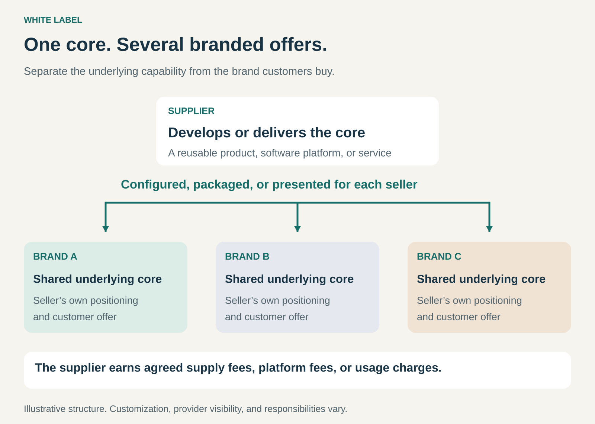

## What it is for

Launching or expanding a branded offering without developing and operating every part of it yourself.

A marketing agency wants to offer website software. A retailer wants to add travel booking. A creator wants to sell merchandise without building a production operation.

In each case, another business already provides much of the underlying capability.

White labeling lets the seller offer that capability under its own brand. The supplier concentrates on developing or delivering the product or service; the seller concentrates on its audience, positioning, distribution, and customer experience.

## The core idea

**Separate the underlying product or service from the brand under which customers buy it.**

A supplier provides a reusable offering that other businesses can present as their own branded proposition.

The underlying capability might be a physical product, software platform, booking service, reporting system, or operational service. Branding can appear in packaging, interfaces, domains, communications, and customer support.

The supplier may serve several sellers using substantially the same core. Sellers can differentiate through design, configuration, specialist knowledge, service, or access to a particular audience.

White labeling does not necessarily mean everything is identical. It means the seller can build a branded offer around a capability supplied by another business.

Terminology overlaps with **private label**. A useful working distinction is that white label commonly emphasizes a reusable offering available to multiple brands, while private label often involves a product developed or specified for a particular retailer. Actual arrangements vary. [Shopify’s comparison of white label and private label](https://www.shopify.com/blog/private-label-vs-white-label)

## How it works

The pattern connects three layers.

**The underlying capability.** The supplier develops software, produces goods, or delivers a service. It maintains the infrastructure and expertise required to provide that capability.

**The branded offer.** The seller selects, configures, packages, or presents the capability for its market. This can include a name, visual identity, pricing structure, specialist content, and additional services.

**The customer relationship.** The parties agree who handles selling, billing, support, fulfillment, complaints, and renewals. Those responsibilities need not all sit with the seller.

The supplier earns through wholesale prices, platform subscriptions, account fees, usage charges, revenue sharing, or a combination.

The seller earns from the customer-facing offer after paying the supplier and covering its own costs.

The supplier’s identity may be absent from the main presentation, but complete invisibility is not required. A branded offer can disclose that another company powers or fulfills it.

## Why it works

The supplier and seller contribute different strengths.

A supplier may have excellent technology or production capabilities but limited access to a particular customer group. A seller may understand that audience and have its trust, while lacking the resources to build the underlying capability.

White labeling connects those assets.

For the seller, it can reduce development time and initial investment. For the supplier, it can extend distribution across several brands and spread development or operating costs across more business.

The seller still needs to add value. That might come from specialist configuration, convenient access, useful content, dependable support, or integration with a broader service.

A different logo alone may provide little reason for customers to choose one seller over another.

## Famous examples

### Walmart+ Travel and Expedia: an established platform behind a retailer’s offer

Walmart launched Walmart+ Travel using Expedia Group’s White Label Template technology. The announcement explicitly identified Expedia as the provider behind the booking capability. [Walmart’s travel partnership announcement](https://corporate.walmart.com/news/2023/07/25/walmart-and-expedia-group-launch-travel-benefit-for-walmart-members)

Walmart’s current help page continues to describe the service as powered by Expedia and directs reservation support to Expedia. [Walmart+ Travel help](https://www.walmart.com/help/article/walmart-travel/0f75ff42ece74f9ca0bcae0c1e73e86d)

The example shows how a retailer can extend its customer proposition using an established travel platform.

It also demonstrates that white labeling can include visible acknowledgment of the provider. Walmart supplies the branded membership context; Expedia supplies the travel capability and specified support.

### Printful: merchandise sold through another business’s brand

Printful describes its fulfillment service as white label. Its help documentation says shipments do not include Printful branding and explains options for branded shipping labels, packing slips, and custom packaging, subject to fulfillment limitations. [Printful’s white-label packaging guidance](https://help.printful.com/hc/en-us/articles/50265222064785-Does-the-packaging-include-any-Printful-branding)

A creator or retailer can therefore sell merchandise through its own storefront while Printful handles underlying production and fulfillment.

The seller contributes artwork, product selection, audience, and marketing. The customer encounters that seller’s offer rather than a Printful retail proposition.

This example also shows how white labeling can coexist with customization: the seller’s artwork changes the finished product while the production capability remains shared.

### Duda: website software presented under an agency’s identity

Duda offers white-label branding for its website platform. Its documentation describes replacing platform branding with an agency’s logo, favicon, and colors across areas such as the login page, dashboard, editor, and previews. [Duda’s white-label branding documentation](https://support.duda.co/hc/en-us/articles/26519443459991-Custom-Branding-for-White-Label)

An agency can combine that software with its own design, setup, maintenance, and customer service.

The agency does not have to build a website editor to offer a branded website service. Its differentiation can come from understanding a particular industry and delivering useful sites reliably.

The underlying platform remains a supplier dependency, even when the customer-facing experience carries the agency’s identity.

## The economics

Consider a hypothetical seller offering a branded travel mug.

| Per-order item                         | Amount |
| -------------------------------------- | -----: |
| Customer price                         |    $40 |
| Supplier’s product and branding charge |   −$18 |
| Fulfillment and shipping               |    −$5 |
| Payment fees and expected return costs |    −$2 |
| Customer acquisition                   |    −$8 |
| Remaining contribution                 | **$7** |

The apparent difference between the selling price and supplier charge is **$22**. After the other listed costs, the contribution is **$7**.

That amount still needs to cover fixed overhead, design work, and taxes.

If acquisition cost rises from **$8 to $15**, the contribution falls to zero.

For the supplier, the **$18** charge is revenue before its own production, labor, equipment, and overhead costs.

These are illustrative figures. They show why access to an inexpensive underlying product does not, by itself, establish a profitable branded business.

## Useful when

- A business has customer access or trust but lacks a complementary production or technology capability.
- Speed to market matters more than owning every component.
- An established supplier can meet the required quality and service standards.
- The seller can differentiate through audience, configuration, content, convenience, or support.
- A supplier wants wider distribution through other businesses’ brands.
- The offering can use a shared core without requiring extensive redevelopment for each seller.

It is less attractive when proprietary technology or product design is the main source of differentiation, or when supplier dependence would undermine the customer promise.

## Common mistakes and limits

**Assuming branding creates a defensible advantage.** Competitors may have access to the same supplier. The seller needs a reason for customers to prefer its overall offer.

**Confusing white label with ordinary resale.** Reselling a product under its manufacturer’s brand leaves that brand central to the offer. White labeling changes the customer-facing identity.

**Assuming outsourced production means white label.** A company can own a proprietary design and hire a factory to manufacture it. That alone does not establish a reusable white-label offering.

**Overlooking responsibility gaps.** Customers need a clear route for support, returns, and complaints. The supplier and seller need matching expectations about who resolves problems.

**Assuming branding transfers ownership.** Using a platform under another name does not automatically transfer its software, designs, or intellectual property.

**Ignoring supplier dependence.** Price changes, outages, quality problems, discontinued products, and migration difficulties can affect the seller’s business.

**Promising more customization than the economics support.** Extensive bespoke development or manual service can consume the savings created by the shared core.

## Related patterns

- [[licensing|Licensing:]] May provide the rights required to rebrand or use an underlying product or platform.
- [[layer-player|Layer Player:]] A specialist supplier can serve the same function across many sellers’ businesses.
- [[dropshipping|Dropshipping:]] Can combine with white labeling when the supplier ships directly to customers; it describes fulfillment rather than branding.
- [[franchising|Franchising:]] Replicates a shared brand and operating format, while white labeling commonly supports several separate brands.
