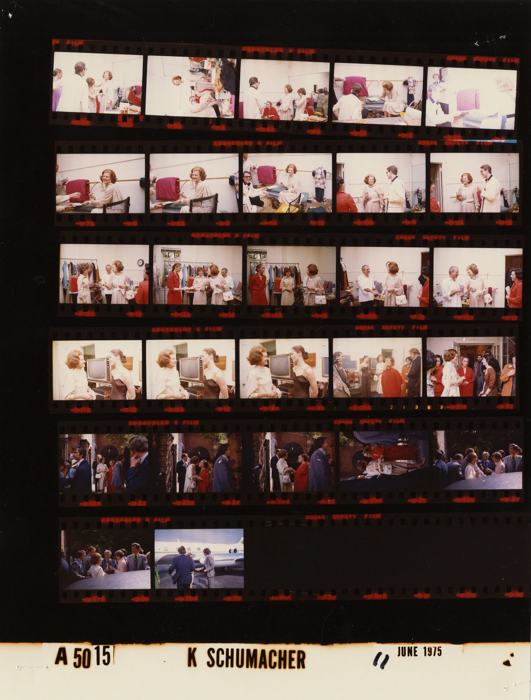

Your first picture of a market stall includes the seller, the counter, and a bright sign.
It records what was there, but the seller's hands disappear behind the goods. Moving a
little sideways reveals the gesture. A closer view emphasizes the exchange; a wider one
shows the queue. You have not simply taken more pictures. You have developed several answers
to a specific photographic possibility.

Stay with a worthwhile scene long enough to explore deliberate variations. Change a position,
frame, moment, light relationship, or emphasis for a reason. Notice what each version gains
and loses. The first photograph becomes information for the next decision rather than the
end of the encounter or a trigger for an undirected burst.

[Source and archival descriptions](https://commons.wikimedia.org/wiki/File:Ford_A5015_NLGRF_photo_contact_sheet_(1975-06-11)(Gerald_Ford_Library).jpg).
Converted to WebP. Open the full-size sheet to inspect individual frames.

## Let each frame answer a question

Think of the first image as a proposal. It suggests what the photograph could become and
reveals some problems you may not have noticed directly. Perhaps a background line crosses
a face. Perhaps the main subject occupies too little space. Perhaps the wide view explains
the situation well and only needs a clearer moment. A useful variation responds to one
of those observations.

The archival sheet demonstrates visible differences rather than a universal shooting procedure.
Some views place people within the room; others give expressions and gestures more space.
The changing orientation also changes which surrounding details survive. We can compare those
consequences without pretending to know why each shutter release happened.

[[choose-your-subject|Choose Your Subject]] provides the intention that makes a variation meaningful.
[[change-your-position|Change Your Position]] supplies one important variable. Working the scene
is the larger process of using such variables to develop possibilities while they remain
available, including the possibility that a better subject emerges.

## A landscape with several possible centers

At a coast, your first frame contains a headland and a broad foreground of pebbles. You
notice that a particular rock echoes the headland's shape. Lowering the camera makes their
relationship visible. Raising it again reveals a curve of foam hidden from the low position.
The two versions now have different purposes: one compares forms, the other describes the coast.

Do not keep adding foreground merely because the lower view seems more dramatic. If the rock
becomes so large that the headland feels incidental, decide whether that is the intention.
A vertical frame may strengthen their relationship or remove too much shoreline. The experiment
is useful because you understand the tradeoff, even if the earlier wide view remains preferable.

[[build-layers|Build Layers]] and [[use-leading-lines|Use Leading Lines]] explain those particular
structures. You do not need to apply both. Exploring a scene is not collecting one compulsory
example of every composition technique.

## A portrait that develops through interaction

With a consenting friend, begin with a comfortable simple arrangement. A seated portrait may
show their face clearly but leave their hands uncertain. If they enjoy making tea, offer
that as an option. Photograph the preparation, a pause, and a moment of conversation. Move
yourself when a background overlap interferes rather than continually repositioning them.

The activity may improve the gestures, but the person may prefer a still portrait. Treat
that preference as useful direction. A changing session should not become a series of demands
that exhausts your subject. [[give-people-something-to-do|Give People Something to Do]] considers
collaboration and comfort in more detail.

Technical changes can be deliberate too. If hands blur unintentionally, use a shorter exposure
or choose a quieter moment. If the setting matters, retain enough depth of field to recognize
it. Avoid changing every setting between frames: you may otherwise lose track of what caused
the difference you are trying to understand.

## Develop a small object photograph

A cup near a window offers a quiet scene that does not hurry you. A high view emphasizes
its circular opening; a lower one emphasizes the handle and shadow. Turning the cup changes
its visible design without changing camera position. Moving the camera changes its relationship
to the window and background. Those are separate choices worth recognizing.

Once a version works, preserve it before attempting a larger change. You can then explore
without forgetting the arrangement you already liked. A phone is entirely adequate for this
process. Manual mode can make some comparisons easier to control, but deliberate observation
does not depend on using it.

## Recognize when to hold still or leave

Working the scene is different from [[find-the-frame-then-wait|Find the Frame, Then Wait]],
where the composition is already established and you hold it for an event. It also differs
from [[anticipate-the-moment|Anticipate the Moment]], which prepares for a brief unfolding
opportunity. You may move between these approaches: explore, find a useful frame, then wait.

This pattern helps when the first view feels automatic or when you make many near-duplicates
without learning anything from them. It has limits. A scene may pass quickly, a person
may need to leave, or the first frame may already serve the purpose. Stop when new variations
repeat what you know or when continued photographing interferes with the experience. Later,
[[select-the-strongest-frame|Select the Strongest Frame]] chooses among the results; [[review-one-thing-at-a-time|Review One Thing at a Time]] turns the comparison into learning. Neither requires endless shooting.
