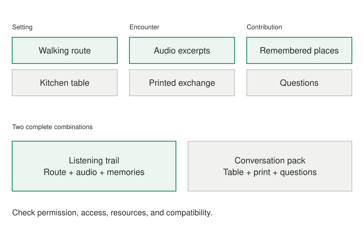

A community archive wants people to engage with its recordings. Every suggestion sounds like a variation of a familiar exhibition: a different room, a different poster, another opening event. The group is generating ideas, but its idea of what an archive experience can be remains fixed.

## Core idea

A Zwicky Box changes the search. Break a design into dimensions, list alternatives within each dimension, and combine choices across them. Instead of asking for another complete idea from nowhere, construct possibilities with different underlying arrangements.

Fritz Zwicky developed morphological analysis. Later work in general morphological analysis, including Tom Ritchey’s, emphasizes the relationships and consistency of combinations. A useful box is more than a random idea generator: its dimensions and compatibility judgments determine what it can reveal.

## When to use it

The box is most useful when the current options share an unnoticed architecture. By changing one dimension at a time, you can discover which parts of that architecture are necessary and which were simply inherited. Keep the rejected combinations when their failure teaches you something about the real design constraints.

## How it works

1. **Choose dimensions.** Separate the aspects of the design that can vary. Give each a short list of alternatives.
2. **Construct candidates.** Select one alternative per dimension and describe the resulting arrangement.
3. **Check compatibility.** Identify combinations that conflict with each other or with genuine requirements.
4. **Develop and test.** Select a coherent candidate and investigate its most consequential uncertainty.

State nonnegotiable requirements before combining. A design that excludes the intended participants is not rescued by being novel. Keep a place for uncertainty as well: an untested compatibility judgment should not silently eliminate a promising option.

After generating, select a candidate for further development. Explain what it changes, which requirements it meets, what remains unknown, and the smallest test that could resolve a critical uncertainty. Novelty alone is not a selection criterion.

## Worked examples



### An archive experience

For the archive, useful dimensions might be setting, encounter, and participant contribution. Settings could include a walking route, a kitchen table, or a bus waiting area. Encounters could include a short audio excerpt, a printed exchange, or a live conversation. Contributions could include a remembered place, a question, or a new recording.

Each dimension should describe one aspect of the design. “Cheap” and “outdoors” do not belong in a single list of interchangeable alternatives because they answer different questions. Likewise, “walking route” and “audio walk” are not cleanly independent: the second already chooses an encounter format.

Perfect independence is rarely possible. Aim for distinctions that make combinations interpretable. Begin with a few dimensions and a few alternatives, then revise if the results repeatedly fail for the same reason.

One combination is a walking route, short audio excerpts, and remembered places. It suggests a neighborhood listening trail where participants mark locations that connect to their own memories.

Another is a kitchen table, a printed exchange, and questions. It suggests a portable conversation pack for intergenerational meals, with archival extracts and space to record unanswered questions for later investigation.

A third is a bus waiting area, live conversation, and new recordings. This is unfamiliar, but its practical constraints are severe: noise, consent, waiting times, staff availability, and safe access. The combination is not useless because it fails in its first form. It reveals a possible need for brief encounters in everyday waiting spaces, perhaps served better by a hosted pop-up elsewhere.

Write out several combinations before judging them. Otherwise, the first familiar option tends to dominate and the box merely decorates an ordinary brainstorming session.

### A learning routine

A learner planning a language routine can choose dimensions such as setting, practice partner, and feedback. Combinations might include a solo train journey with recorded prompts and later self-review, or a weekly walk with a friend and immediate correction.

The exercise can reveal that “study more” had concealed several independent choices. It can also expose incompatibilities: immediate spoken feedback is not available from a silent reading routine. That insight suggests either changing the activity or choosing a different feedback arrangement.

## Pitfalls and limits

A combination can be conceptually coherent and still be impractical. Check legal requirements, accessibility, technical dependencies, cost, and the experience of the people involved. Separate a genuine incompatibility from a preference that deserves exploration.

For the listening trail, public access to recordings may be limited by contributor permissions. That is not a creativity challenge to bypass. It changes which material can be used. A printed kitchen-table pack may be affordable but unsuitable for participants with low vision unless another format is available.

General morphological analysis can involve systematic pairwise consistency assessment across many dimensions. A small personal worksheet does not implement that full process. It helps make a handful of combinations and their constraints explicit. Do not claim that checking a few combinations exhausts the solution space.

Do not multiply dimensions merely to make the method impressive. Four alternatives across six dimensions produce thousands of theoretical combinations, most of which nobody will examine. A smaller box with well-chosen dimensions can yield more useful exploration.

## Related patterns

[[reframing-generate-real-options|Generate Real Options]] helps expand a narrow choice. This pattern supplies a particular mechanism for doing so: recombination across dimensions. [[separate-exploration-from-selection|Separate Exploration from Selection]] helps preserve the temporary space in which unusual combinations can be considered. [[prefer-the-smallest-useful-experiment|Prefer the Smallest Useful Experiment]] helps turn a candidate into evidence.

## Sources and attribution

- [Tom Ritchey and the Swedish Morphological Society: General Morphological Analysis](https://www.swemorph.com/ma.html), including Zwicky’s contribution and cross-consistency assessment.

## Practice — Build Three Unfamiliar Combinations

**Purpose:** Generate structurally different possibilities by combining alternatives across independent dimensions.

**Time:** About 20 minutes. The practice produces a reflection or plan; it does not execute actions for you.

```patternverse-language
:language 1
:title "Build Three Unfamiliar Combinations"
:output result

!show {
About 20 minutes. Work with one manageable situation. This participant-led practice needs no AI. Review each group before Continue. The result is a reflection or plan; actions are not carried out or scheduled for you.
}
context = !form {
:title "Set the design brief"
aim = !ask {
What function or experience are you trying to create?
}
requirements = !ask {
Which requirements must every viable combination satisfy?
}
}
dimensions = !form {
:title "Choose three distinct dimensions"
one = !ask {
Name dimension 1: one aspect of how the design could work.
}
two = !ask {
Name an independently variable dimension 2.
}
three = !ask {
Name an independently variable dimension 3.
}
}
alternatives = !form {
:title "Supply alternatives within each dimension"
one_a = !ask {
First alternative for {{dimensions.one}}
}
one_b = !ask {
Second alternative for {{dimensions.one}}
}
two_a = !ask {
First alternative for {{dimensions.two}}
}
two_b = !ask {
Second alternative for {{dimensions.two}}
}
three_a = !ask {
First alternative for {{dimensions.three}}
}
three_b = !ask {
Second alternative for {{dimensions.three}}
}
}
first = !form {
:title "Construct a first combination"
!show {
Try a combination that differs meaningfully from the previous ones. The practice does not automatically reject duplicates.
}
one = !choose {
Choose for {{dimensions.one}}
- a: "{{alternatives.one_a}}"
- b: "{{alternatives.one_b}}"
}
two = !choose {
Choose for {{dimensions.two}}
- a: "{{alternatives.two_a}}"
- b: "{{alternatives.two_b}}"
}
three = !choose {
Choose for {{dimensions.three}}
- a: "{{alternatives.three_a}}"
- b: "{{alternatives.three_b}}"
}
idea = !ask {
Describe what this combination would actually be.
}
compatibility = !ask {
Which elements conflict, and which requirements or uncertainties need checking?
}
}
second = !form {
:title "Construct a second combination"
!show {
Try a combination that differs meaningfully from the previous ones. The practice does not automatically reject duplicates.
}
one = !choose {
Choose for {{dimensions.one}}
- a: "{{alternatives.one_a}}"
- b: "{{alternatives.one_b}}"
}
two = !choose {
Choose for {{dimensions.two}}
- a: "{{alternatives.two_a}}"
- b: "{{alternatives.two_b}}"
}
three = !choose {
Choose for {{dimensions.three}}
- a: "{{alternatives.three_a}}"
- b: "{{alternatives.three_b}}"
}
idea = !ask {
Describe what this combination would actually be.
}
compatibility = !ask {
Which elements conflict, and which requirements or uncertainties need checking?
}
}
third = !form {
:title "Construct a third combination"
!show {
Try a combination that differs meaningfully from the previous ones. The practice does not automatically reject duplicates.
}
one = !choose {
Choose for {{dimensions.one}}
- a: "{{alternatives.one_a}}"
- b: "{{alternatives.one_b}}"
}
two = !choose {
Choose for {{dimensions.two}}
- a: "{{alternatives.two_a}}"
- b: "{{alternatives.two_b}}"
}
three = !choose {
Choose for {{dimensions.three}}
- a: "{{alternatives.three_a}}"
- b: "{{alternatives.three_b}}"
}
idea = !ask {
Describe what this combination would actually be.
}
compatibility = !ask {
Which elements conflict, and which requirements or uncertainties need checking?
}
}
develop = !form {
:title "Develop a candidate"
candidate = !choose {
Which combination will you develop?
- first: "First"
- second: "Second"
- third: "Third"
- rework: "Rework the dimensions or combinations"
}
revision = !ask {
What would improve the candidate or the search space?
}
test = !ask {
What small check could test its weakest important assumption?
}
}
result = {brief: context, dimensions: dimensions, alternatives: alternatives, combinations: {first: first, second: second, third: third}, development: develop}
!show {
Your candidate selection: {{develop.candidate}}
Development or revision: {{develop.revision}}
Next check: {{develop.test}}
}
-> end
```
