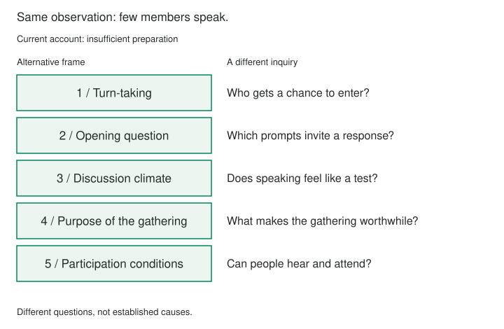

A reading group meets regularly, but only a few people speak. The organizer concludes that everyone else needs to prepare more carefully. That explanation suggests reminders, shorter reading lists, or a stricter expectation to arrive with notes. Before choosing a remedy, it is worth asking what other accounts of the same silence might make visible.

## Core idea

Five Alternative Frames creates a short interval in which several interpretations can exist before one is selected. Keep the situation recognizable while changing what the difficulty is about: the goal, the arrangement, an assumed cause, the people affected, or a boundary around the account.

A different frame should open a different inquiry. “People are unprepared” and “people have not done enough reading” offer almost the same explanation. “The conversation gives people little time to enter” points toward a different observation and a different possible response. That difference is the purpose of the exercise.

Five is a useful working target for this practice, rather than a scientifically established optimum. It encourages a search beyond the first plausible alternative while keeping the session bounded. The result is a set of hypotheses to examine, not five equally credible accounts or a requirement to reject the original one.

## When to use it

Use this practice when one interpretation has started to feel inevitable, when a group keeps proposing variations of the same remedy, or when a strongly worded explanation arrives before anyone has inspected the situation. It also helps when a creative task has become narrowly defined by its first proposed solution.

Choose a manageable situation with room for inquiry. A small recurring difficulty is usually easier to work with than a concern as broad as “everything about my work.” When an immediate response is needed, act on what is already clear; the exercise can wait until there is time to reconsider the wider account.

## How it works

Begin with a brief description of the situation and the interpretation currently guiding action. Keep an observable detail available as an anchor. For the reading group, that might be “the same three people speak during most of the discussion,” while “the others do not prepare” remains an explanation to examine.

Produce five alternatives before ranking them. Change one consequential aspect at a time: who gets a turn, what the discussion asks of people, what participation feels like, what members want from the gathering, or which practical conditions make participation possible. These are possible lenses, rather than a required checklist for every situation.

After the set exists, compare the accounts. Ask whether each changes what would be worth noticing or trying. Merge near-duplicates and revise statements that merely blame a different person. A useful set can include an uncomfortable possibility as well as a reassuring one.

Choose one or two frames worth checking next. Name a question, observation, or modest experiment that could change your view. The guided practice below records the situation, the current interpretation, and the five alternatives; this final comparison happens after generating them. Keep the original account in the comparison when the evidence still supports it.

## Worked examples

### Five accounts of a quiet reading group

The organizer keeps the observed silence constant and tries five alternatives to “people need to prepare more.”



1. **The turn-taking arrangement favors quick speakers.** A few members enter immediately, leaving others little time to formulate a response. The next inquiry concerns pauses, interruptions, and who gets invited into the conversation. A short period of individual reflection could be tried before discussion.
2. **The opening question is too abstract.** “What does the novel say about modernity?” may be harder to enter than “Which passage stayed with you?” The organizer could compare how people respond to specific passages and broad themes, without assuming either kind of question is always better.
3. **Speaking feels like a test of expertise.** Members may worry about offering an interpretation they cannot defend. The useful next step is a tentative conversation about the discussion climate, rather than an announcement that the organizer knows how everyone feels.
4. **Members want different experiences from the gathering.** Some may enjoy listening, social contact, or discovering books more than literary debate. Asking what makes the meeting worthwhile could reveal that equal speaking time is not everyone’s measure of success.
5. **The format makes participation difficult.** Timing, room noise, or the way remote participants join may interfere. Checking what people can hear and when they can attend opens practical possibilities that preparation reminders would miss.

These frames lead to different questions. They can also overlap: a member might enjoy listening and still want a clearer opening to speak. The organizer could first ask members about their experience and observe one meeting, then choose a small change. Neither silence nor a clever alternative account establishes its own cause.

### From a perfect draft to usable material

A writer’s current frame is “I cannot finish because the sentences are not good enough.” Alternatives could concern an unresolved argument, an order of sections that hides the main point, a lack of concrete examples, an imagined audience that keeps changing, or treating a first draft as finished prose. Each suggests different work. Producing rough material may help the last account; it will not automatically settle a missing argument.

## Pitfalls and limits

Five positive restatements are not five frames. “I am learning,” “this is a challenge,” and “there is an opportunity here” may change the emotional tone without changing the explanation or the possible action. Look for a difference in the question each account makes worth pursuing.

Do not manufacture certainty to complete the list. A frame about another person’s motives should remain tentative and answerable to their account. Equally, an alternative should not erase a genuine constraint or excuse conduct that needs a direct response.

Stop when the next useful step depends on information rather than more interpretations. If five distinct frames do not emerge, a few meaningful ones are more useful than padding. The exercise succeeds when the situation becomes easier to investigate, not when the list sounds inventive.

## Related patterns

[[creative-reframing|Creative Reframing]] introduces the broader move of changing how a situation is represented. [[reframing-generate-real-options|Generate Real Options]] checks whether alternatives differ in their underlying assumptions. [[reframing-validate-frame|Validate the Frame]] connects a promising account to evidence that could strengthen or weaken it.

## Sources and attribution

This is an original Patternverse exercise and explanatory adaptation. The reading-group and writing examples are illustrative. The five-frame target is a practical constraint for this exercise, with no claim that it is an optimal number or a validated diagnostic procedure.

## Practice — Generate Five Alternative Frames

```patternverse-language
:language 1
:title "Five Alternative Frames Practice"

step_1 = !form {
  :title "Describe the situation"
  !show {
Generate several interpretations before evaluating any of them.
  }
  situation = !ask {
Describe the situation you are working with.
  }
}

step_2 = !form {
  :title "Name the current frame"
  current-frame-response = !ask {
What is your current interpretation?
  }
}

step_3 = !form {
  :title "Generate alternatives"
  alternatives-response = !ask {
Write five substantially different ways to frame the same situation.
  }
}

-> end
```
