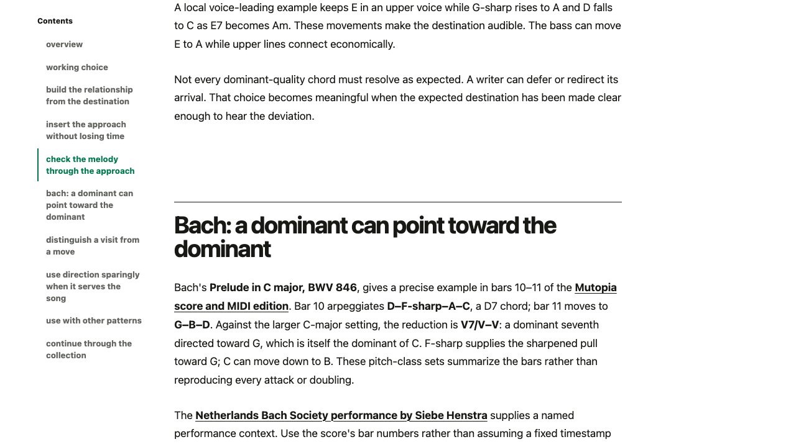
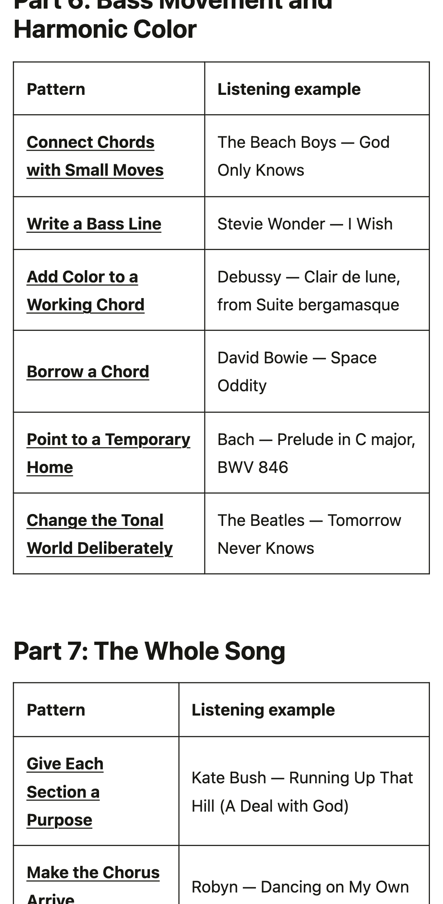

# Listening examples integrated

All 48 songwriting patterns now contain one developed, source-linked external study. This pass added 44 sections and retained the Four Tet, Bill Withers, Joni Mitchell, and True Love Waits studies. The listening guide now indexes the actual examples across all eight parts.

Each addition identifies what to notice and connects that relationship to the original Porch Light or Platform Three material. Source editions, creator accounts, and musical interpretations are distinguished. No commercial lyric passages, score images, or recordings were copied. The course remains unpublished.

## Coverage

| Part | Written studies |
| ---- | --------------- |

| 1. Start Making Songs | 6 of 6 |

| 2. Rhythm and Groove | 6 of 6 |

| 3. Notes, Keys, and Chords | 6 of 6 |

| 4. Melody and Hooks | 6 of 6 |

| 5. Lyrics and Meaning | 6 of 6 |

| 6. Bass Movement and Harmonic Color | 6 of 6 |

| 7. The Whole Song | 6 of 6 |

| 8. Arrange, Revise, and Finish | 6 of 6 |

## Verification

66 focused content/music checks and 30 desktop/phone browser checks pass. Every article was visited in both layouts. The guide renders eight two-column tables with 48 working article links. All 63 course entities remain drafts and are excluded from the public corpus. Focused lint and formatting pass.

The new browser test initially needed its JSON loading corrected before it could run; the completed run has no failures. This pass did not rerun the public production build or unrelated full suites. Their previous results and limitations remain in progress.md.

## Playback and analysis scope

This is written integration: the three existing YouTube player bindings are unchanged. Additional embeds, matched excerpt endpoints, and inline placement of the pilot cards remain separate work. The other 96 candidate placements remain alternatives rather than three analyses per article. Full audio audition and regional playback are not certified by these checks.

The primary notation checks cover the Schubert D-major reference, Mozart’s opening four bars, Debussy’s bar-27 texture change, and Bach’s D7-to-G example in bars 10–11. Process claims use the New Order and Billie Eilish/FINNEAS transcripts. Some studies intentionally remain qualitative; exact course note comparisons are not misattributed to those recordings.

[Machine-readable coverage and source-check record](listening-integration.json) · [Progress record](progress.md)

## Presentation

